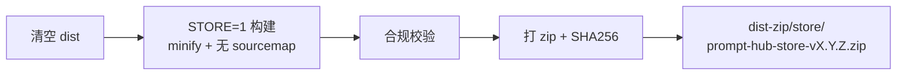

# 打包 Chrome Web Store 上架 zip（更新已有扩展）

## 背景

本仓库**已有专用上架脚本**，不要用手动 `npm run build` + `npm run zip`：

| 命令 | 用途 | 是否适合商店上传 |
|---|---|---|
| [`npm run release:store`](package.json) | 清 dist → `STORE=1` 生产构建 → 合规校验 → 打 zip | **是（推荐）** |
| `npm run zip` / `npm run package` | 普通 dev 构建 + 打包到 `dist-zip/` | **否**（含 sourcemap、无校验） |

[`scripts/release-store.mjs`](scripts/release-store.mjs) 会做的事：



校验项（任一失败则中止）：
- 无 `*.map` / `*.ts(x)` 文件
- `manifest.json` 存在且 `manifest_version === 3`
- `manifest.version` 与 [`package.json`](package.json) 一致（当前 **0.1.73**）
- 四张图标 `icons/icon-{16,32,48,128}.png` 齐全
- zip 体积 ≤ 10 MiB

生产构建开关在 [`vite.config.ts`](vite.config.ts)：

```71:72:vite.config.ts
    minify: process.env.STORE === '1' ? 'esbuild' : false,
    sourcemap: process.env.STORE === '1' ? false : true,
```

## 执行步骤（确认计划后由我运行）

### 1. 前置检查

在仓库根目录 `d:\vscode\prompt-hub`：

```powershell
npm ci
```

- **版本号**：[`package.json`](package.json) 当前为 `0.1.73`，[`src/manifest.config.ts`](src/manifest.config.ts) 从 pkg 同步 version。上传到已有扩展时，**新版本必须高于商店当前线上版本**；若商店已是 `0.1.73`，需先 bump 版本再打包。
- **图标**：若近期换过 logo，按 [`.cursor/rules/logo-replacement.mdc`](.cursor/rules/logo-replacement.mdc) 跑 `npm run icons:from-image` 后再 `release:store`（脚本会自行清 dist）。
- **TypeScript**：`npm run build` 内含 `tsc --noEmit`，lint 不过会中断。

### 2. 生成上架包

```powershell
npm run release:store
```

**预期输出**：

- 终端打印 `=========== 上架包就绪 ===========`
- 文件路径：`dist-zip/store/prompt-hub-store-v0.1.73.zip`
- SHA-256 摘要（建议记入 GitHub Release notes）

### 3. 本地验收（上传前 2 分钟）

解压 zip 或加载验证：

- [ ] 根目录直接是 `manifest.json`（不是嵌套一层文件夹）
- [ ] 无 `.map` 文件
- [ ] 四张 `icons/icon-*.png` 存在且为新 logo
- [ ] 可选：`chrome://extensions` → 开发者模式 → 「加载已解压的扩展程序」选 `dist/` 目录，冒烟测试右键提取 / popup / options

### 4. 上传到 Chrome Web Store（更新已有扩展）

1. 打开 [Chrome Web Store 开发者控制台](https://chrome.google.com/webstore/devconsole)
2. 进入已有 **Prompt Hub** 条目（列表页参考：[已上架扩展](https://chromewebstore.google.com/detail/prompt-hub/oaanodmbndnpeohmfoedgmfleabhdmkg)）
3. **Package** 页 → 上传 `dist-zip/store/prompt-hub-store-v*.zip`
4. 若仅代码更新、商店文案/截图未变：**无需**重填 [`store-listing/`](store-listing/) 或重传 `store-assets/`
5. 填写版本说明 → **Submit for review**

更新场景**不需要**重走首次上架的 5 张截图 / 2 张宣传图流程；仅当 UI/品牌变更时才考虑重跑 `npm run store:assets` / `store:screenshots`（见 [`docs/MAINTAINER.zh.md`](docs/MAINTAINER.zh.md)）。

### 5. 可选：CI 自动上传

若已配置 GitHub Secrets（`CWS_*`），可改用 Actions workflow [`.github/workflows/publish-chrome-store.yml`](.github/workflows/publish-chrome-store.yml) 的 `dry_run=true` 先验证 zip，再 `dry_run=false` 上传。配置见 [`docs/CHROME_WEB_STORE_CI.md`](docs/CHROME_WEB_STORE_CI.md)。本次你选的是本机 zip + 手工上传，**不必**走 CI。

## 与 `npm run zip` 的关键差异

```14:15:package.json
    "zip": "npm run build && node scripts/zip.mjs",
    "release:store": "node scripts/release-store.mjs",
```

- `zip`：不设置 `STORE=1` → **保留 sourcemap、不 minify**；输出到 `dist-zip/prompt-hub-v*.zip`；无合规校验
- `release:store`：专为 Chrome Web Store 设计，输出到 `dist-zip/store/prompt-hub-store-v*.zip`

## 风险与回滚

- 版本号未递增 → 商店 API/后台拒绝上传
- 合规校验失败 → 按终端列出的 violation 修复后重跑
- 审核期间勿重复提交同一版本（见 [`store-listing/CHECKLIST.md`](store-listing/CHECKLIST.md) §6）
