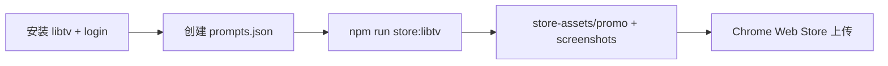

# LibTV 生成 Chrome Web Store 截图与宣传图

## 现状

| 项 | 状态 |
|---|---|
| 自动化脚本 | 已有 [`scripts/generate-store-assets-libtv.mjs`](scripts/generate-store-assets-libtv.mjs) + `npm run store:libtv` |
| 项目 Skill | 已有 [`.cursor/skills/libtv-store-assets/SKILL.md`](.cursor/skills/libtv-store-assets/SKILL.md) |
| 提示词配置 | **缺失** [`store-assets/libtv/prompts.json`](store-assets/libtv/prompts.json)（脚本第 363 行会直接 `fail`） |
| libtv CLI | **本机未安装**（`where libtv` 失败，`%USERPROFILE%\.libtv\libtv.exe` 不存在） |
| 视觉风格 | 你已选 **黑蜂巢新品牌**（与 [`scripts/_store-utils.mjs`](scripts/_store-utils.mjs) 的 `STORE_BRAND` 及 [`public/icons/icon-128.png`](public/icons/icon-128.png) 一致，替换截图中的旧紫色宣传图） |
| sharp | 已在 [`package.json`](package.json) devDependencies，无需额外安装 |

你截图中的 Chrome Web Store 要求与脚本输出一一对应：

- **屏幕截图**：1280×800，最多 5 张 → `store-assets/screenshots/screenshot-{1..5}-*.png`
- **小型宣传图块**：440×280 → `store-assets/promo/small-promo-440x280.png`
- **顶部宣传图块**：1400×560 → `store-assets/promo/marquee-1400x560.png`

（商店 icon 128×128 **不走 LibTV**，继续用扩展包内 `dist/icons/icon-128.png`。）



---

## 阶段 1：安装 LibTV CLI Skill（官方 ZIP）

本仓库 [`npm run store:libtv`](scripts/generate-store-assets-libtv.mjs) 依赖全局 **`libtv` 命令行**（`lib-image-2` 图生图），不是 OpenClaw 的 Python `libtv-skill`（`LIBTV_ACCESS_KEY` + Python 脚本）。

### 1.1 官方安装入口（你提供的提示词）

对 Agent 说（或执行阶段由 Agent 自动完成）：

> 请帮我安装 LibTV CLI Skill：https://liblibai-web-static.liblib.cloud/cli/latest/libtv-cli-skill.zip

**下载地址（固定 latest）：**

`https://liblibai-web-static.liblib.cloud/cli/latest/libtv-cli-skill.zip`

### 1.2 安装步骤（Windows）

1. **下载并解压** ZIP 到临时目录，阅读包内 `SKILL.md` / `README`（以包内说明为准，优先于猜测）。
2. **安装 Cursor Skill**（供 Agent 查 CLI 用法）：
   - 将包内 skill 目录解压到用户级技能目录，例如：
     - `%USERPROFILE%\.cursor\skills\libtv-cli\`（常见约定）
   - 或在当前仓库 `.cursor/skills/` 下增加 `libtv-cli/`（仅本仓库可用）。
3. **安装 `libtv` 可执行文件**（供 [`generate-store-assets-libtv.mjs`](scripts/generate-store-assets-libtv.mjs) 调用）：
   - 若 ZIP 内含 `libtv.exe`（或安装脚本），按包内说明放到：
     - **`%USERPROFILE%\.libtv\libtv.exe`**（与本项目 skill 约定一致）
   - 将 `%USERPROFILE%\.libtv` 加入用户 **Path**，或当前会话临时：
     ```powershell
     $env:Path += ";$env:USERPROFILE\.libtv"
     ```
4. **验证 CLI 可用**：
   ```powershell
   where.exe libtv
   libtv --help
   ```

### 1.3 登录与账号

```powershell
libtv login web
libtv account info
```

- `account info` 应返回含 `user` 字段的 JSON；否则脚本会提示先登录。
- 脚本下载使用 `--vip --without-ai-watermark`，需 LibTV 账号有 **会员/算力**。
- **不要**与 OpenClaw 的 `LIBTV_ACCESS_KEY` 混用：本流程走 CLI 的 `login web` 会话，不是 Python `create_session.py`。

### 1.4 项目依赖（仓库内）

```powershell
cd d:\vscode\prompt-hub
npm install
```

---

## 阶段 2：创建 `prompts.json`（阻塞项）

在 [`store-assets/libtv/prompts.json`](store-assets/libtv/prompts.json) 新增 7 条任务（该文件被 [`.gitignore`](.gitignore) 白名单跟踪，应提交到 git 以便复跑）。

结构对齐脚本期望字段（见 [`scripts/generate-store-assets-libtv.mjs`](scripts/generate-store-assets-libtv.mjs) 224–241、352–356 行）：

```json
{
  "model": "lib-image-2",
  "resolution": "2K",
  "quality": "high",
  "referenceNode": "logo-ref",
  "tasks": [ /* 7 items */ ]
}
```

每条 task 字段：`node`, `ratio`, `prompt`, `out`, `width`, `height`。

| node | ratio | 输出 | 尺寸 | 文案/画面来源（黑蜂巢） |
|------|-------|------|------|-------------------------|
| `promo-small` | `3:2` | `promo/small-promo-440x280.png` | 440×280 | [`make-store-assets.mjs`](scripts/make-store-assets.mjs) 小图：黑底、蜂巢 logo、标题 **Prompt Hub**、副标题「右键/框选参考面板 · 多图合成反推」、模型 chip |
| `promo-marquee` | `2:1` | `promo/marquee-1400x560.png` | 1400×560 | 同文件 Marquee：大标题「右键图片，**获得** AI 提示词」、副标题参考面板/四种风格/策略档位 |
| `shot-1-hero` | `16:9` | `screenshots/screenshot-1-hero.png` | 1280×800 | [`make-store-screenshots.mjs`](scripts/make-store-screenshots.mjs) SHOT_1：核心三步 + 「右键图片，获得 AI 提示词」 |
| `shot-2-reference` | `16:9` | `screenshots/screenshot-2-reference.png` | 1280×800 | SHOT_2：参考面板 5/8、生成提示词/材质/风格/视频分镜 |
| `shot-3-popup` | `16:9` | `screenshots/screenshot-3-popup.png` | 1280×800 | SHOT_3：「历史记录、版本管理、一键复制」+ popup 列表 mock |
| `shot-4-settings` | `16:9` | `screenshots/screenshot-4-settings.png` | 1280×800 | SHOT_4：「粘贴 Key，快速开始」+ ModelPicker |
| `shot-5-providers` | `16:9` | `screenshots/screenshot-5-providers.png` | 1280×800 | SHOT_5：「12+ 视觉大模型，自由切换」+ 供应商网格 |

**Prompt 编写要点**（写入每条 `prompt` 英文字段，末尾附必须出现的中文）：

- 背景：`pure black #000000`，subtle cyan `#22d3ee` / amber `#fbbf24` glow，honeycomb logo watermark
- 必须包含参考图左侧 logo（脚本自动 `--left logo-ref` + `modeType=image2image`）
- 要求清晰可读的中文标题/副标题（Lib Image 2 对长文本较好，但仍需在 prompt 中逐字写明）
- 截图类：白色 UI 卡片 mock、专业 Chrome extension marketing screenshot，无真实浏览器 chrome 边框
- 禁止旧紫色全屏渐变主视觉（与用户选的 black_honeycomb 一致）

---

## 阶段 3：执行生成

```powershell
cd d:\vscode\prompt-hub
npm run store:libtv
```

脚本四阶段（约 5–15 分钟，7 路并行）：

1. **Setup** — `libtv project create PromptHubStore`（无空格名，避免 Windows 拆参）→ `project use` → `group store-assets` → `upload logo-ref` 使用 [`public/icons/icon-128.png`](public/icons/icon-128.png)
2. **Upsert** — 串行 create/update 7 个 image 节点
3. **Parallel Run** — `Promise.all` 7× `libtv node <key> --run`（**不用** `group --run`，那是顺序执行）
4. **Parallel Post** — 轮询（最长 420s/张）→ `download --vip --without-ai-watermark` → **sharp** 居中裁剪到精确像素

预期输出：

```
store-assets/promo/small-promo-440x280.png
store-assets/promo/marquee-1400x560.png
store-assets/screenshots/screenshot-1-hero.png
store-assets/screenshots/screenshot-2-reference.png
store-assets/screenshots/screenshot-3-popup.png
store-assets/screenshots/screenshot-4-settings.png
store-assets/screenshots/screenshot-5-providers.png
```

原始下载在 `store-assets/libtv/raw/`（gitignore，可留作对比）。

### 验收

- 用图片查看器确认 7 张 PNG 尺寸分别为 440×280、1400×560、1280×800×5
- 肉眼检查：黑底 + 新蜂巢 logo 一致；中文标题无乱码/严重错字
- 若某张中文不可读：只改 `prompts.json` 对应条目的 `prompt`，重跑 `npm run store:libtv`（会 upsert 同节点并重新生成）

### 与 Playwright 方案对比（可选）

若 LibTV 中文小字不稳定，可并行生成精确 UI 稿作备选：

```powershell
npm i -D playwright
npx playwright install chromium
npm run store:assets
npm run store:screenshots
```

两套输出路径相同，便于 A/B 选图上传。

---

## 阶段 4：上传到 Chrome Web Store

按 [`store-listing/CHECKLIST.md`](store-listing/CHECKLIST.md) §4.1：

| 后台字段 | 本地文件 |
|----------|----------|
| 屏幕截图（按序 1→5） | `screenshot-1-hero.png` … `screenshot-5-providers.png` |
| 小型宣传图块 | `small-promo-440x280.png` |
| 顶部宣传图块 | `marquee-1400x560.png` |

格式要求（与你截图一致）：JPEG 或 **24-bit PNG（无 alpha）**；当前脚本输出 PNG，若后台拒绝带透明通道可再用 sharp/画图工具转为不透明 PNG/JPEG。

---

## 风险与对策

| 风险 | 对策 |
|------|------|
| libtv 未安装/未登录 | 完成阶段 1 后再跑脚本 |
| `prompts.json` 缺失 | 阶段 2 必须先完成 |
| AI 中文/ UI 细节不准 | 改 prompt 重跑；或改用 Playwright 精确稿 |
| 单张超时（420s） | 检查网络/算力；重跑；必要时临时改为串行（需改脚本，默认不做的 YAGNI） |
| 旧节点缓存旧图 | 脚本用 `_updatedAtMs` 基准判断新图；仍异常可删 `store-assets/libtv/.libtv/` 后重绑项目 |

---

## 实施顺序小结

1. 用官方 ZIP 安装 LibTV CLI Skill + `libtv.exe` → `libtv login web` → 验证 `libtv account info`
2. **新增** `store-assets/libtv/prompts.json`（7 条黑蜂巢 prompt）
3. `npm run store:libtv` → 检查 7 张输出
4. Chrome Web Store 后台替换截图与宣传图块
