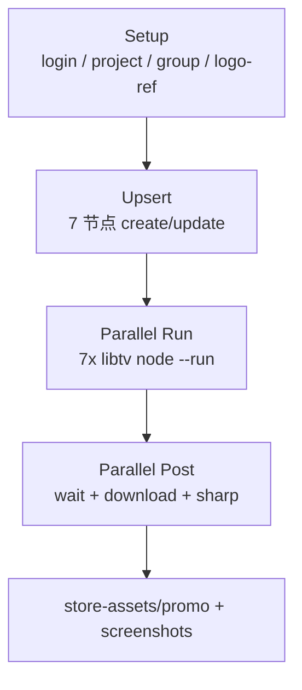

# LibTV 生成 Chrome Web Store 素材

## 背景

- 仓库已有 **Playwright 静态 HTML** 方案：[`scripts/make-store-assets.mjs`](scripts/make-store-assets.mjs)、[`scripts/make-store-screenshots.mjs`](scripts/make-store-screenshots.mjs) → `npm run store:assets` / `store:screenshots`。
- 你已安装全局 **`libtv`**（`C:\Users\Administrator\.libtv\libtv.exe`），账号已登录（`libtv account info` 可用）；全局 skill 在 [`C:\Users\Administrator\.cursor\skills\libtv-cli\SKILL.md`](C:\Users\Administrator\.cursor\skills\libtv-cli\SKILL.md)。
- 本任务：**用 LibTV 再生成一套对比稿**，并把流程写进本项目，供 Agent 以后直接调用。

## 目标产出（8 张 + 可选 icon）

| 文件 | 尺寸 | LibTV ratio 建议 | 后处理 |
|------|------|------------------|--------|
| `store-assets/promo/small-promo-440x280.png` | 440×280 | `3:2` 或 `16:9` 生成后居中裁剪 | 精确裁到 440×280 |
| `store-assets/promo/marquee-1400x560.png` | 1400×560 | `2:1`（最接近 2.5:1） | 裁到 1400×560 |
| `screenshot-1-hero.png` … `screenshot-5-providers.png` | 1280×800 | `16:9` 生成 | 裁到 1280×800 |
| `dist/icons/icon-128.png`（可选对比） | 128×128 | **不上 LibTV**：直接 [`public/icons/icon-128.png`](public/icons/icon-128.png) 缩放；商店 icon 以扩展包为准 | 仅 copy/resize |

文案与布局核心来自现有脚本 + 上条对话中的 7 段 prompt（黑蜂巢品牌、cyan/amber 点缀、5 张功能主题不变）。

## 技术方案



### 1. 项目内记住 LibTV 能力

新增 **[`.cursor/skills/libtv-store-assets/SKILL.md`](.cursor/skills/libtv-store-assets/SKILL.md)**（项目 skill，Agent 在本仓库生图/商店素材时优先读）：

- 前置：全局 `libtv` 已安装且 `libtv account info` 成功；工作目录在 `store-assets/libtv/`。
- 绑定项目：首次 `libtv project create PromptHubStore` → `libtv project use <uuid>`，写入 `store-assets/libtv/.libtv/project.json`（父目录 `store-assets/` 已在 [`.gitignore`](.gitignore)，不入仓）。
- 模型：`lib-image-2`，`-s resolution=2K`，`-s quality=high`，`-s ratio=<见上表>`。
- 品牌一致：先 `libtv upload "logo-ref" -f ../../public/icons/icon-128.png`，各节点 `--left logo-ref`（图生图参考）。
- 下载：`libtv download -n "<节点名>" -o store-assets/libtv/raw/ --vip --without-ai-watermark`（会员账号已确认）。
- 与 Playwright 并存：精确 UI mock 用 `npm run store:screenshots`；视觉探索/AI 风格对比用 `npm run store:libtv`。

### 2. 提示词清单文件

新增 **[`store-assets/libtv/prompts.json`](store-assets/libtv/prompts.json)**（结构化，脚本读取）：

```json
{
  "model": "lib-image-2",
  "referenceNode": "logo-ref",
  "tasks": [
    { "node": "promo-small", "ratio": "3:2", "out": "promo/small-promo-440x280.png", "width": 440, "height": 280, "prompt": "..." },
    { "node": "promo-marquee", "ratio": "2:1", "out": "promo/marquee-1400x560.png", "width": 1400, "height": 560, "prompt": "..." },
    { "node": "shot-1-hero", "ratio": "16:9", "out": "screenshots/screenshot-1-hero.png", "width": 1280, "height": 800, "prompt": "..." }
  ]
}
```

每条 `prompt` 填入上条对话里对应图的 **英文主 prompt + 必须出现的中文标题/副标题**（Lib Image 2 长文本能力较好）。5 张截图 + 2 张宣传图共 7 条；icon 不进入 LibTV 队列。

### 3. 自动化脚本

新增 **[`scripts/generate-store-assets-libtv.mjs`](scripts/generate-store-assets-libtv.mjs)** + `package.json` 脚本 `"store:libtv": "node scripts/generate-store-assets-libtv.mjs"`：

1. **检查**：`libtv account info` 非 0 则提示 `libtv login web` 并退出。
2. **目录**：`cd store-assets/libtv`；若无 `.libtv/project.json` 则 `libtv project create` + `use`（UUID 打印到 stderr 供人工备份）。
3. **分组（可选）**：`libtv group create "store-assets"` + `group use`，节点整齐。
4. **上传参考**：若不存在 `logo-ref` 节点则 upload [`public/icons/icon-128.png`](public/icons/icon-128.png)。
5. **Upsert 全部节点**（串行 create/update，不 `--run`）
6. **并行触发**：`Promise.all` 同时 7 路 `libtv node <name> --run`（不用 `group --run`，那是顺序执行）
7. **并行等待 + 下载 + 裁剪**：轮询 URL → `libtv download` → sharp 裁到目标尺寸
8. **汇总**：打印 7 条输出路径、总耗时与 CHECKLIST 上传顺序

**轮询**：`libtv node --run` 可能异步；脚本对全部节点并行轮询直到 `data.url` 非空或超时（180s）。

### 4. 文档同步

- [`store-listing/CHECKLIST.md`](store-listing/CHECKLIST.md) §2 / §4.1：补充「LibTV 对比稿：`npm run store:libtv` → `store-assets/`」。
- [`README.md`](README.md) 上架小节：Playwright 与 LibTV 两条命令并列。

### 5. 验收

- [ ] `npm run store:libtv` 一次跑通 7 张 PNG
- [ ] 尺寸：`440×280`、`1400×560`、`1280×800×5`
- [ ] 视觉：黑底蜂巢 + logo 一致；中文标题可读（若 AI 糊字，保留 raw 并用 Playwright 版叠字对比）
- [ ] 项目 skill 存在，Agent 下次提到「libtv 生商店图」能自动走此流程
- [ ] 手动上传 Chrome Web Store 后台（与 Playwright 版二选一或 A/B 对比）

## 风险与对策

| 风险 | 对策 |
|------|------|
| AI 中文小字不可读 | prompt 强调「large headline typography」；必要时只生成背景+布局，文字用 Playwright 版 |
| ratio 无 16:10 / 11:7 | 用 16:9 / 2:1 生成 + sharp 裁剪 |
| 生成耗时长 | 7 节点并行 `--run`；墙钟时间 ≈ 最慢一张 + 下载裁剪（约 1–2 分钟） |
| `.libtv/project.json` 丢失 | skill 文档写「重新 project create」；脚本无 binding 时自动创建 |

## 不在本次范围

- 不替换现有 Playwright 脚本（两套并存）
- 不把 `store-assets/` 纳入 git
- 不自动提交 Chrome Web Store（仍手动上传）
