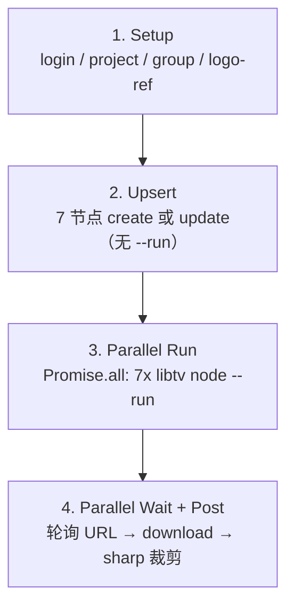

# LibTV 画布并行生图改造

## 结论

**可以。** 7 张商店图彼此无依赖（均 `--left logo-ref` 图生图），适合在同一画布上**先建好全部 image 节点，再同时触发 7 次 `libtv node <name> --run`**。

注意：**不要用** `libtv group store-assets --run` 来加速——官方文档明确该命令是「整组**按顺序**执行」（与网页「整组执行」一致），比当前串行脚本更慢或相当。

LibTV CLI 对「真正并发」的建议是：多个独立进程各自 `--run`，**不要**并行写同一条 NDJSON 管道（见全局 skill [`nested-dag.md`](file:///C:/Users/Administrator/.cursor/skills/libtv-cli/examples/pipes/nested-dag.md)）。本脚本不涉及管道并行，仅多进程 spawn，符合规范。

## 当前瓶颈

[`scripts/generate-store-assets-libtv.mjs`](scripts/generate-store-assets-libtv.mjs) 主循环（约 245–253 行）对每张图串行：

```245:253:scripts/generate-store-assets-libtv.mjs
  for (const task of cfg.tasks) {
    log(`生成: ${task.node} (${task.ratio})`);
    await upsertAndRun(task, cfg);
    const raw = downloadNode(task.node);
    ...
  }
```

`upsertAndRun` 内部：`create/update` → `--run` → **阻塞轮询直到出图** → 才处理下一张。7 张 ≈ 7× 单张耗时。

另：[`store-assets/libtv/run.log`](store-assets/libtv/run.log) 显示 `project create` 因项目名含空格在 Windows 下被拆成 3 个参数而失败，需一并修复才能跑通验证。

## 目标流程（四阶段）



| 阶段 | 操作 | 并行 |
|------|------|------|
| Setup | 现有 `ensureLoggedIn/Project/Group/LogoRef` | 否 |
| Upsert | 拆分 `upsertNode(task)`：仅写节点参数与 `--left logo-ref` | 可串行（毫秒级，7 次 CLI） |
| Trigger | `Promise.all(tasks.map(t => runLibtvAsync(['node', t.node, '--run'])))` | **7 路全并行** |
| Wait | `Promise.all(tasks.map(t => waitForNodeImage(t.node)))` | **7 路全并行** |
| Post | `Promise.all` 下载 + sharp 裁剪 | **7 路全并行** |

预计墙钟时间：≈ **最慢一张** 的生成时间 + 下载/裁剪开销（约 1–2 分钟量级），而非 7 张累加。

## 代码改动（单文件为主）

### 1. 修复 `project create` 传参

[`ensureProject()`](scripts/generate-store-assets-libtv.mjs) 中项目名 `"Prompt Hub Store"` 在 Windows 被拆词。改为**无空格**名称，例如：

```js
runLibtv(['project', 'create', 'PromptHubStore']);
// 或 runLibtv(['project', 'create', 'prompt-hub-store']);
```

若已有 `.libtv/project.json` 绑定则跳过，不影响旧项目。

### 2. 新增异步 libtv 调用

在 [`scripts/generate-store-assets-libtv.mjs`](scripts/generate-store-assets-libtv.mjs) 增加 `runLibtvAsync`（基于 `spawn`，保留现有 `runLibtv` 给 setup 同步步骤用）：

- 与 `runLibtv` 共享 cwd=`store-assets/libtv/`、错误处理逻辑
- 并行 trigger 时各进程 stdout/stderr 独立，避免 NDJSON 管道冲突

### 3. 拆分函数

| 函数 | 职责 |
|------|------|
| `upsertNode(task, cfg)` | 从 `upsertAndRun` 拆出：create/update，**不** `--run` |
| `triggerRun(nodeName)` | 单次 `libtv node <name> --run`（async） |
| `waitForNodeImage(nodeName)` | 保持现有轮询逻辑（已有 async） |
| `processTask(task, cfg)` | download → crop → 返回 outPath |
| `main()` | 四阶段编排 + 汇总日志 |

### 4. 日志与失败策略

- Trigger 阶段：`log('并行触发生成: promo-small, shot-1-hero, …')`
- Wait 阶段：各节点独立打 `等待生成 X … (Ns)`；任一超时则 `fail` 并列出未完成节点名
- 不做 partial retry（保持简单）；失败时 raw 目录可能部分有图，便于人工排查

### 5. 配置

按你的选择：**默认 7 路全并行**，不在 `prompts.json` 增加 `concurrency` 字段（YAGNI）。若日后遇 API 限流再补可选上限。

## 文档同步（小改）

- [`.cursor/skills/libtv-store-assets/SKILL.md`](.cursor/skills/libtv-store-assets/SKILL.md)：补充「7 节点并行 `--run`，不用 group --run」
- [`.cursor/plans/libtv_商店素材生成_883848ac.plan.md`](.cursor/plans/libtv_商店素材生成_883848ac.plan.md)：更新技术方案 mermaid + `run-verify` 验收项

## 验收

- [ ] `npm run store:libtv` 一次跑通 7 张 PNG（修复 project create 后）
- [ ] 日志可见：先 upsert 7 节点 → 并行 trigger → 并行 wait → 7 路 download/crop
- [ ] 墙钟时间明显短于串行（约 1/5–1/7，取决于服务端并发能力）
- [ ] 输出尺寸不变：`440×280`、`1400×560`、`1280×800×5`

## 风险

| 风险 | 对策 |
|------|------|
| LibTV 账号/API 并发上限未知 | 先全并行实测；若部分 `--run` 失败，日志会标出节点名，可再降并发 |
| 7 路同时轮询 `libtv node` | 仅读查询，负载可接受；`POLL_MS=8000` 保持不变 |
| 并行 download 占带宽 | 7 张 2K 图可接受；post 阶段同样并行 |

## 不在本次范围

- 不改 Playwright 方案
- 不增加 CLI 参数（如 `--serial`）；保持 `npm run store:libtv` 单一入口
- 不把 `store-assets/` 纳入 git
