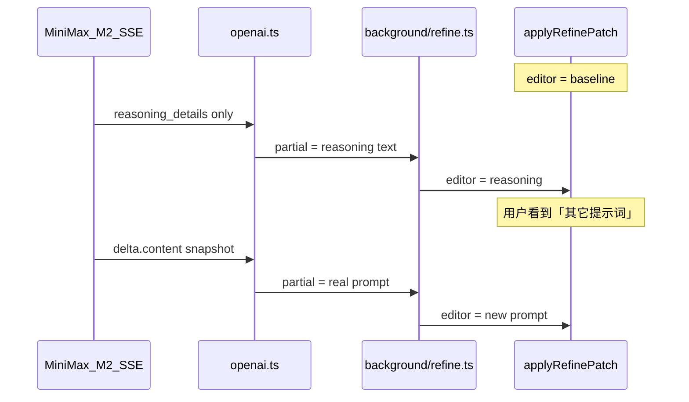

# MiniMax M2 refine 提示词闪烁修复

## 问题定性

你已确认使用 **MiniMax-M2 系**模型。该型号请求体会带 `reasoning_split: true`（[`openai.ts`](src/lib/api/providers/openai.ts) L25–31），流式早期只有 `delta.reasoning_details` 增长，正式改写结果在 `delta.content`（往往晚很多才出现）。

当前 [`applyOpenAIStreamDelta`](src/lib/api/providers/openai.ts) 对 `minimax` 的逻辑：

```139:149:src/lib/api/providers/openai.ts
  if (cfg.id === 'minimax') {
    let changed = false;
    if (contentPiece) {
      acc.answerRaw = contentPiece;
      acc.partialRaw = contentPiece;
      changed = true;
    } else if (reasoningPiece) {
      acc.partialRaw = reasoningPiece;
      changed = true;
    }
    return changed;
  }
```

**Refine 路径**（[`callOpenAICompatibleText`](src/lib/api/providers/openai.ts) → [`refine.ts`](src/lib/api/refine.ts) L68）会把 `partialRaw` 经 `REFINE_PROGRESS` 推到面板；[`applyRefinePatch`](src/content/panel/loading.ts) L342–348 每 ~80ms **整段**写 `editor.value`。

因此主编辑器会在三者之间跳变：

| 阶段 | 编辑器内容 | 用户感知 |
|------|------------|----------|
| 流式开始前 | `refineBaselinePrompt`（当前版本提示词） | 正常 |
| 仅 reasoning 时 | 思考链（「核心元素…」「修改要点…」） | **像「另一条提示词」** |
| content 出现后 | 正式改写正文 | 再次大跳变 |
| 收尾 flush | `answerRaw`（content-only） | 可能再闪一次 |

截图红框内的中文说明性文字正是 **reasoning 预览**，与侧栏历史版本里的秋日树提示词不是同一段文本。



Extract（反推）仍可能用 reasoning 驱动进度条，**本次只改 refine**，范围最小。

---

## 修复方案

### 1. API：refine 流式不向面板暴露 reasoning（核心）

在 [`applyOpenAIStreamDelta`](src/lib/api/providers/openai.ts) 增加选项，例如：

```ts
type StreamDeltaOptions = { exposeReasoningInPartial?: boolean };
// 默认 true（保持 extract 现状）；refine 传 false
```

- `exposeReasoningInPartial === false` 时：仅有 `reasoningPiece` 时不更新 `partialRaw`，`changed` 可为 false（不触发无意义的 partial flush）。
- 有 `contentPiece` 时行为不变：`answerRaw` / `partialRaw` 均用 content 快照。

在 [`callOpenAICompatibleText`](src/lib/api/providers/openai.ts) 的 SSE 循环中调用时传入 `{ exposeReasoningInPartial: false }`；[`callOpenAICompatible`](src/lib/api/providers/openai.ts)（extract）保持默认 `true`。

**思考阶段 UX**：无 partial 时面板继续显示 baseline（[`applyRefinePatch`](src/content/panel/loading.ts) 已有 `job?.partial ?? job?.refineBaselinePrompt` 回落）；进度条保持 `calling` /「正在调用大模型…」直到首段 content 到达——符合预期。

### 2. UI：思考阶段可选文案（小改，建议同 PR）

在 [`refineStageHint`](src/content/panel/loading.ts) / [`refineStageProgress`](src/content/panel/loading.ts) 中，当 `stage === 'streaming'` 且 `!hasPartial` 时显示 **「模型思考中…」**（替代误用的「正在接收模型回复…」），避免用户在长时间只有 reasoning 时误以为卡住。

实现方式：在 `callOpenAICompatibleText` 中，首次收到 reasoning-only chunk 时发一次 `{ stage: 'streaming' }`（**不带** `partial`），让 job 进入 streaming 阶段但不改编辑器；与方案 1 配合。

### 3. 加固 `patchRefineProgress` 轻量路径（防御性）

[`patchRefineProgress`](src/content/panel/index.ts) L416–426 在 `refineLightUpdate` 为 false 时会 `renderPanel`，而 `state.draft` 在流式期间未更新，[`successEditorDisplayedText`](src/content/panel/templates.ts) 可能短暂回落到旧 `draft`，与 DOM 中 partial 冲突。

调整建议（保持小 diff）：

- 当 `panelHasActiveRefine(merged)` 且 payload 含 `stage`/`partial` 时，**优先**走 `applyRefinePatch`，即使 `status !== 'success'`（refine 从 success 发起，理论上不应触发，可防竞态）。
- `jobs.length === 0` 时：若 `payload.refineJobId` 存在且 `currentState` 刚 enqueue，可考虑单次 rAF 重试（可选，仅在有复现日志时加）。

### 4. 单测

新增 [`src/lib/api/providers/openai.stream.test.ts`](src/lib/api/providers/openai.stream.test.ts)（或扩展现有 api 测试）覆盖：

- `minimax` + `exposeReasoningInPartial: false`：仅 reasoning delta → `partialRaw` 不变、`changed === false`。
- 随后 content delta → `partialRaw === content`。
- 默认 `true` 时 reasoning 仍会写入 `partialRaw`（extract 回归）。

### 5. 文档

在 [`docs/troubleshooting-minimax.zh.md`](docs/troubleshooting-minimax.zh.md) 补一句：**AI 调整（refine）流式主编辑器只展示正式 `delta.content`，不展示 M2 思考链**，避免用户误以为面板串了历史版本。

---

## 验收清单

- [ ] 设置 refine 使用 **MiniMax-M2***，对已有提示词执行「AI 调整」
- [ ] 流式过程中主编辑器 **始终为 baseline 或改写正文**，不出现「核心元素/修改要点」类思考链
- [ ] 首段 content 到达后正文平滑递增（MiniMax 快照语义），无整段 reasoning 插入
- [ ] 完成后 `refine.complete` 与编辑器、侧栏新版本一致
- [ ] 换 **非 minimax** 或 **非 M2** refine 模型，行为与改前一致
- [ ] `npm run test` / `npm run lint` / `npm run build` 通过

---

## 不在本次范围

- Extract 反推是否展示 reasoning 预览（可另开 issue）
- 更换 refine 模型为 VL（M2 本身不适合识图，refine 纯文本可用 M2，但会带 reasoning_split）
- 将 refine progress 纳入 reducer（架构优化，见 [`docs/optimization-roadmap.md`](docs/optimization-roadmap.md)）
