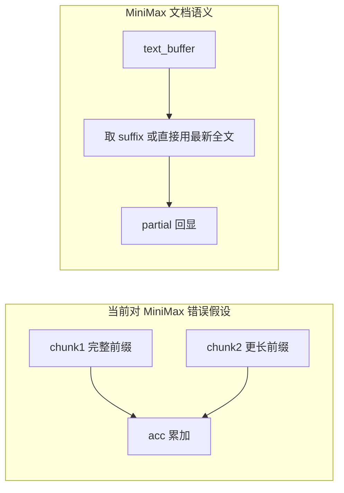

# MiniMax 流式输出支持

## 背景与根因

- Extract / Refine 已走 [`src/lib/api/providers/openai.ts`](d:\code\Code Experiment\Prompt extraction\src\lib\api\providers\openai.ts)：`stream: true`、`Accept: text/event-stream`，并在 `isSseResponse(resp)` 为真时用 [`readSseDataChunks`](d:\code\Code Experiment\Prompt extraction\src\lib\api\http.ts) 解析 SSE。
- [MiniMax 官方「Compatible OpenAI API」流式示例](https://platform.minimax.io/docs/api-reference/text-openai-api) 写明：每个 chunk 里 `chunk.choices[0].delta.content` 是**从开始到当前的完整文本**，正确做法是 `new_text = content_text[len(text_buffer):]` 再更新 `text_buffer`，而不是把每块当作独立增量拼接。
- 当前实现（约 151–154 行、247–250 行）对**所有** OpenAI 兼容厂商统一 `acc += chunk`，对 MiniMax 会造成重复/错乱，表现为「流式不可用」或面板内容异常。

## 实现方案

**1. 在 [`openai.ts`](d:\code\Code Experiment\Prompt extraction\src\lib\api\providers\openai.ts) 抽取统一的「流式 content 累积」逻辑**

- 对 `cfg.id === 'minimax'`：
  - 维护最近一次非空的**累计** `delta.content` 字符串（经现有 `extractOpenAIContent` 拍平数组）。
  - 每收到新的一块：若新串以旧串为前缀，则只对 `suffix` 做节流与 `partial`；若不符合前缀关系（异常情况），则用新串整体替换累计结果，避免卡死。
  - **最终正文**在完成 SSE 后以最后一次累计 content 为准（或等价于按需 `stripRedactedThinking` 后的全文）。
- 对非 `minimax`：保持现有 `acc += chunk`（OpenAI 等仍为增量语义）。

可同时用于：

- `callOpenAICompatible`（视觉 extract 流式）
- `callOpenAICompatibleText`（refine 流式）

**2.（可选健壮性）SSE 误判**

- 若实际遇到 MiniMax 网关返回 **`stream:true` 但 Content-Type 非 `text/event-stream`**、`parseJsonResponse` 失败或过慢：可在仅此场景增加「读首块判断 `data:` 前缀」的回退分支（注意不要重复消费 body；优先考虑 `resp.clone()` + 有限前缀读取或共享 reader 的策略）。
- **建议先做第 1 步**；若在真机仍有「完全不吐 partial」且抓包确认为 SSE，`再补此项`。

**3. 文档**

- 在 [`docs/strategy-v035-model-payload.zh.md`](d:\code\Code Experiment\Prompt extraction\docs\strategy-v035-model-payload.zh.md) 或与 MiniMax 相关的小节中加一句：**MiniMax 流式为累计 delta，实现已单独处理**，避免以后再改回增量累加。

## 不涉及

- 不改 `providers.ts` 默认 Base URL；`reasoning_split` 与 multimodal 顺序等现有 MiniMax 特化保持不变。
- 不在此任务中推断「自定义 provider 实际是 MiniMax」；仍仅 `cfg.id === 'minimax'` 启用累计语义（与现有 MiniMax 特化一致）。
