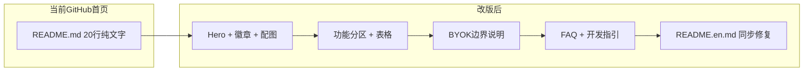

# Prompt Hub README 星标化改版计划

## 现状诊断

| 文件 | 问题 |
|------|------|
| [`README.md`](README.md) | 仅 20 行：无 Logo、徽章、截图、功能说明、FAQ；GitHub 默认展示页观感平淡 |
| [`README.en.md`](README.en.md) | 结构完整（Hero / Features / FAQ / Dev），但存在 **UTF-8 乱码**（如 `简体中?`、`?`）；License 写「proprietary」与 [`LICENSE`](LICENSE)（MIT）矛盾；引用不存在的 `store-listing/`；部分表述仍像商店版（CWS 更新） |

**已有资产（可直接引用，无需重新生成）：**

- 配图：[`docs/images/readme/`](docs/images/readme/)（9 张 PNG，含 hero、workflow、面板、供应商等）
- Logo：[`docs/images/readme/logo-128.png`](docs/images/readme/logo-128.png)
- 功能事实来源：[`src/manifest.config.ts`](src/manifest.config.ts)、[`src/lib/providers.ts`](src/lib/providers.ts)、[`src/lib/strategies-meta.ts`](src/lib/strategies-meta.ts)
- 版本号：[`package.json`](package.json) `0.1.145`
- CI 徽章：[`/.github/workflows/ci.yml`](.github/workflows/ci.yml)



---

## 目标结构（中英文镜像）

两文件采用**相同章节骨架**，中文为主入口、英文为 `README.en.md`，顶部互链。

### 1. Hero 区（第一印象）

```html
<p align="center">
  
  <h1>Prompt Hub</h1>
  <p>一句话价值主张（痛点 → 解法）</p>
</p>
```

- **中文 tagline 示例方向**：「浏览即创作：右键收集参考图/视频，自备视觉 API，秒级反推 SD / MJ / Flux 可用提示词」
- **徽章行**（shields.io，提升「正经开源项目」观感）：
  - MIT License → `LICENSE`
  - Chrome Extension（紫色 Chrome 色）
  - CI passing → `https://github.com/xiaotao-02/prompt-hub/actions/workflows/ci.yml/badge.svg`
  - 语言切换：**简体中文** · [English](README.en.md) / 反向链接

### 2. Hero 配图 + 痛点段落

- 全宽图：[`hero-marquee.png`](docs/images/readme/hero-marquee.png)
- 2–3 句叙事：AI 绘画瓶颈往往在「把参考变成可复用 prompt」；扩展在浏览场景就地完成，**图片与 Key 不经开发者后端**（链到 [`PRIVACY.md`](PRIVACY.md)）

### 3. 30 秒上手（Quick Start）

三步 + [`workflow-three-step.png`](docs/images/readme/workflow-three-step.png)：

1. 从 [GitHub Releases](https://github.com/xiaotao-02/prompt-hub/releases) 安装（`chrome://extensions` → 开发者模式 → 加载已解压）
2. 扩展 **设置 → 模型与连接** 填写视觉模型 API Key
3. 任意网页 **右键图片** → 加入参考 / 直接反推 → 面板 **生成提示词** → 复制

### 4. 核心功能（分节 + 配图，参考优秀 OSS 的「扫一眼就懂」）

| 小节 | 要点 | 配图 |
|------|------|------|
| 右键与参考面板 | ``/`<video>`/canvas/SVG/背景图；最多 8 张合成；`Ctrl+Shift+E` 区域截图 | `context-menu.png`、`reference-panel.png` |
| GIF / 视频 / 区域捕获 | 动图首帧、伪 GIF 视频帧、菜单被劫持时用框选 | 文字说明即可 |
| 输出风格与策略 | 自然中/英、SD Tag、MJ；策略档位含 v0.3.6 默认 | 表格（与 EN 版一致） |
| 历史、对话改写与提示词库 | 版本回溯、对话 refine、Options 提示词库 | `popup-history.png`、`prompt-library.png` |
| 12+ 视觉供应商 | OpenAI / Anthropic / Gemini / 智谱 / 通义 / SiliconFlow / Moonshot / 豆包 / 千帆 / OpenRouter / 自定义兼容端点；Key 仅存浏览器 | `providers-grid.png` |
| 设置与隐私 | `chrome.storage.sync` 同步偏好；无遥测 | `settings-quickstart.png` |

> DeepSeek 官方 API 不支持识图 → 用 SiliconFlow + `deepseek-ai/deepseek-vl2`（保留 EN 版已有 FAQ 条目）

### 5. BYOK 开源版说明（差异化 + 诚实边界）

独立章节，避免与商业完整版混淆（参考 [`docs/BYOK_BOUNDARY.zh.md`](docs/BYOK_BOUNDARY.zh.md) 历史边界表，精简为用户可读版）：

- **包含**：完整扩展逻辑、自备 Key、直连供应商、本地历史与提示词库
- **不包含**：平台代调用、官网登录、充值
- **维护者注记**：本仓由私有 monorepo export 生成；**请勿在公开仓直接改扩展逻辑**（链 [`docs/MAINTAINER.zh.md`](docs/MAINTAINER.zh.md)）
- **更新方式**：GitHub Releases + 扩展内检查更新（与 [`auto-release.yml`](.github/workflows/auto-release.yml) 一致）

### 6. 安装与开发

```bash
npm install
npm run dev          # HMR + UI 预览 http://localhost:5173/__dev__/ui-preview
npm run build        # → dist/
npm run zip          # 打包扩展
npm run install:chrome   # 一键加载到 Chrome
```

- 要求 Node 18+
- 技术栈一行：Manifest V3 · Vite 6 · React 18 · TypeScript · Tailwind v4 · Shadow DOM
- `install:chrome` flags 折叠块（从 EN 版搬过来并修乱码）

### 7. FAQ（降低试用摩擦）

保留并中文化 EN 版 5 条：右键菜单项、图片下载失败、Twitter 伪 GIF、跨域视频、Enhanced Safe Browsing 警告。

### 8. 更多文档 + License

- 链：[`PRIVACY.md`](PRIVACY.md)、[`docs/plugin-pages-overview.zh.md`](docs/plugin-pages-overview.zh.md)、[`docs/MAINTAINER.zh.md`](docs/MAINTAINER.zh.md)
- **删除** 对不存在路径 `store-listing/description.en.md` 的引用
- License：**MIT**，与 [`LICENSE`](LICENSE) 一致；安装渠道写 GitHub Releases

### 9. Star 引导（克制、不营销腔）

在文档末尾 FAQ 之前或 License 之前加一小段：

> 如果 Prompt Hub 帮你节省了写 prompt 的时间，欢迎在 GitHub 点 Star —— 这对独立维护的开源扩展意义重大。

（英文 mirror 一句，不用 emoji 堆砌）

---

## README.en.md 同步修复清单

与中文版**章节一一对应**，额外修复：

1. 全文乱码字符恢复（`简体中文`、`→`、`…` 等）
2. License 段改为 MIT + GitHub Releases
3. 移除 `store-listing` 与 Chrome Web Store 作为主安装渠道的表述
4. Quick start 安装步骤与 BYOK 版对齐
5. BYOK boundary 英文简述

---

## 不改动的范围（按你的选择）

- 不新增 GIF / 视频
- 不新增 CONTRIBUTING / 不改动 [`docs/MAINTAINER.zh.md`](docs/MAINTAINER.zh.md)
- 不重新跑 `npm run docs:readme-images`（现有 PNG 已入仓）
- 不修改 CI workflow（仅用现有 badge URL）

---

## 验收标准

1. GitHub 首页 README 预览：Logo + 徽章 + Hero 图 + 至少 5 张功能截图可见
2. 中英文互链正确，无乱码、无死链（`store-listing` 等）
3. License / 安装渠道 / BYOK 边界三处表述一致
4. `npm run format:check` 对 Markdown 无破坏性影响（改完后可选跑一次 format）
