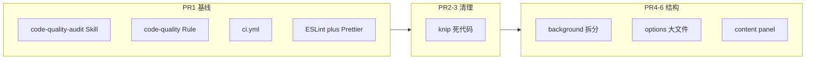

# 代码质量分阶段优化计划

## 现状结论：有没有专用 Skill？

**没有。** 你当前可用的相关能力如下：

| 来源 | 名称 | 与代码质量的关系 |
|------|------|------------------|
| 本仓库 | [execute-cursor-plan](.cursor/skills/execute-cursor-plan/SKILL.md) | 执行 `.cursor/plans` 里的重构计划，不自动做质量扫描 |
| 本仓库 | LibTV / UI 预览等 | 与质量无关 |
| 全局 `~/.cursor/skills-cursor/` | [create-skill](C:\Users\Administrator\.cursor\skills-cursor\create-skill\SKILL.md) | **用来新建**质量审计 Skill |
| 全局 | [split-to-prs](C:\Users\Administrator\.cursor\skills-cursor\split-to-prs\SKILL.md) | 把大改动拆成可 review 的小 PR（与你选的 incremental 一致） |
| 全局 | [babysit](C:\Users\Administrator\.cursor\skills-cursor\babysit\SKILL.md) | PR/CI 评论与失败修复循环 |
| 文档 | [docs/optimization-roadmap.md](docs/optimization-roadmap.md) | 架构/策略路线图（含 background 拆分、content FSM），**不是**通用 lint 流程 |

本仓库工程门禁现状：

- [`package.json`](package.json)：`lint` = 仅 `tsc --noEmit`；已有 `knip` / `vitest`（约 24 个 `*.test.ts`）
- [`tsconfig.json`](tsconfig.json)：`strict` + `noUnusedLocals` / `noUnusedParameters` 已开
- **无** ESLint / Prettier 配置文件；代码里仅有零星 `eslint-disable` 注释（说明曾考虑过但未落地）
- [`.github/workflows/`](.github/workflows/)：**无** PR 上的 lint/test 工作流（仅有 release、gitleaks、商店发布、website）

超长文件（优先结构拆分目标，行数约数）：

- [`src/content/panel/events.ts`](src/content/panel/events.ts) (~1530)
- [`src/background/index.ts`](src/background/index.ts) (~1350)
- [`src/options/PromptLibrary/index.tsx`](src/options/PromptLibrary/index.tsx) (~1340)
- [`src/content/panel/styles.ts`](src/content/panel/styles.ts) (~1270)
- [`src/content/panel/templates.ts`](src/content/panel/templates.ts) (~970)
- [`src/lib/configImport.ts`](src/lib/configImport.ts) (~1040)
- [`src/options/DataPersistence.tsx`](src/options/DataPersistence.tsx) (~1030)



---

## 推荐交付：6 个小 PR（增量、可回退）

### PR1 — 流程与门禁基线（先做，后续 PR 都走同一套检查）

**新增项目 Skill** `.cursor/skills/code-quality-audit/SKILL.md`（触发词示例：「代码质量审计」「跑一遍质量检查」「knip + lint」）：

1. `npm run knip`（或 `knip:all`）→ 记录未使用文件/依赖
2. `npm run lint` → TypeScript
3. `npm run test` → Vitest
4. 可选：按行数列出 `src/**/*.{ts,tsx}` Top 15（与上文超长文件列表对照）
5. 输出固定模板：发现项 / 建议 PR 切片 / 不扩大 scope
6. 大改动时提示叠加 `split-to-prs`

**新增 Cursor Rule** [`.cursor/rules/code-quality.mdc`](.cursor/rules/code-quality.mdc)（与现有 [logo-replacement.mdc](.cursor/rules/logo-replacement.mdc) 并列）：

- 最小 diff、不混功能与重构
- 单 PR 单主题（knip 不与 FSM 重构同 PR）
- 结构拆分后必须 `npm run build` + 相关 vitest
- Chrome 扩展约束：background SW、content shadow DOM、storage 迁移需单独说明

**工程基线**：

- 引入 ESLint 9 flat config + `@typescript-eslint` + `eslint-plugin-react-hooks` + Prettier（与 ESLint 集成 `eslint-config-prettier`）
- `package.json` 增加脚本：`lint:eslint`、`format`、`format:check`；保留现有 `lint`（tsc）或改为 `lint:types` 并在 `lint` 中串联（需在 PR 中一次性修完首批告警，避免半吊子）
- 新增 [`.github/workflows/ci.yml`](.github/workflows/ci.yml)：`push`/`pull_request` 到 `main` 时跑 `npm ci` → `lint` → `test` → `knip`（knip 可先 `continue-on-error: false` 但在 PR2 前允许临时 `|| true` 仅当存量过多——优先在 PR2 清完再硬性失败）

ESLint 范围建议：**先宽后严**——首期只开 `recommended` + `react-hooks/recommended`，不对全库开 `any` 零容忍，避免 PR1 爆炸。

---

### PR2 — Knip：依赖与导出面

- 在本地跑 `npm run knip`，按 [`knip.json`](knip.json) 的 `entry` 修正误报（Chrome 多入口已配置，一般只需补漏）
- 删除确认无用的 `dependencies` / `devDependencies`
- 删除或合并仅被测试引用的死工具（若有）
- 验收：`knip` 零 error；`test` + `build` 通过

---

### PR3 — Knip：未引用文件与重复导出

- 处理 `files` / `exports` 类问题（若有）
- 合并明显重复的 helper（仅在 knip 或重复搜索能证明无行为变化时）
- **不做** 与 PR4+ 重叠的大文件搬移

---

### PR4 — Background 拆分（对齐 roadmap §4.2）

按 [docs/optimization-roadmap.md](docs/optimization-roadmap.md) §4.2，**零功能变更**拆 [`src/background/index.ts`](src/background/index.ts)：

```
src/background/
  index.ts          # 注册 listener，委托
  context-menu.ts
  extraction.ts
  history.ts
  messages.ts
  # updater.ts 若已存在则保持
```

- 保持 [`src/background/dataDirectorySync.test.ts`](src/background/dataDirectorySync.test.ts) 通过
- 验收：`npm run build`、手动 smoke：右键提取 + 历史写入

---

### PR5 — Options 层大文件（低风险部分）

分两批亦可，但建议一个 PR 只动一块：

- **5a（推荐本 PR）**：[`src/options/DataPersistence.tsx`](src/options/DataPersistence.tsx) → `parts/` 或 `hooks/`（纯 UI 切分）
- **5b（下一 PR）**：[`src/lib/configImport.ts`](src/lib/configImport.ts) → 按 import/export/validate 分模块

[`src/options/PromptLibrary/index.tsx`](src/options/PromptLibrary/index.tsx) 体量大且与 FolderTree/ExpandedPanel 耦合高，**放到 PR6 之后**单独 PR，避免与 DataPersistence 同批。

---

### PR6 — Content panel 结构（高风险，最后做）

严格遵循 roadmap §4.1，**先**利用已有 [`src/content/panel/state.ts`](src/content/panel/state.ts) + [`reducer.ts`](src/content/panel/reducer.ts) + [`reducer.test.ts`](src/content/panel/reducer.test.ts)：

1. 扩展 FSM / reducer 覆盖 `events.ts` 中散落的状态转换
2. 再瘦化 [`events.ts`](src/content/panel/events.ts)；[`templates.ts`](src/content/panel/templates.ts) / [`styles.ts`](src/content/panel/styles.ts) 按状态渲染拆分
3. 每步都跑 `reducer.test.ts` + 开发预览（[open-plugin-ui-preview](.cursor/skills/open-plugin-ui-preview/SKILL.md)）

**本阶段不做**：CRXJS→WXT、React 19（roadmap P2.3/P2.4），避免与质量 PR 纠缠。

---

## 执行时 Agent 应使用的 Skills

| 阶段 | Skill |
|------|--------|
| 编写/跑审计 | 新建 `code-quality-audit`（PR1） |
| 拆 PR | `split-to-prs` |
| 按已有 plan 做 UI/设置页 | `execute-cursor-plan` + 对应 `.cursor/plans/*.plan.md` |
| CI 红了 | `babysit` |

---

## 验收清单（每个 PR）

- [ ] `npm run lint`（types + eslint，PR1 起）
- [ ] `npm run test`
- [ ] `npm run knip`（PR2 起硬性）
- [ ] `npm run build`
- [ ] 扩展相关 PR：Reload 后 smoke（提取 / 设置保存 / Prompt 库）

---

## 明确不在本计划内（除非你另开需求）

- 测试覆盖率全面提升（你未选；可在 PR4–6 顺带补受影响模块的测试）
- WXT 迁移、React 19、策略内容 v0.3.1（见 roadmap P1–P2）
- 自动格式化全库历史 blame 的大范围 Prettier-only commit（若团队介意，可 PR1 只加配置 + 仅 touch 改动文件 `format on save`）
