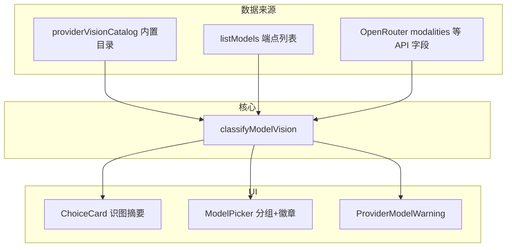

# 供应商识图模型列表与实时分类

## 目标

- **供应商网格**（含未填 Key、未拉取）：每张卡片展示该厂商**支持识图**与**不支持识图**的模型（示例或端点实列）。
- **模型下拉**：在现有 [`ModelPicker`](src/options/ModelPicker.tsx) 中**分组展示全部模型**，识图项带「识图」徽章（用户选择：默认显示全部、分组即可）。
- **实时更新**：端点 `/models` 拉取完成、切换供应商、后台刷新其它已配置供应商时，卡片与下拉同步更新分类结果。



---

## 1. 统一分类模块（新建）

**文件**：[`src/lib/modelVision.ts`](src/lib/modelVision.ts)（配套 `modelVision.test.ts`）

**类型**：

```ts
export type ModelVisionSupport = 'vision' | 'no_vision';
export type VisionClassifySource = 'api' | 'rule' | 'heuristic' | 'static';

export interface ClassifiedModel {
  id: string;
  vision: ModelVisionSupport;
  source: VisionClassifySource;
}
```

**逻辑分层**（按优先级）：

| 优先级 | 来源 | 说明 |
|--------|------|------|
| 1 | **厂商硬规则** | 复用并扩展 [`providerValidation.ts`](src/lib/api/providerValidation.ts)：如 MiniMax `MiniMax-M2*` → `no_vision`，`MiniMax-VL*` → `vision` |
| 2 | **API 元数据** | OpenRouter：`architecture.input_modalities` 含 `image`；若响应含 `capabilities` / `modalities` 等字段则解析（其它端点忽略） |
| 3 | **全局启发式** | id 含 `vision`/`vl`/`4v`/`pixtral`/`multimodal`/`gpt-4o` 等 → vision；含 `embed`/`tts`/`whisper`/`dall-e`/`moderation`/`image-01`/`hailuo`/`speech`/`music`/`transcribe` 等 → no_vision |
| 4 | **内置静态目录** | 见下节，用于未拉取端点时的卡片展示 |

导出：

- `classifyModel(providerId, modelId, apiHint?)`
- `classifyModelList(providerId, ids[], apiHints?)`
- `partitionByVision(models)` → `{ vision, noVision }`
- `getProviderVisionDisplay(providerId, discoveredIds?, visionMap?)` → 供 UI 用的两组列表（合并静态示例 + 端点实列、去重）

**扩展 [`providerValidation.ts`](src/lib/api/providerValidation.ts)**：`validateExtractModel` 在 `hasImages` 时若 `classifyModel(...) === 'no_vision'` 则警告（不仅限 MiniMax），推荐该厂商 `defaultModel` 或目录中首个 vision 示例。

---

## 2. 内置供应商识图目录

**文件**：[`src/lib/providerVisionCatalog.ts`](src/lib/providerVisionCatalog.ts)

为 [`PROVIDERS`](src/lib/providers.ts) 中每个 `ProviderId` 维护：

- `visionExamples: string[]` — 官方/文档推荐的识图 model id（如 MiniMax `MiniMax-VL-01`，DeepSeek 官方填 `deepseek-chat` 时标注为**非识图**并指向 SiliconFlow 的 VL）
- `nonVisionExamples: string[]` — 常见纯文本或易误选 id（如 `MiniMax-M2-latest`、`deepseek-chat`、`abab6.5-chat`）
- 可选 `notes?: string` — 一行说明（如 DeepSeek 官方不支持图，走 SiliconFlow）

数据来源：现有 `defaultModel` + `description` + 上一轮对话中的厂商文档结论；**不追求穷尽**，卡片展示截断为每类最多 4 条 +「等 N 个」。

---

## 3. 拉取端点：带回 vision 元数据

**改动**：[`src/lib/api/models.ts`](src/lib/api/models.ts)

- 返回类型由 `string[]` 改为 `ModelListResult`：`{ ids: string[]; visionById?: Record<string, ModelVisionSupport> }`（对外仍可提供 `ids` 兼容）。
- **OpenRouter**（`providerId === 'openrouter'`）：解析 `data[].architecture.input_modalities`，含 `image` → `vision`。
- **其它 OpenAI 兼容 / Anthropic / Gemini**：`listModels` 后对每个 id 调用 `classifyModel` 生成 `visionById`（`source: heuristic|rule`）。
- [`modelSort.ts`](src/lib/api/modelSort.ts) 组内排序：识图模型优先（在现有新→旧分组逻辑之后加 tie-break）。

**存储**：[`src/lib/storage/settings.ts`](src/lib/storage/settings.ts) 的 `DiscoveredCache` 扩展为：

```ts
{ models: string[]; visionById?: Record<string, ModelVisionSupport>; at: number }
```

读取时若缺 `visionById` 则按当前规则**即时重算**（保证升级后旧缓存也能显示分类）。

---

## 4. 设置页 UI

### 4.1 供应商网格卡片

**改动**：[`src/options/SettingsView.tsx`](src/options/SettingsView.tsx)、[`src/components/ui/ChoiceCard.tsx`](src/components/ui/ChoiceCard.tsx)（如需小幅样式）

- `renderProviderCard` 去掉仅 `compact` 的极简模式，或保留 compact 但在 `children` 中渲染识图摘要。
- 新建 [`src/options/ProviderVisionSummary.tsx`](src/options/ProviderVisionSummary.tsx)：
  - **未拉取**：展示目录中的 `visionExamples` / `nonVisionExamples`（小字两列或上下两块，标题「支持识图」「不支持识图」）。
  - **已拉取**：用 `cfg.discoveredModels` + `visionById` 分区；标题旁显示 `识图 M · 其它 N · {formatTimeAgo}`。
  - 当前选中卡片可显示略多行（`max-h` 滚动），未选中卡片单行截断，避免 4 列网格过高。
- 点击卡片仍只切换 `activeProvider`；列表区域 `pointer-events-none` 或 `stopPropagation` 避免误触（若无可点击子项则不必）。

### 4.2 模型下拉分组

**改动**：[`src/options/ModelPicker.tsx`](src/options/ModelPicker.tsx)

- Props 增加 `visionById?: Record<string, ModelVisionSupport>`（或 `classifiedModels`）。
- 列表分两组 sticky 标题：「支持识图」「不支持识图」；识图项右侧 `识图` badge（violet/emerald 小标签）。
- 搜索仍过滤两组；元信息行增加识图数量统计。
- 当前手动输入的 model 若不在列表，用 `classifyModel` 在输入框下方显示单行识图/非识图提示。

### 4.3 实时刷新范围

**改动**：[`SettingsView.tsx`](src/options/SettingsView.tsx) 中 `runFetchModels`

- 拉取完成后写入 `discoveredModels` + `visionById`。
- **进入「模型与连接」面板时**：对已配置 `apiKey`+`baseUrl` 的**所有**供应商排队拉取（串行或最多 2 并发，带签名去重，避免重复打爆端点）；仅更新对应 provider 的缓存，不强制切换 activeProvider。
- 保持现有 activeProvider 的 debounce 自动拉取逻辑。

[`ProviderModelWarning`](src/options/ProviderModelWarning.tsx) 复用扩展后的 `validateExtractModel`。

---

## 5. 类型与导出

- [`src/lib/types.ts`](src/lib/types.ts)：`ProviderConfig` 增加可选 `discoveredVisionById?: Record<string, ModelVisionSupport>`（运行时与 local 缓存同步，不写 sync）。
- [`src/lib/api/index.ts`](src/lib/api/index.ts)：如需导出 `classifyModel` 给 options 使用，可从 `@/lib/modelVision` 直接 import（保持 api 层薄）。

---

## 6. 测试与文档

| 项 | 内容 |
|----|------|
| 单测 | `modelVision.test.ts`：MiniMax M2/VL、OpenRouter modalities 解析、embed/tts 黑名单、静态目录回退 |
| 回归 | 更新 [`providerValidation.test.ts`](src/lib/api/providerValidation.test.ts)、[`extract.test.ts`](src/lib/api/extract.test.ts) |
| 文档 | 在 [`docs/troubleshooting-minimax.zh.md`](docs/troubleshooting-minimax.zh.md) 加一句「设置页会标注识图模型」；README 可选一句 |

---

## 7. 验收清单

- [ ] 未配置 Key 时展开供应商网格，每张卡可见「支持识图 / 不支持识图」示例（内置目录）。
- [ ] 配置 Key 并拉取后，该卡列表与计数随端点结果更新；其它已配置供应商在后台拉取后卡片同步更新。
- [ ] 模型下拉分两组，识图项有徽章；选 `MiniMax-M2*` 时有图场景仍被拦截并提示 VL。
- [ ] 升级后旧 `discoveredModels` 缓存仍能显示分类（缺 `visionById` 时重算）。
- [ ] `npm run build` 通过。

---

## 关键约束

- 标准 OpenAI `/models` **无** vision 字段 → 以启发式 + 厂商规则为主，OpenRouter 等可走 API。
- 分类为**辅助选型**，不能 100% 保证与网关路由一致；非识图模型选用于反推时以 `validateExtractModel` + 实际 API 报错为准。
- 网格卡片列表需控制高度，避免 20+ 供应商撑满整页（截断 + 计数）。
