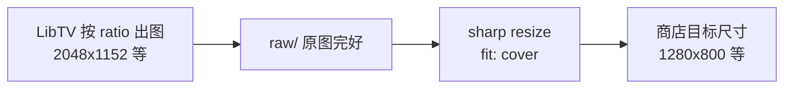

# 修复 LibTV 商店图裁切/变形问题

## 问题现象

- **LibTV 画布 / `store-assets/libtv/raw/`**：图片完整、比例正常（你已确认）
- **最终 `store-assets/promo/` 与 `store-assets/screenshots/`**：内容被裁切，部分画面「显示不完整」

你附的 5 张截图正是脚本输出的最终文件；在 LibTV 里看 raw 版通常更完整。

## 根因（已用实际文件验证）



### 1. 生成比例 ≠ 商店目标比例

| 任务 | LibTV `ratio` | 实际 raw 尺寸 | 目标尺寸 | 目标比例 | 差异 |
|------|---------------|---------------|----------|----------|------|
| 截图 ×5 | `16:9` (1.778) | 2048×1152 | 1280×800 | **16:10 (1.600)** | 目标更「矮宽」 |
| Marquee | `2:1` (2.000) | 2048×1024 | 1400×560 | **2.5:1** | 目标更「宽扁」 |
| Small promo | `3:2` (1.500) | 2016×1344 | 440×280 | **11:7 (1.571)** | 略差 |

[`lib-image-2`](C:\Users\xiaotao\.cursor\skills\libtv-cli\node-types\image.md) **不支持** `16:10`、`2.5:1` 等商店专用比例，枚举仅有 `16:9`、`2:1`、`3:2`、`21:9` 等（见 `libtv model lib-image-2` 输出）。

### 2. 后处理强制 center-crop

[`scripts/generate-store-assets-libtv.mjs`](scripts/generate-store-assets-libtv.mjs) 第 378–389 行：

```javascript
await sharp(inputPath)
  .resize(width, height, { fit: 'cover', position: 'centre' })
```

`fit: 'cover'` **只裁切、不拉伸**；若你感觉「挤压」，常见原因是：
- 裁掉过多边缘后布局看起来被「压缩进框里」
- 或在其他预览器（非 1:1 像素显示）里被拉伸查看

按当前 raw 尺寸估算 **cover 裁切量**：
- **截图 16:9 → 1280×800**：左右各裁约 **5%**（底部 chip 行、顶部标题若贴边易丢）
- **Marquee 2:1 → 1400×560**：上下各裁约 **10%**（最严重）
- **Small promo 3:2 → 440×280**：上下各裁约 **2.4%**（相对轻微）

配置来源：[`store-assets/libtv/prompts.json`](store-assets/libtv/prompts.json) 的 `ratio` + `width`/`height` 与上述脚本逻辑。

## 解决方案（按推荐顺序）

### 方案 A：换更接近的生成比例 + 保留 cover（最小改动）

修改 [`store-assets/libtv/prompts.json`](store-assets/libtv/prompts.json)：

| 节点 | 现 ratio | 建议 ratio | 理由 |
|------|----------|------------|------|
| `promo-marquee` | `2:1` | **`21:9`** (2.333) | 比 2:1 更接近 2.5:1，cover 裁切从 ~10% 降到 ~3% |
| 截图 ×5 | `16:9` | 保持 `16:9` | 已是 lib-image-2 最接近 16:10 的选项 |
| `promo-small` | `3:2` | 保持 `3:2` | 已最接近 11:7 |

同步在 prompt 里强调 **safe area**：「Keep all text and UI within central 90% safe margins; leave generous empty padding on all edges for crop.」

### 方案 B：改裁剪策略为 contain + 黑边填充（零内容丢失）

修改 [`cropToSize`](scripts/generate-store-assets-libtv.mjs)：

```javascript
await sharp(inputPath)
  .resize(width, height, {
    fit: 'contain',
    position: 'centre',
    background: { r: 0, g: 0, b: 0, alpha: 1 },
  })
  .png()
  .toFile(outPath);
```

- **优点**：不再裁切任何内容，不变形
- **缺点**：上下或左右会出现黑边（与品牌黑底一致，通常可接受）；需确认 Chrome Web Store 是否接受（一般接受精确像素 PNG）

可做成 CLI 开关，例如 `STORE_LIBTV_CROP=contain|cover`（默认 `contain`）。

### 方案 C：精确像素 — 继续用 Playwright 方案

若中文小字、布局必须 1:1 精确：
- `npm run store:assets` + `npm run store:screenshots`（[`scripts/make-store-assets.mjs`](scripts/make-store-assets.mjs)）
- 直接按 1280×800 / 1400×560 / 440×280 渲染 HTML，**无二次裁切**

LibTV 方案保留作 AI 视觉探索 / A/B 对比（见 [`.cursor/skills/libtv-store-assets/SKILL.md`](.cursor/skills/libtv-store-assets/SKILL.md)）。

### 方案 D：验收时用 raw 对比（排查用）

对比路径：
- 完好原图：`store-assets/libtv/raw/<node>/<node>.png`
- 裁切后：`store-assets/screenshots/` 或 `store-assets/promo/`

若只有后者有问题，即可确认是**本仓库后处理**而非 LibTV 画布本身。

## 推荐实施组合

**短期（推荐）**：方案 A + 方案 B
1. Marquee 改 `21:9` + prompt 安全区
2. `cropToSize` 默认改为 `contain` + 黑底
3. 重跑 `npm run store:libtv`，对比 raw vs 输出

**长期**：商店正式上架仍以 Playwright 精确版为准；LibTV 版作备选视觉稿。

## 验收清单

- [ ] `store-assets/libtv/raw/*` 与最终 PNG 并排对比，确认无关键文案/UI 被裁
- [ ] 7 张输出像素仍为 440×280、1400×560、1280×800×5
- [ ] Marquee 上下内容完整（改 ratio 后重点看）
- [ ] 截图左右 chip/标题不再贴边被切
- [ ] 更新 [`.cursor/skills/libtv-store-assets/SKILL.md`](.cursor/skills/libtv-store-assets/SKILL.md) 说明裁切策略与 ratio 选择

## 不在本次范围

- 修改 lib-image-2 模型本身（无法新增 16:10 ratio）
- 自动上传 Chrome Web Store
