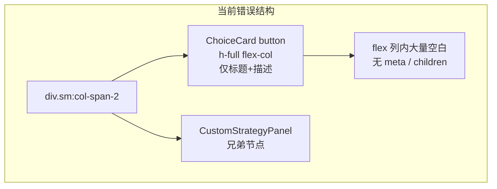

# 修复策略版本「自定义组合」大面积空白

## 问题现象

选中「自定义组合」后，卡片在描述文字下方出现大块深色空白，看不到预期的 3 个下拉框（指令集 / 采样 / 拼接）、高级覆盖与「我的策略配置」区域（见截图）。

## 根因分析

相关代码在 [`src/options/SettingsView.tsx`](d:\code\Code Experiment\Prompt extraction\src\options\SettingsView.tsx) 约 975–1000 行：

```975:1000:src/options/SettingsView.tsx
          {strategyList
            .filter((s) => s.id === 'custom')
            .map((s) => {
              const customActive = settings.promptStrategy === 'custom';
              // ...
              return (
                <div key={s.id} className="sm:col-span-2">
                  <ChoiceCard ... className={customActive ? 'rounded-b-none' : ''} />
                  {customActive && (
                    <CustomStrategyPanel settings={settings} setSettings={setSettings} />
                  )}
                </div>
              );
            })}
```

[`ChoiceCard`](d:\code\Code Experiment\Prompt extraction\src\components\ui\ChoiceCard.tsx) 基类含 `flex h-full min-h-0 flex-col`：

```31:37:src/components/ui/ChoiceCard.tsx
        'relative flex h-full min-h-0 w-full flex-col rounded-lg border p-3 ...',
```

对比其它策略卡的外层包裹：

```917:917:src/options/SettingsView.tsx
                <div key={s.id} className="h-full min-h-0">
```

**自定义组合** 的外层只有 `sm:col-span-2`，没有 `flex flex-col` 约束。



综合行为：

1. **`h-full` + `flex-col`**：自定义卡没有 `meta` 行（其它卡有 `temperature · max_tokens` 脚注并用 `mt-auto` 压底），标题/描述在顶部后，按钮内部会留下大量未填充的 flex 空间。
2. **CSS Grid `align-items: stretch`**：同行其它策略卡使用 `h-full` 对齐行高；自定义卡展开时，按钮仍按「填满网格单元」的方式被拉高，空白集中在 **`<button>` 内部**（与截图红框区域一致）。
3. **`CustomStrategyPanel` 在按钮外**：配置 UI 逻辑上已挂载（`customActive && ...`），但用户感知为「卡片里空白」，因为紫框上半部是空按钮、下半部才是面板；若按钮被撑得过高，面板会落到视口外，更像「整块空白」。

`CustomStrategyPanel` 本身（约 1136–1371 行）内容完整，含 3 个 `<select>`、高级覆盖、预设列表；**不是**业务逻辑缺失，而是**布局/结构**问题。`advancedOpen` 折叠逻辑已在历史改动中移除，当前文件无该状态。

## 修复方案（推荐，改动集中在单文件）

在 [`SettingsView.tsx`](d:\code\Code Experiment\Prompt extraction\src\options\SettingsView.tsx) 调整「自定义组合」区块结构，**不**把表单控件塞进 `<button>`（避免无效 HTML 与无障碍问题）。

### 1. 外层容器改为纵向 flex

```tsx
<div key={s.id} className="sm:col-span-2 flex flex-col min-h-0">
```

### 2. 选中时禁止 ChoiceCard 纵向撑满

为 `ChoiceCard` 增加激活态 class，例如：

```tsx
className={customActive ? 'rounded-b-none !h-auto shrink-0' : ''}
```

未选中时也可加 `!h-auto`（或 `h-auto`），避免在网格中无谓拉伸。

### 3. 面板紧贴标题区、边框连贯

保持 `CustomStrategyPanel` 为兄弟节点（现有 `border-t-0 border-violet-500` 与 `rounded-b-none` 衔接合理），必要时给面板加 `shrink-0`，确保紧跟在 `h-auto` 的按钮下方渲染。

### 4.（可选加固）`CustomStrategyPanel` 防御性默认值

在 `CustomStrategyPanel` 内对 `SAMPLING_PROFILES[comp.sampling]` 做兜底（无效 storage 时用 `v0.3.0`），避免极端损坏配置导致渲染期抛错；属于小范围加固，非本次主因。

## 不在此次范围

- 不改 [`ChoiceCard.tsx`](d:\code\Code Experiment\Prompt extraction\src\components\ui\ChoiceCard.tsx) 全局 `h-full`（其它网格卡片依赖该行为对齐行高）。
- 不合并「我的预设」卡片与内置 `custom` 卡（产品逻辑保持现状）。

## 验证步骤

1. `npm run dev`，打开 `http://localhost:5173/__dev__/ui-preview#options`（见 [open-plugin-ui-preview skill](d:\code\Code Experiment\Prompt extraction\.cursor\skills\open-plugin-ui-preview\SKILL.md)）。
2. 侧栏进入 **策略版本** → 点击 **自定义组合**。
3. 确认描述下方**立即**出现：
   - 指令集版本 / 采样参数 / 拼接方式 三个下拉框
   - 「高级覆盖」区（textarea、温度滑块、Token 上限）
   - 「我的策略配置」区
4. 无大面积空白；紫框内按钮区仅包裹标题+描述。
5. 暗色模式下文字与控件可见。
6. `npm run build` 后在 Chrome 扩展 Options 页复测一次。

## 涉及文件

| 文件 | 变更 |
|------|------|
| [`src/options/SettingsView.tsx`](d:\code\Code Experiment\Prompt extraction\src\options\SettingsView.tsx) | 自定义组合外层 flex + ChoiceCard `!h-auto shrink-0`；可选 sampling 兜底 |
