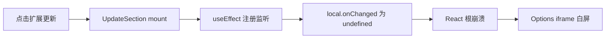

# 修复本地预览「扩展更新」导致 Options 白屏

## 根因

用户确认复现路径：**聚合预览 → 选项页 Options → 设置 → 左侧点「扩展更新」→ 整页消失**。

[`src/options/UpdateSection.tsx`](src/options/UpdateSection.tsx) 在 `useEffect` 中使用了 **不存在的 Chrome API**：

```47:48:src/options/UpdateSection.tsx
    chrome.storage.local.onChanged.addListener(listener);
    return () => chrome.storage.local.onChanged.removeListener(listener);
```

Chrome 扩展只有 **`chrome.storage.onChanged`**（根级事件，回调第二参数为 `areaName: 'local' | 'sync' | ...`），`StorageArea`（`local`/`sync`）本身没有 `onChanged`。

对比同仓库其它组件均使用正确写法，例如 [`SettingsView.tsx`](src/options/SettingsView.tsx)：

```175:176:src/options/SettingsView.tsx
    chrome.storage.onChanged.addListener(onStorage);
    return () => chrome.storage.onChanged.removeListener(onStorage);
```

在开发预览中，[`chromeShim.ts`](src/dev/preview/chromeShim.ts) 的 `chrome.storage.local` 由 `makeArea()` 生成，不含 `onChanged`，因此 **UpdateSection 首次挂载即 `TypeError`**，React 18 无 Error Boundary 时整棵 Options 树卸载 → iframe 白屏。



**注意**：此 bug 不限于本地预览；在真实 `chrome-extension://` 环境进入「扩展更新」同样会触发（只是用户目前在 dev preview 中发现）。

## 修复方案（最小 diff）

仅改 [`src/options/UpdateSection.tsx`](src/options/UpdateSection.tsx)：

- 将 `chrome.storage.local.onChanged` 改为 `chrome.storage.onChanged`
- 监听回调增加 `area` 过滤：仅当 `area === 'local'` 且 `changes` 含 `REMOTE_RUNTIME_CONFIG_CACHE_KEY` 时调用 `loadRemoteHints()`
- 与 [`SettingsView.tsx`](src/options/SettingsView.tsx) / [`PromptLibrary/index.tsx`](src/options/PromptLibrary/index.tsx) 的写法保持一致

示意：

```typescript
const listener = (
  changes: Record<string, chrome.storage.StorageChange>,
  area: chrome.storage.AreaName
) => {
  if (area !== 'local') return;
  if (!(REMOTE_RUNTIME_CONFIG_CACHE_KEY in changes)) return;
  void loadRemoteHints();
};
chrome.storage.onChanged.addListener(listener);
return () => chrome.storage.onChanged.removeListener(listener);
```

**不改** `chromeShim.ts`：shim 已正确实现根级 `onChanged`；修复业务代码即可，避免在 shim 里伪造 `local.onChanged` 掩盖 API 误用。

## 可选增强（非必须，本次不做）

- `chromeShim.getManifest()` 目前 `throw`，[`getCurrentVersion()`](src/lib/updater.ts) 靠 try/catch 回退 `0.0.0`——不影响白屏，但可在后续让预览显示真实 package 版本号。
- 预览入口加 Error Boundary 仅改善 DX，不解决根因。

## 验收步骤

1. 根目录 `npm run dev`，打开 `http://localhost:5173/__dev__/ui-preview#options`
2. 确认 Options iframe 正常渲染（设置 Tab 默认可见）
3. 左侧导航点击 **「扩展更新」**
4. 预期：显示「检查更新」面板（当前版本、立即检查/立即更新按钮），**不再白屏**
5. 点击「立即检查更新」：预览 shim 应返回「当前已是最新版本」（[`chromeShim.ts`](src/dev/preview/chromeShim.ts) `CHECK_UPDATE` stub）
6. 切换到「提示词库」Tab 再切回「设置 → 扩展更新」，确认重复进入仍正常
