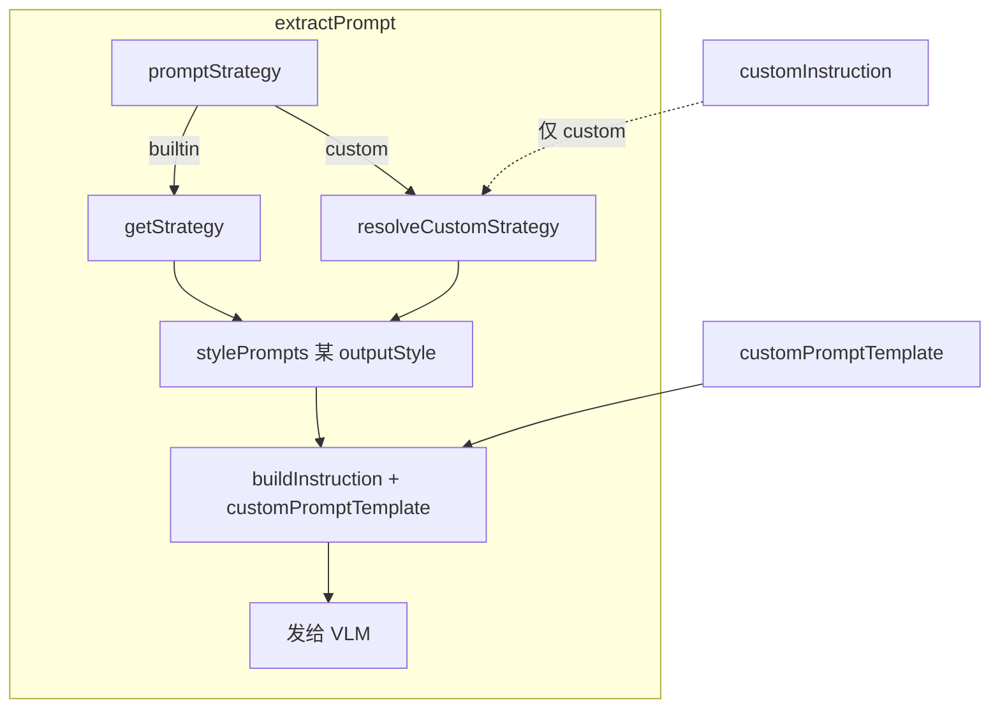

# 合并「额外提示词」与「自定义指令模板」UI

## 现状（为何感觉重复）

两者在运行时职责不同，但 UI 都是「大段可选中文」：

| 维度 | 额外提示词 [`customPromptTemplate`](src/lib/types.ts) | 自定义指令模板 [`customInstruction`](src/lib/types.ts) |
|------|------------------------------------------------------|--------------------------------------------------------|
| 位置 | [`OutputSettingsPanel.tsx`](src/options/OutputSettingsPanel.tsx) | [`CustomStrategyPanel.tsx`](src/options/CustomStrategyPanel.tsx)「高级覆盖」 |
| 生效策略 | **所有**内置档位 + 自定义组合 | **仅** `promptStrategy === 'custom'` |
| 对系统指令 | **叠加**（不替换 `STYLE_PROMPT_SETS` 正文） | **整段替换**四套 `stylePrompts`（见 [`resolveCustomStrategy`](src/lib/strategies.ts) L398–401） |
| 拼接 | 由策略的 `customPosition` 决定 prepend / append（[`buildInstruction`](src/lib/api/extract.ts) L85–96） | 替换后再走同一套 `buildInstruction`（若模板非空会二次拼接） |



用户选 **merge_ui**：不合并存储字段、不改 [`extract.ts`](src/lib/api/extract.ts) 核心逻辑，只统一入口与模式语义。

---

## 目标体验

在 **「输出与交互」** 保留一块控件：

```
自定义提示词（可选）
[ 追加到系统指令 ▼ ] [ 替换系统指令 ]   ← 第二项仅在「自定义组合」可选

┌─────────────────────────────────────┐
│ 单一 textarea                        │
└─────────────────────────────────────┘

动态说明（1 行）：
- 追加：会叠在当前策略/输出风格对应的系统指令上；拼接位置由策略版本决定…
- 替换：将替代所选指令集正文，对所有输出风格统一生效；仅自定义组合…
```

**「策略版本 → 自定义组合」** 内「高级覆盖」只保留温度 / Token，去掉重复的「自定义指令模板」textarea；可加一行链式说明：「系统指令正文请在「输出与交互 → 自定义提示词」中配置（可切换替换模式）」。

---

## 实现要点

### 1. 新建共享组件

新建 [`src/options/UnifiedCustomPromptEditor.tsx`](src/options/UnifiedCustomPromptEditor.tsx)（名称可微调），Props：

- `settings`, `setSettings`
- `promptStrategy`（或整个 `settings` 内读）
- 可选 `compact` / `showStrategyHint` 供策略页引用

**模式推导（无需新持久化字段也可工作）**：

```ts
type CustomPromptMode = 'append' | 'replace';

function inferMode(s: AppSettings): CustomPromptMode {
  if (s.customInstruction?.trim()) return 'replace';
  return 'append';
}

function readText(s: AppSettings, mode: CustomPromptMode): string {
  return mode === 'replace'
    ? (s.customInstruction ?? '')
    : (s.customPromptTemplate ?? '');
}

function writeText(s: AppSettings, mode: CustomPromptMode, text: string): AppSettings {
  if (mode === 'replace') {
    return {
      ...s,
      customInstruction: text.trim() || undefined,
      customPromptTemplate: '', // 互斥，避免双写
    };
  }
  return {
    ...s,
    customPromptTemplate: text,
    customInstruction: undefined,
  };
}
```

**模式切换**：切换时把当前 textarea 内容 `writeText` 到新字段，清空另一字段（避免预设/导出里悄悄残留双份）。

**「替换系统指令」禁用规则**：

- `promptStrategy !== 'custom'` 时：分段控件第二项 `disabled` + `title` 说明「需先选择自定义组合」；若当前为 replace 且用户切到内置策略，**自动降级为 append** 并把 `customInstruction` 文本迁入 `customPromptTemplate`（防止静默失效）。

### 2. 接线

| 文件 | 改动 |
|------|------|
| [`OutputSettingsPanel.tsx`](src/options/OutputSettingsPanel.tsx) | 用 `UnifiedCustomPromptEditor` 替换 L63–70 的裸 textarea；折叠区「需要帮助？」更新为按模式分述，去掉与策略页重复的冗长脚注 |
| [`CustomStrategyPanel.tsx`](src/options/CustomStrategyPanel.tsx) | 删除 L215–229「自定义指令模板」区块；指纹行 `自定义指令` 逻辑不变（仍读 `settings.customInstruction`）；预设说明 L329–331 改为「自定义提示词（追加/替换）」 |
| [`StrategySettingsPanel.tsx`](src/options/StrategySettingsPanel.tsx) | 可选：在自定义组合展开区顶部放一行只读摘要（如 `追加：注重光影…` / `替换：已写 120 字`），点击滚动或提示去「输出与交互」— 非必须，视版面决定 |

### 3. 不改 / 少改

- [`extract.ts`](src/lib/api/extract.ts)、[`strategies.ts`](src/lib/strategies.ts)、[`userStrategyPresets.ts`](src/lib/storage/userStrategyPresets.ts)：**保持双字段**；预设仍同时存 `customPromptTemplate` + `customInstruction`，`isSettingsMatchingUserPreset` 不变。
- [`types.ts`](src/lib/types.ts)：字段注释改为「由 UnifiedCustomPromptEditor 互斥写入」即可。

### 4. 边界与验收

- **双字段历史数据**：首次打开若两者都有内容，以 `customInstruction` 优先进入 replace 并展示其文本；可在帮助里写一句「若曾同时填写，以替换内容为准」。
- **replace + 再填 append 语义**：replace 模式下 `customPromptTemplate` 应为空；若未来允许「替换后再追加」，需改 `buildInstruction`（本次 **不做**，UI 互斥即可）。
- **原生策略**：追加模式仍生效；replace 在非 custom 下不可用（与现逻辑一致）。
- **构建与预览**：`npm run build`；`__dev__/ui-preview#options` 目视 output / strategy 两 tab；选 custom → 切换 replace → 保存预设 → 应用预设 → 切经典策略确认文本迁移。

---

## 文案建议（简体）

| 模式 | 标签 | 一行说明 |
|------|------|----------|
| append | 追加到系统指令 | 叠在当前策略的系统提示之后；高保真档前置、经典档以「额外要求：」追加。 |
| replace | 替换系统指令 | 完全替代指令集正文，四档输出风格共用同一段；**仅在选择「自定义组合」时可用**。 |

占位符合并为一条中性示例：「例如：注重画面氛围与光影；或整段替换为自写反推指令。」

---

## 不在本次范围

- 合并 `customPromptTemplate` / `customInstruction` 为单字段的数据迁移
- 让「替换系统指令」对内置策略档位生效（会扩大产品语义，需单独评审）
- 设置页其余面板的大 refactor（见 [设置页其余面板优化](.cursor/plans/设置页其余面板优化_d701807b.plan.md)）
