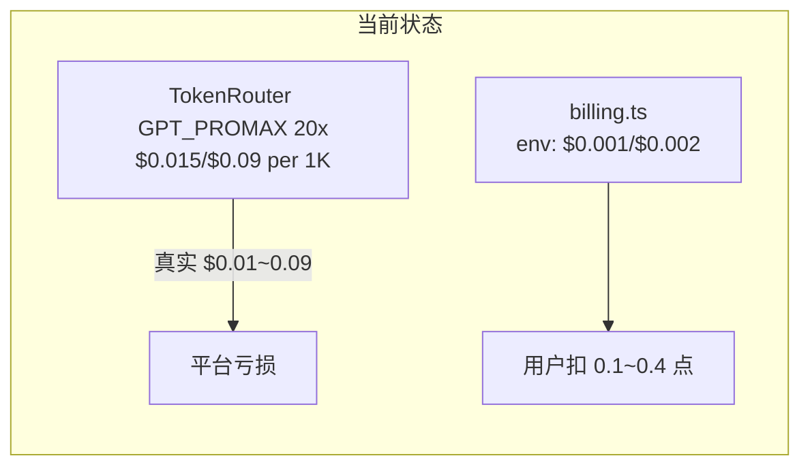
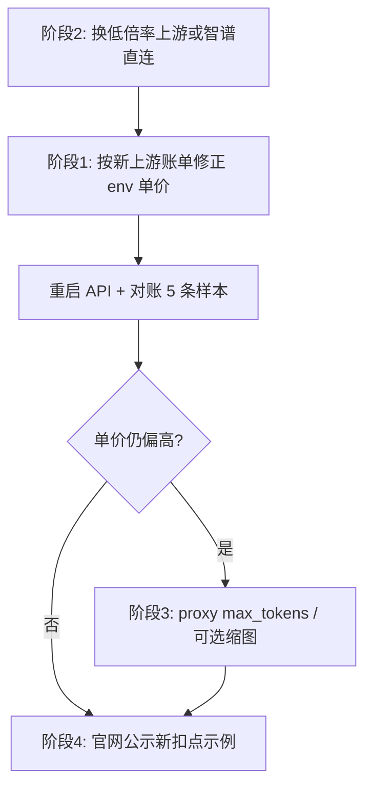

# 平台代调用成本与扣点对齐优化

## 问题诊断

### 数据对账（你的 5 条记录）

| 上游真实费用 (图1) | token (in/out) | 官网扣点 (图2) | 按**错误 env**反推扣点 | 按**正确 env**应收 |
|---|---|---|---|---|
| $0.087 | 1310 / 749 | 0.4 | 0.4 | **12.5** |
| $0.094 | 1254 / 838 | 0.4 | 0.4 | **13.5** |
| $0.059 | 1302 / 433 | 0.3 | 0.3 | **8.4** |
| $0.014 | 460 / 82 | 0.1 | 0.1 (最低扣) | **2.0** |
| $0.012 | 463 / 52 | 0.1 | 0.1 (最低扣) | **1.7** |

**反推结论**：图2 扣点与 [`services/api/.env`](services/api/.env) 中 `UPSTREAM_INPUT_PRICE_PER_1K=0.001`、`UPSTREAM_OUTPUT_PRICE_PER_1K=0.002` 配合 `POINTS_PER_USD≈144` **完全吻合**；但与 TokenRouter 账单（GPT_PROMAX **20×** 分组，输入 $0.75/1M × 20 = **$0.015/1K**）脱节约 **15~45 倍**。

当前单次请求平台实付约 **¥0.6~0.7**，用户只付 **¥0.01~0.04**（按 ¥0.1/点），属于严重补贴。



### 次要发现

- 配置模型为 `glm-4v-flash`，TokenRouter 日志显示 `gpt-3.5-mini` + `GPT_PROMAX`——说明上游存在**模型别名/路由**，换模型时必须以**账单实付价**为准，不能只看 model id 字面量。
- 输入 token ~1300：策略指令（[`src/lib/strategies.ts`](src/lib/strategies.ts) 中 v0.3.0 档 `maxTokens: 1536`）+ 图片 base64 共同构成；[`src/lib/image.ts`](src/lib/image.ts) 主链路**不做缩图**（有意为之），大图会推高 input token。
- 计费逻辑本身正确：[`services/api/src/billing.ts`](services/api/src/billing.ts) 按 `usage` → USD → 点数；问题在 **env 单价**，不在代码。

---

## 优化策略（按优先级）

### 阶段 1：立即修正计费 env（对齐成本 + 毛利）

**目标**：扣点反映真实上游成本 × `POINTS_PER_USD`（文档默认 144 ≈ 2× 毛利）。

在 [`services/api/.env`](services/api/.env)（生产部署同理）更新：

```env
# TokenRouter GPT_PROMAX 20x 分组实付价（与图1「详情」一致）
UPSTREAM_INPUT_PRICE_PER_1K=0.015
UPSTREAM_OUTPUT_PRICE_PER_1K=0.090
POINTS_PER_USD=144
MIN_CHARGE_POINTS=0.1
```

**验证公式**（无需改代码）：

```
cost_usd = prompt/1000 × 0.015 + completion/1000 × 0.090
points   = floor(cost_usd × 144 × 10) / 10   # 向下取整到 0.1
```

**预期用户侧变化**（你已选择 align_cost）：

- 典型反推（~1300 in / ~700 out）：**约 12~14 点/次**（≈ ¥1.2~1.4）
- 小请求（~460 in / ~80 out）：**约 2 点/次**
- 无 usage 兜底：**0.1 点**（不变）

**运维动作**：

1. 修改 env 后重启 API（[`docs/PLATFORM_OPERATIONS.zh.md`](docs/PLATFORM_OPERATIONS.zh.md) §计费逻辑）
2. 用一条带 `usage` 的测试请求核对 `usage_logs` 与余额变动
3. **同步更新** [`.env.example`](services/api/.env.example) 注释，标明 TokenRouter 20× 分组口径，避免再次配错

---

### 阶段 2：降低上游真实成本（比涨价更有效）

当前最大成本杠杆是 **GPT_PROMAX 20× 分组**，不是扣点公式。

**方案 A（推荐）：切回智谱直连**

[`services/api/.env.example`](services/api/.env.example) 已预设智谱 OpenAI 兼容端点 + `gpt-5.4-mini`（或 `glm-4v-flash` 视觉模型）。直连通常**无 20× 代理倍率**，视觉任务单价显著低于 TokenRouter GPT_PROMAX。

```env
UPSTREAM_BASE_URL=https://open.bigmodel.cn/api/paas/v4
UPSTREAM_DEFAULT_MODEL=glm-4v-flash   # 或经验证的视觉模型 id
UPSTREAM_INPUT_PRICE_PER_1K=<智谱账单实付，通常远低于 0.015>
UPSTREAM_OUTPUT_PRICE_PER_1K=<智谱账单实付>
```

**方案 B：继续用 TokenRouter，但换低倍率分组**

- 在 TokenRouter 控制台将令牌从 `GPT_PROMAX`（20×）换到**低倍率分组**（如 1×/5× 组）
- 确认 `UPSTREAM_DEFAULT_MODEL` 在该分组可用且**视觉能力满足反推质量**
- 按新分组账单**重新填写** `UPSTREAM_*_PRICE_PER_1K`

**选型原则**：每次换模型/分组后，取 3~5 条真实账单单价反算 env，直到 `computeCostUsdFromUsage` 与上游「花费」列误差 < 1%。

---

### 阶段 3：可选 token 治理（进一步压上游账单）

在阶段 1~2 完成后若仍觉得单价高，再考虑代码改动（非必须）：

| 手段 | 文件 | 预期效果 | 代价 |
|------|------|----------|------|
| 网关侧 `max_tokens` 上限 | [`services/api/src/routes/proxy.ts`](services/api/src/routes/proxy.ts) | 限制输出 token（当前策略允许 1536） | 长提示词可能被截断 |
| platform 专用图片缩图 | [`src/lib/image.ts`](src/lib/image.ts) + 调用方 | 降低 input token | 增加 200~500ms 客户端耗时；需 A/B 质量验证 |
| 默认策略降档 | [`src/lib/strategies-meta.ts`](src/lib/strategies-meta.ts) | 缩短 system 指令 | 输出质量可能下降 |

**建议**：优先在 proxy 层对 platform 请求加 `max_tokens` 硬顶（如 1024），改动面最小；图片缩图仅在上游仍贵时再开。

---

### 阶段 4：用户侧公示与过渡

你已选择按成本+毛利定价，需避免用户感知「突然涨价」却无说明：

1. **定价页 FAQ** [`website/src/pages/pricing.astro`](website/src/pages/pricing.astro)：补充示例——「典型反推约 X 点，随图片大小与输出长度浮动」
2. **账户页用量**：[`website/src/scripts/account.ts`](website/src/scripts/account.ts) 的「最近用量」已显示扣点；可考虑增加「等效上游 token」字段（`usage_logs` 已有 `prompt_tokens`/`completion_tokens`，[`services/api/src/db.ts`](services/api/src/db.ts)）
3. **过渡策略（可选）**：老用户余额按旧规则已补贴，可邮件/公告说明新扣点规则生效日；无需改代码

---

## 安全提醒

本地 [`.env`](services/api/.env) 含 `UPSTREAM_API_KEY`，已在 git status 中为 untracked——**切勿提交**；若曾泄露建议轮换 TokenRouter 密钥。

---

## 验收清单

- [ ] 用图1 任一条记录的 token 数，手算 `pointsFromUsage` 与图2 **新规则下**应收一致（非旧 0.4 点）
- [ ] TokenRouter/智谱控制台 24h 总费用 ≈ Σ(用户扣点 / POINTS_PER_USD)
- [ ] 扩展 platform 模式反推 smoke：质量可接受、余额扣减正确
- [ ] 定价页/运维文档 env 说明与生产一致

## 建议执行顺序



**关键原则**：先降上游真实成本，再修正 env；否则即使用正确公式扣点，用户单价仍会偏高。
