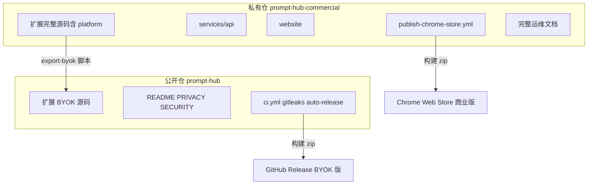
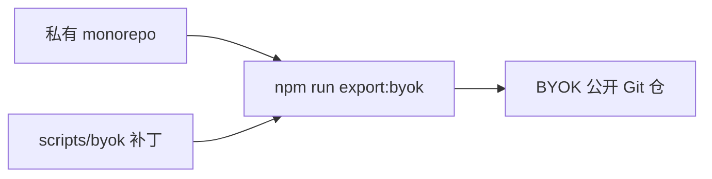

# 插件开源 + 全项目闭源拆分方案

## 目标架构



| 仓库 | 可见性 | 内容 | 发版 |
|------|--------|------|------|
| **私有**（当前仓改名） | Private | 扩展 + `services/api` + `website` + 平台 UI/登录 | CWS 商业版（含平台代调用） |
| **公开**（新建） | Public | 仅 BYOK 扩展 | GitHub Release / 侧载 zip |

你已确认：**商店继续从私有仓构建**；公开仓仅供 BYOK 用户 sideload / GitHub Release。

---

## 术语（项目内记忆，勿与目录名混淆）

| 说法 | 含义 |
|------|------|
| **BYOK** | Bring Your Own Key：用户在设置里自备各供应商 API Key，扩展直连模型 API，**不经**平台代调用（`api.PromptHub.com`、平台登录、平台余额）。 |
| **BYOK 仓 / 公开仓** | 计划中的 **Public Git 仓库**，只含 BYOK 版 Chrome 扩展源码；发 GitHub Release / 用户 sideload。**不是**当前这个私有 monorepo 本身。 |
| **私有仓 / 商业仓** | 当前 monorepo（将改名并 Private）：完整扩展 + `services/api` + `website` + 平台 UI；Chrome 商店商业版从此构建。 |
| **`scripts/byok/`** | 私有仓内的 **导出工具集**（补丁、排除清单、overlay），不是 BYOK 公开仓的源码根目录。 |
| **`npm run export:byok`** | 入口 [`scripts/export-byok-repo.ts`](scripts/export-byok-repo.ts)：复制树 → `applyAllByokPatches` → 生成公开版 README/PRIVACY。 |
| **`.export-byok-test/`** | 本地跑 export 的测试输出目录，应 gitignore，**勿提交**。 |



**持久化位置**（阶段 2 `docs-dual-repo`）：[`docs/BYOK_EXPORT.zh.md`](docs/BYOK_EXPORT.zh.md) 写完整术语与操作步骤；[`AGENTS.md`](AGENTS.md) 快速入口表加一行「双仓 / BYOK 导出」链到该文档；[`docs/MAINTAINER.zh.md`](docs/MAINTAINER.zh.md) 增加「从私有仓导出开源版」章节。

---

## 私有仓保留 vs 公开仓剔除

### 整目录移出公开仓（私有独有）

- [`services/api/`](services/api/)
- [`website/`](website/)
- [`.github/workflows/api.yml`](.github/workflows/api.yml)、[`website.yml`](.github/workflows/website.yml)
- [`docs/PLATFORM_OPERATIONS.zh.md`](docs/PLATFORM_OPERATIONS.zh.md)、[`docs/deploy-platform.zh.md`](docs/deploy-platform.zh.md)（或保留精简自托管说明，**不含**生产域名与定价）

### 扩展内「平台/商业化」模块（公开仓删除）

| 路径 | 说明 |
|------|------|
| [`src/lib/platform/`](src/lib/platform/) | Token、登录、config |
| [`src/components/PlatformLoginForm.tsx`](src/components/PlatformLoginForm.tsx) | 登录 UI |
| [`src/options/PlatformAccountPanel.tsx`](src/options/PlatformAccountPanel.tsx) | 平台账户面板 |
| [`src/background/externalAuth.ts`](src/background/externalAuth.ts) | 官网 `PE_EXT_LOGIN` 回传 |
| [`src/lib/quota/adapters/platform.ts`](src/lib/quota/adapters/platform.ts) | 平台余额额度 |

### 共享文件需改动的关键点

1. **[`src/lib/types/domain.ts`](src/lib/types/domain.ts)** — 从 `ProviderId` 移除 `'platform'`
2. **[`src/lib/providers.ts`](src/lib/providers.ts)** — 删除 `platform` 注册项及对 `platform/config` 的 import
3. **[`src/lib/providerVisionCatalog.ts`](src/lib/providerVisionCatalog.ts)** — 删除 `platform` 条目
4. **[`src/lib/quota/registry.ts`](src/lib/quota/registry.ts)** — 移除 platform adapter
5. **[`src/lib/api/extract.ts`](src/lib/api/extract.ts)** / [`refine.ts`](src/lib/api/refine.ts) — 删除 `case 'platform'`
6. **[`src/lib/platform/auth.ts`](src/lib/platform/auth.ts) 的 `resolveProviderApiKey`** — 逻辑迁到无 platform 分支的文件（如 [`src/lib/api/providerValidation.ts`](src/lib/api/providerValidation.ts)），BYOK 只校验 `cfg.apiKey`
7. **[`src/background/messages.ts`](src/background/messages.ts)** — 删除 `PLATFORM_LOGIN_*` 处理器
8. **[`src/background/index.ts`](src/background/index.ts)** — 移除 `registerExternalAuthListener`
9. **[`src/lib/types/messages.ts`](src/lib/types/messages.ts)** — 删除 `PE_EXT_LOGIN`、`PlatformLogin*` 等类型
10. **UI** — [`SettingsView.tsx`](src/options/settings/SettingsView.tsx) 去掉 `PlatformAccountPanel`；[`ProviderSettingsPanel.tsx`](src/options/settings/tabs/ProviderSettingsPanel.tsx) 去掉 platform 相关 UI；[`PopupApp.tsx`](src/popup/PopupApp.tsx) 去掉登录表单与平台状态
11. **[`src/manifest.config.ts`](src/manifest.config.ts)** — 公开版：
    - 删除 `externally_connectable`
    - 删除 `identity` 权限（仅 [`authApi.ts`](src/lib/platform/authApi.ts) 使用）
    - `homepage_url` 改为 GitHub 公开仓地址
12. **[`src/lib/storage/keys.ts`](src/lib/storage/keys.ts)** — 可保留 `PLATFORM_TOKEN_KEY` 常量无引用，或删除并在 `getSettings` 迁移旧 `activeProvider: platform` → `openai`

### 设置迁移（公开版首次加载）

在 [`src/lib/storage/settings.ts`](src/lib/storage/settings.ts) 合并默认值时：若 `activeProvider` / `refineProvider === 'platform'`，回退为 `openai`（与现有未知 id 回退一致）。

---

## 推荐实现：私有仓内 `export-byok` 脚本

在**私有仓**新增 [`scripts/export-byok-repo.ts`](scripts/export-byok-repo.ts)（或 PowerShell + 固定清单），每次发开源版时运行：

```
npm run export:byok -- --out ../prompt-hub-open
```

脚本职责：

1. **复制 git 跟踪文件**：[`scripts/byok/copyTree.ts`](scripts/byok/copyTree.ts) 用 `git ls-files -z` 白名单复制（仅 tracked 文件，天然跳过 `node_modules`/`dist`/`.export-byok-test` 等未跟踪目录）；再按 [`BYOK_DELETE_PATHS`](scripts/byok/config.ts) 删除 platform 相关路径
2. **安全清理目标目录**：重跑 export 时**不**整目录 `rmSync` 输出根；仅删除除 `node_modules`/`.git` 外的顶层项，避免 Windows 删 `node_modules` 卡死；`--verify` 用 `npm install --no-audit --no-fund`（非 `npm ci`）配合保留的 `node_modules` 增量安装
3. **应用 BYOK 补丁**：对上述共享文件执行预置 transform（overlay 见 [`scripts/byok/overlays/`](scripts/byok/overlays/)）
4. **生成公开版 `PRIVACY.md`**：仅保留 BYOK「模式 A」段落，删除平台代调用与 `api.PromptHub.com` 披露
5. **生成公开版 `README.md`**：强调自备 API Key；安装指向 GitHub Release / 侧载；链接商店页作为「官方预配置版（非开源构建）」可选一句，避免混淆
6. **`npm run lint && npm run test && npm run build`** 在输出目录验证通过后再 push（`--verify` 可选）

**开发流程**：日常只在私有仓开发；发开源版时跑 export → 在公开仓 commit/tag。本地测试可用 `--out .export-byok-test`（已 gitignore）。

---

## GitHub 仓库迁移步骤

1. **备份**：确认本地与 remote 同步
2. **重命名当前仓**（Settings → Repository name）：例如 `prompt-hub` → `prompt-hub-commercial`
3. **设为 Private**
4. **新建公开仓** `prompt-hub`（或 `prompt-hub`），push export 结果
5. **更新引用**：
   - 私有仓 [`publish-chrome-store.yml`](.github/workflows/publish-chrome-store.yml) 无需改 workflow 逻辑，但确认 checkout 指向私有仓
   - 公开仓 `README` / badge 指向新 URL
   - [`PRIVACY.md`](PRIVACY.md) 商店 URL 仍可用 raw.githubusercontent.com **公开仓** BYOK 版，或继续用官网 privacy（商业版商店披露仍含平台模式 — 见下节）
6. **Fork 用户**：旧公开 fork 会随私有化失效；在公开仓 README 说明迁移

---

## 文档与合规分轨

| 文档 | 私有仓 | 公开仓 |
|------|--------|--------|
| `PRIVACY.md` | BYOK + 平台模式完整版（商店审核用） | **仅 BYOK** |
| `store-listing/data-usage-disclosure.md` | 含 platform 披露 | 可省略或 BYOK-only 副本 |
| `docs/OPEN_SOURCE_SECURITY.zh.md` | 全栈敏感信息 | 仅扩展 + 勿提交 `.env` |
| `docs/MAINTAINER.zh.md` | 含 CWS CI、api/website | 仅扩展上架与 export 流程 |

**Chrome Web Store**：商业版 zip 从私有仓构建，隐私政策 URL 可继续指向官网 `https://PromptHub.com/privacy`（覆盖平台模式）；与开源 BYOK 隐私文本分离，避免审核与开源表述冲突。

---

## CI 拆分

| Workflow | 私有仓 | 公开仓 |
|----------|--------|--------|
| `ci.yml` | 扩展 lint/test/build/knip | 同左 |
| `gitleaks.yml` | 有 | 有 |
| `auto-release.yml` | 扩展 zip Release | 有（BYOK Release） |
| `api.yml` / `website.yml` | 有 | **无** |
| `publish-chrome-store.yml` | **有** | **无** |

公开仓 [`package.json`](package.json) 可去掉 `website:sync-images` 等依赖 `website/` 的 script。

---

## 实施阶段（建议顺序）

### 阶段 1 — 私有仓内 BYOK 变体可构建（不立刻建公开仓）

- 新增 `patches/byok/` 或 inline transform，使「删 platform 后的树」在私有仓子目录能通过 `lint/test/build`
- 补测试：无 `platform` 时 `ProviderId`、settings 迁移、`PopupApp` 无登录 UI smoke

### 阶段 2 — export 脚本 + 文档

- `npm run export:byok`（工具已在 [`scripts/byok/`](scripts/byok/)）
- 新增 [`docs/BYOK_EXPORT.zh.md`](docs/BYOK_EXPORT.zh.md)：本节「术语」+ 命令示例 + 与商店版差异
- 公开版 README / PRIVACY / SECURITY 模板（`generateDocs.ts`）
- [`docs/MAINTAINER.zh.md`](docs/MAINTAINER.zh.md)、[`AGENTS.md`](AGENTS.md) 链到 BYOK_EXPORT

### 阶段 3 — GitHub 迁移

- 私有化 + 重命名 + 创建公开仓 + 首次 push
- 验证私有仓 CWS workflow 仍可用

### 阶段 4 — 首版开源 Release

- 公开仓打 `vX.Y.Z` tag，`auto-release` 上传 BYOK zip
- README 写清：商店版 ≠ GitHub 开源构建

---

## 风险与注意

- **export 卡顿（Windows）**：勿对含 `node_modules` 的输出目录做整目录 `rmSync`；复制必须用 `git ls-files`，勿回退手写整树递归
- **双仓 drift**：必须以 export 脚本为唯一公开源，避免手工改公开仓后丢失
- **类型联合 `ProviderId`**：删 `platform` 后需全仓 grep `'platform'` 清干净，否则 TS 报错
- **用户升级路径**：从商店商业版切到 sideload BYOK 版时，settings 里可能残留 `platform` provider — 迁移逻辑必须存在
- **AGENTS.md / knip.json**：公开仓 entry 去掉 platform 相关路径
- **已有敏感信息治理**（`.gitleaks.toml`、`validateProductionConfig` 等）留在**私有仓**；公开仓仅保留扩展相关 ignore 与 gitleaks

---

## 与前一版「单仓开源治理」的关系

已落地的 [`.gitignore`](.gitignore)、[`SECURITY.md`](SECURITY.md)、[`docs/OPEN_SOURCE_SECURITY.zh.md`](docs/OPEN_SOURCE_SECURITY.zh.md) 等：

- **私有仓**：继续作为全栈安全规范
- **公开仓**：export 时带入扩展相关部分；`services/api` 相关段落由 export 脚本剔除

拆分后，商业运维文档**仅存在于私有仓**，公开仓不再包含 `PLATFORM_OPERATIONS` 定价细节。
