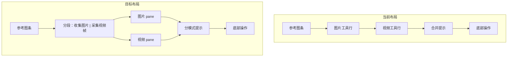

# 收集参考图 UI：图片 / 视频分段切换

## 现状

[`src/content/panel/templates.ts`](src/content/panel/templates.ts) 的 `status === 'compose'` 分支（约 612–684 行）把两套能力纵向堆叠：

- **图片**：`.compose-toolbar`（URL 输入 + 添加 + 本地图片）
- **视频**：`.compose-video-segment`（起止秒、视频选择、采样 / 时间段反推）

样式在 [`src/content/panel/styles.ts`](src/content/panel/styles.ts)（`.compose-toolbar` / `.compose-video-segment`）。事件在 [`src/content/panel/events.ts`](src/content/panel/events.ts)（`add-ref-url`、`sample-video-segment-to-refs`、`extract-video-segment` 等），**无需改动业务逻辑**。



## 目标 UI 结构

在参考图条下方插入分段控件，再渲染两个互斥 pane：

| 分段 | 内容 |
|------|------|
| **收集图片**（默认） | URL 输入（整行）+ 下方「添加 / 本地图片」按钮行 |
| **采集视频帧** | 起止秒输入、视频下拉、「采样到参考 / 时间段反推」；无页面视频时在 pane 内显示简短说明 |

底部 **策略选择 + 提取材质 / 提取风格 / 生成提示词** 保持共用，不随 tab 变化。

## 实现要点

### 1. 分段状态（模块级，不污染 PanelState）

在 [`src/content/panel/state.ts`](src/content/panel/state.ts) 增加：

```ts
export type ComposeCollectMode = 'image' | 'video';
let composeCollectMode: ComposeCollectMode = 'image';
export function getComposeCollectMode(): ComposeCollectMode { ... }
export function setComposeCollectMode(mode: ComposeCollectMode): void { ... }
```

- 默认 `'image'`
- `closePanel()` 时重置为 `'image'`（在 [`src/content/panel/index.ts`](src/content/panel/index.ts) 的关闭逻辑里调用）
- 每次 `renderPanel` 重渲时从该变量读取，保证「添加参考图」后 tab 不跳回默认

### 2. 模板重构 — [`templates.ts`](src/content/panel/templates.ts)

在 `compose` 分支中，将现有两块替换为：

```html
<div class="compose-mode-tabs" role="tablist" aria-label="参考收集方式">
  <button role="tab" data-action="compose-set-mode" data-mode="image" aria-selected="true">收集图片</button>
  <button role="tab" data-action="compose-set-mode" data-mode="video" aria-selected="false">采集视频帧</button>
</div>

<div class="compose-pane compose-pane-image" role="tabpanel" ...>
  <!-- 原 compose-toolbar，输入框独占一行 -->
</div>
<div class="compose-pane compose-pane-video" role="tabpanel" hidden ...>
  <!-- 原 compose-video-segment，改为纵向分组布局 -->
</div>
```

- 根据 `getComposeCollectMode()` 设置 `aria-selected` / `hidden`
- 提示文案拆分：
  - 图片：强调 URL / 本地 / 右键「添加到参考」
  - 视频：强调起止秒、采样与「时间段反推」分镜用途
- 共用计数：`当前 N / 8 张` 可放在 hint 末尾或 tab 下方一行

### 3. 事件 — [`events.ts`](src/content/panel/events.ts)

新增 `compose-set-mode` 分支（在现有 `data-action` 分发处）：

- 校验 `state.status === 'compose'`
- `setComposeCollectMode(mode)` + 调用 `syncComposeCollectModeUi(root, mode)`（纯 DOM：切换 tab `aria-selected`、pane `hidden`）
- **不调用 `renderPanel`**，避免切换 tab 时清空用户已填的视频起止秒

现有 `add-ref-url` / `sample-video-segment-to-refs` / `extract-video-segment` 等 handler **原样保留**。

### 4. 样式 — [`styles.ts`](src/content/panel/styles.ts)

新增（沿用面板 CSS 变量 `--pe-*`，视觉对齐 React [`SegmentedControl`](src/components/ui/SegmentedControl.tsx) 的 pill 风格）：

- `.compose-mode-tabs` — 全宽 segmented control（`inline-flex` + 圆角底 + active 高亮）
- `.compose-pane` — 统一内边距与间距；非 active 用 `[hidden] { display: none }`
- `.compose-pane-image` — URL 输入 `flex: 1 1 100%`，按钮行 `flex-wrap`
- `.compose-pane-video` — 改为 **纵向分组**（标签 + 起止秒一行；视频选择一行；操作按钮一行），去掉原先与图片混排的「一行塞满所有控件」感
- 保留 dark mode 下的边框/背景规则

可删除或弱化原 `.compose-video-segment` 的 dashed 外框（pane 本身已提供分区），或保留为视频 pane 内 subtle 背景。

### 5. 开发预览验证

[`src/dev/preview/panelPreviewScenes.ts`](src/dev/preview/panelPreviewScenes.ts) 已有 `compose` 场景，无需改数据。

验收步骤：

1. `npm run dev` → 打开 `http://localhost:5173/__dev__/ui-preview#panel`，切换到「合成 · 待发图」
2. 确认默认显示「收集图片」pane；点击「采集视频帧」切换且无整板闪烁
3. 在视频 tab 填入起止秒 → 切回图片 tab 再切回 → 输入值仍在
4. 添加参考图触发重渲 → tab 保持当前选中
5. 关闭面板再打开 → 回到默认「收集图片」

## 不在本次范围

- 不改视频采样 / 反推算法（[`src/content/videoSegmentSample.ts`](src/content/videoSegmentSample.ts)）
- 不改 `PanelState` 数据结构
- 不新增单元测试（纯 UI 布局；若需要可后续补 DOM 结构 snapshot）

## 涉及文件

| 文件 | 变更 |
|------|------|
| [`src/content/panel/templates.ts`](src/content/panel/templates.ts) | compose HTML 分段 + 双 pane |
| [`src/content/panel/styles.ts`](src/content/panel/styles.ts) | tab / pane 样式，视频 pane 纵向布局 |
| [`src/content/panel/state.ts`](src/content/panel/state.ts) | `ComposeCollectMode` 模块状态 |
| [`src/content/panel/events.ts`](src/content/panel/events.ts) | tab 切换 action + `syncComposeCollectModeUi` |
| [`src/content/panel/index.ts`](src/content/panel/index.ts) | `closePanel` 重置 tab |
