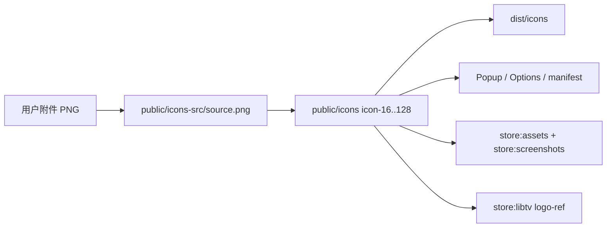

# 更新 Prompt Hub 插件 Logo

## 背景与现状

你提供的 logo：**黑底 + 白色蜂巢六边形线框**，与项目商店脚本里已有的「黑蜂巢品牌」方向一致（见 [`scripts/_store-utils.mjs`](scripts/_store-utils.mjs) 的 `STORE_BRAND`、`honeycombBg`）。

当前工程状态：

| 层级 | 状态 |
|------|------|
| 源图 | [`public/icons-src/source.png`](public/icons-src/source.png) 已存在（将用你附件覆盖） |
| 扩展图标 | [`public/icons/icon-{16,32,48,128}.png`](public/icons/) 由 `resize-icons.ps1` 生成 |
| UI 品牌位 | 已用 ``，**无需改 React 代码** |
| 程序化旧图标 | [`scripts/generate-icons.mjs`](scripts/generate-icons.mjs) 仅在**无** `source.png` 时生成紫渐变 sparkle；有源图时会跳过 |
| 商店素材 | [`scripts/make-store-assets.mjs`](scripts/make-store-assets.mjs) / [`scripts/make-store-screenshots.mjs`](scripts/make-store-screenshots.mjs) 运行时从 `icon-128.png` 内嵌 logo；LibTV 方案上传同一文件作 `logo-ref` |

附件路径（执行阶段复制到源图）：

`C:\Users\Administrator\.cursor\projects\d-code-Code-Experiment-prompt-hub\assets\c__Users_Administrator_AppData_Roaming_Cursor_User_workspaceStorage_e4cfd967e29a00a1347f1f52e42416aa_images_image-8ec792f6-4a67-47e5-9f0b-7b52f511afb1.png`



## 实施步骤

### 1. 写入源图并生成 4 档 PNG

按 [`.cursor/rules/logo-replacement.mdc`](.cursor/rules/logo-replacement.mdc)：

1. 将附件**覆盖**到 [`public/icons-src/source.png`](public/icons-src/source.png)
2. 运行：

```powershell
npm run icons:from-image
```

- [`scripts/resize-icons.ps1`](scripts/resize-icons.ps1)：中心正方形裁剪 + 缩放到 16/32/48/128
- [`scripts/optimize-pngs.mjs`](scripts/optimize-pngs.mjs)：无损压缩

**注意**：源图为黑底，16×16 工具栏图标上线条可能偏细，生成后需肉眼对比 `icon-16.png` / `icon-32.png`；若过小可考虑源图四周留少量安全边距（不改设计，仅裁剪策略已为中心裁剪）。

### 2. 清理 dist 并构建

vite/@crxjs 增量缓存可能保留旧图，必须：

```powershell
Remove-Item -Recurse -Force dist
npm run build
```

产物验收：[`dist/icons/icon-{16,32,48,128}.png`](dist/icons/) 均为新图，且目录内**仅有**这 4 张 PNG（无 `icon.svg` 等残留）。

### 3. 扩展内 UI（自动同步，仅验证）

以下位置已正确引用，换图后随 build 更新，**不需改代码**：

- [`src/manifest.config.ts`](src/manifest.config.ts) — `icons/icon-48.png`、`icon-128.png`
- [`src/popup/PopupApp.tsx`](src/popup/PopupApp.tsx) — header `icon-48.png`
- [`src/options/OptionsApp.tsx`](src/options/OptionsApp.tsx) — header `icon-128.png`（桌面 + 移动两处）
- [`src/dev/preview/context-menu-preview.html`](src/dev/preview/context-menu-preview.html) — `/icons/icon-128.png`

**视觉检查**：黑底 logo 在 popup/options 的 `ring-zinc-*` 圆角框内应仍清晰；若暗色模式下边框对比不足，可微调 `className`（例如略加强 `ring` 或改 `object-contain`），仅在实际验收发现问题时做最小样式 diff。

**不修改**：各处 `violet-500` / `#6366f1` 等 UI 主题色（规则明确为页面装饰，非品牌 logo 容器）；`PopupApp` 空状态的 `<Sparkles>` 等功能图标保持不动。

### 4. 刷新所有商店/营销引用（你要求「所有需要图标的地方」）

`store-assets/` 在 [`.gitignore`](.gitignore) 中，但本地 Chrome Web Store 上传需要最新图。

**4a. Playwright 方案（推荐先做，logo 嵌入精确）**

前置（若未装）：`npm i -D playwright` + `npx playwright install chromium`

```powershell
npm run store:assets
npm run store:screenshots
```

输出路径与 [`store-listing/CHECKLIST.md`](store-listing/CHECKLIST.md) §4.1 一致：

- `store-assets/promo/small-promo-440x280.png`
- `store-assets/promo/marquee-1400x560.png`
- `store-assets/screenshots/screenshot-*.png`

两脚本均通过 [`logoBase64(public/icons)`](scripts/_store-utils.mjs) 读取**新** `icon-128.png`，无需改 HTML 模板。

**4b. LibTV 方案（AI 对比稿 / 若你曾用 LibTV 出图）**

```powershell
libtv account info   # 未登录则 libtv login web
npm run store:libtv
```

脚本 [`scripts/generate-store-assets-libtv.mjs`](scripts/generate-store-assets-libtv.mjs) 会重新 `upload "logo-ref" -f ../../public/icons/icon-128.png`，7 张图均以新 logo 为 `--left` 参考；配置见 [`store-assets/libtv/prompts.json`](store-assets/libtv/prompts.json)。

两套方案输出路径相同，可 A/B 对比后选一套上传 CWS。

### 5. 全局排查（Grep）

执行后搜索确认无残留旧资源：

- `public/icons/` 下除 `icon-*.png` 外的 `.svg` / 孤儿 PNG
- 硬编码旧 logo 路径或重复的静态 logo 文件
- [`README.md`](README.md) 无嵌入旧 logo 截图（当前仅文字说明 `public/icons/`）

### 6. 浏览器验收

按规则清单：

- [ ] Chrome `chrome://extensions` 重新加载 unpacked（`dist/`）
- [ ] 工具栏 16/32 图标、popup 头图、options 头图视觉一致
- [ ] 若已上架：新 zip（`npm run zip`）内 `icons/icon-128.png` 即为商店 icon，无需单独重传 128 图（见 CHECKLIST）

## 范围说明

| 包含 | 不包含 |
|------|--------|
| 源图 + 4 档扩展图标 + dist 构建 | 修改 UI 主题紫色体系 |
| popup/options/manifest/dev 预览中的品牌图 | lucide 功能图标 |
| Playwright + LibTV 商店素材重生 | git commit（除非你另行要求） |

## 风险与回退

- **小尺寸可读性**：16px 白线可能发糊 → 验收失败时仅需换更高对比/略加粗的源图重跑 `icons:from-image`
- **LibTV**：依赖登录与配额，失败不影响扩展本体，Playwright 素材仍可上传
- **回退**：保留旧 `source.png` 备份或 `git checkout -- public/icons-src public/icons` 后重跑步骤 1–2
