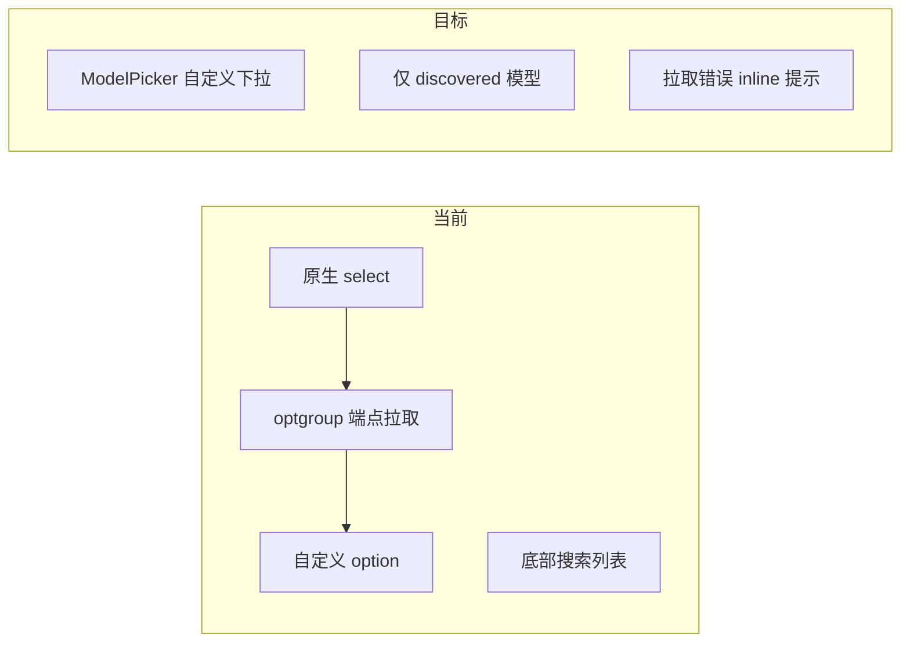

# 模型选择器 UI 精炼

## 目标（对照截图反馈）

| 项 | 现状 | 目标 |
|----|------|------|
| 操作按钮 | 文字链接样式，不明显 | 使用 [`Button`](src/components/ui/Button.tsx) 实色/描边按钮 |
| 底部列表 | `discoveredModelsPanel` 搜索 + 可点列表 | **删除**，与下拉重复 |
| 模型选择 | 原生 `<select>` + optgroup +「自定义...」 | **自定义下拉**，仅 `discoveredModels` |
| 厂商标题 | `自定义 (OpenAI 兼容) · gpt-5.5` | **保持原样**（用户确认仅去掉下拉里的「自定义...」） |



---

## 1. 新建 `ModelPicker` 组件

**文件**：新建 [`src/options/ModelPicker.tsx`](src/options/ModelPicker.tsx)（参考 [`RewriteRandomnessDropdown.tsx`](src/options/PromptLibrary/parts/RewriteRandomnessDropdown.tsx) 的 listbox 模式）

**能力**：

- 全宽触发器：`font-mono` 显示当前 `value`，右侧 Chevron，选中态 `ring-violet-500`
- 展开面板：`rounded-xl` + `shadow-lg` + 暗色 backdrop，最大高度约 `240px` 可滚动
- 列表项：每行模型 id + 选中 `Check` 高亮（复用现有紫色调，与 `ChoiceCard` 一致）
- **内置搜索**：`models.length > 6` 时面板顶部显示搜索框（吸收原 `modelFilter` 逻辑）
- 元信息：面板顶栏一行小字 `N 个模型 · {formatTimeAgo}`（替代原生 optgroup 标题「端点拉取 (10) · 刚刚拉取」）
- 无「自定义...」项；`onChange` 仅接受 `discovered` 内的 id
- `disabled` / `fetching` 时触发器显示「拉取中…」或占位

**未在列表中的当前模型**（例如手动导入的 id）：触发器仍显示该值；下方保留一行 `input`（沿用现有 `!discovered.includes(model)` 分支），**不**通过下拉选「自定义」

**无模型时**：`discovered.length === 0` 时不渲染 ModelPicker，继续用现有 `<input className="input">` + 短提示文案

从 [`src/components/ui/index.ts`](src/components/ui/index.ts) 导出（可选，或仅 options 内引用）。

---

## 2. 精简 [`SettingsView.tsx`](src/options/SettingsView.tsx)

**删除**：

- 整个 `discoveredModelsPanel` 常量及其在 `modelField` 中的引用
- 状态 `modelFilter` / `setModelFilter`、`filteredDiscovered`、`onClearDiscovered`（及 `Search`、`X` 相关 import 若不再使用）
- 原生 `<select>`、`optgroup`、`__custom__`、`自定义...` option
- provider 切换时对 `setModelFilter('')` 的清理可一并移除

**替换 `modelField` 核心**：

```tsx
// 伪代码
<div className="flex items-center justify-between gap-2">
  <span className="label mb-0">模型</span>
  <Button variant="secondary" size="xs" onClick={onFetchModels} disabled={...}>
    <RefreshCw /> 从端点拉取
  </Button>
</div>
{discovered.length > 0 ? (
  <ModelPicker models={discovered} value={activeCfg.model} ... meta={discoveredAt} />
) : (
  <input ... />
)}
{/* 当前 model 不在 discovered 时保留单行 input */}
{fetchModelsError && <inline alert>}
```

- `fetchModelsError` 改为 `modelField` 内单行 alert（不再依赖底部面板）
- `ProviderModelWarning` 位置不变

---

## 3. 强化 [`ApiQuickSetup.tsx`](src/options/ApiQuickSetup.tsx) 按钮

将紧凑状态条右侧：

- `换模型` → `<Button variant="secondary" size="xs">换模型</Button>`（保留 scroll 到 `#provider-model-field`）
- `更改配置` → `<Button variant="quiet" size="xs">更改配置</Button>`

与 SettingsView 的「从端点拉取」统一为 `Button` 组件，避免 `hover:underline` 文字链样式。

---

## 4. 验收

- [ ] 配置 API 后仅见：**模型自定义下拉** +（必要时）单行手动输入；**无**底部大列表
- [ ] 下拉里只有端点返回的模型，无「自定义...」，无原生 optgroup 样式
- [ ] 「换模型」「更改配置」「从端点拉取」视觉上为明显按钮
- [ ] 顶部状态条仍显示完整厂商 label（含「自定义 (OpenAI 兼容)」）
- [ ] `npm run build` 通过

## 主要改动文件

- 新建 [`src/options/ModelPicker.tsx`](src/options/ModelPicker.tsx)
- [`src/options/SettingsView.tsx`](src/options/SettingsView.tsx)
- [`src/options/ApiQuickSetup.tsx`](src/options/ApiQuickSetup.tsx)
- 可选 [`src/components/ui/index.ts`](src/components/ui/index.ts)
