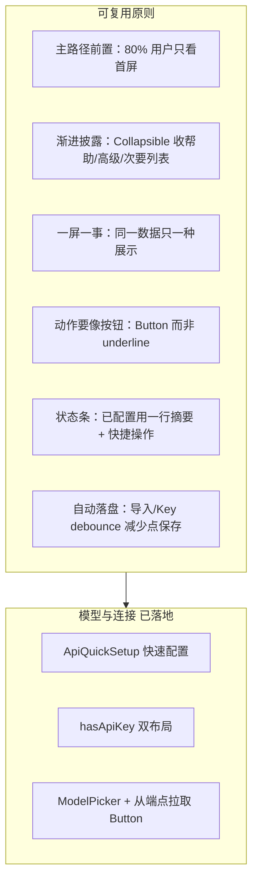

# 设置页优化经验总结 + 其余面板路线图

## 一、「模型与连接」做了什么（演进脉络）

| 阶段 | 目标 | 关键改动 |
|------|------|----------|
| 1. 流程简化 | 小白能配 API | [`ApiQuickSetup.tsx`](src/options/ApiQuickSetup.tsx)：粘贴优先、推荐芯片、帮助/高级折叠；未配置隐藏 Key/URL 表单 |
| 2. 信息架构 | 少点两次、配完能选模型 | 供应商 **单次展开** `PROVIDER_LIST`；`discoveredModels` 上移到主区 |
| 3. UI 精炼 | 少字、少重复、别用原生控件 | [`ModelPicker.tsx`](src/options/ModelPicker.tsx) 替代 `<select>` + 底部列表；[`Button`](src/components/ui/Button.tsx) 替代文字链 |

---

## 二、七条可复用经验（写进后续 PR 的检查清单）

1. **先画主路径，再删字**  
   问：新用户 30 秒内要完成什么？只保留主路径上的控件；说明进「需要帮助？」或 `title` tooltip。

2. **configured / unconfigured 两套 UI**  
   [`SettingsView.tsx`](src/options/SettingsView.tsx) 用 `hasApiKey` 分支：未配置只显示粘贴 + 选厂商；已配置显示摘要条 + Key/模型。其它面板可用类似「是否有非默认值 / 是否已选过」做摘要态。

3. **同一数据不要两处编辑**  
   模型曾同时有：原生下拉 + 底部搜索列表 → 只留 `ModelPicker`。其它面板先 grep 是否有重复说明 + 重复控件。

4. **折叠层级最多一层**  
   供应商曾「列表 + 更多」两层 → 合并为一次展开。策略里的「自定义组合」大面板可视为「选中后才展开」， acceptable；避免折叠套折叠。

5. **次要操作用 `Button`，不用 `hover:underline`**  
   统一 `variant="secondary"`（主操作）、`quiet`（次要），尺寸 `xs`/`sm`。

6. **能自动保存就别逼用户点右上角**  
   导入 `applyConfig`、Key debounce `persistAndMark`；其它面板若改的是即时生效项，评估是否也要 debounce 落盘（注意与 `dirty` 一致）。

7. **组件下沉，SettingsView 只编排**  
   `ApiQuickSetup`、`ModelPicker` 已从 [`SettingsView.tsx`](src/options/SettingsView.tsx)（~1300 行）拆出。`output` / `strategy` 建议同样拆 `OutputSettingsPanel.tsx`、`StrategySettingsPanel.tsx`。

---

## 三、其余面板现状与问题（对照 provider 标准）

### 1. 输出与交互 — [`SettingsView.tsx` L698–841](src/options/SettingsView.tsx)

**现状**：单页长卷；4 张带长 `desc` 的 `ChoiceCard`；原生策略说明段；2 个 checkbox 各带两行说明；「弹窗编辑」2 选项 + 段落；「随机风格」3 选项各带长 `desc`（[`REWRITE_RANDOMNESS_OPTIONS`](src/options/SettingsView.tsx) L97–117）。

**问题**：首屏文字密度高；与「策略版本」有交叉说明（额外提示词拼接、native 策略提示）。

**建议优化（按收益排序）**：

| 动作 | 做法 |
|------|------|
| 顶部摘要 | 一行：`当前：自然语言（中文） · 弹窗→提示词库 · 随机强度：中度` + `更改` 展开详情 |
| 输出风格 | `ChoiceCard` 改 `compact`，描述仅选中项显示；或改 4 个 SegmentedControl/芯片 |
| 长说明 | native 提示、弹窗说明、额外提示词脚注 → 各收进「需要帮助？」 |
| 随机强度 | 复用 [`RewriteRandomnessDropdown`](src/options/PromptLibrary/parts/RewriteRandomnessDropdown.tsx)（已是自定义下拉），替换 3 张大 ChoiceCard |
| checkbox | 保留标题一行，副说明收 tooltip 或折叠「高级交互」 |
| 拆文件 | 新建 `OutputSettingsPanel.tsx` |

### 2. 策略版本 — [`SettingsView.tsx` L844+](src/options/SettingsView.tsx) + `CustomStrategyPanel`

**现状**：顶部长段解释「三组件」；每张策略卡 `description` + `meta`（temperature/max_tokens）；自定义组合展开巨大表单（指令集/采样/拼接/高级覆盖/预设）；`STYLE_PROMPT_SET_LABELS` 等下拉 option 文案极长。

**问题**：小白不知选哪档；老手才被「自定义」吸引；首屏像文档。

**建议优化**：

| 动作 | 做法 |
|------|------|
| 默认视图 | 只展示 4–6 个「推荐档位」芯片 + 「更多策略」一次展开全部（仿 provider 单折叠） |
| 卡片 | 列表用 `compact`；`meta` 仅选中项显示或 hover |
| 自定义 | 保持选中后展开，但内部三块 select 的 label 缩短（option 只显示 `v0.3.5`，详情放 title） |
| 摘要条 | `当前策略：高保真 v0.3.5 · temp 0.3` + `切换` |
| 拆文件 | `StrategySettingsPanel.tsx` + 视情况拆 `CustomStrategyPanel.tsx`（已内嵌在 SettingsView 尾部） |

### 3. 数据与备份 — [`DataPersistence.tsx`](src/options/DataPersistence.tsx)（~950 行）

**现状**：独立组件、`variant="plain"` 已嵌入侧栏；含目录选择、同步状态、导入导出、多重确认模态；文案偏「防踩坑」偏长。

**问题**：与 provider 不同，这里是**安全敏感**，不能过度删减警告；但可以改善**扫读性**。

**建议优化**（保守）：

| 动作 | 做法 |
|------|------|
| 首屏分层 | **推荐**：数据目录状态一行（已连接 / 未配置）+ 主按钮 `选择目录` / `立即同步` |
| 次要 | 手动导入/导出 JSON 收进「没有 File System API？」折叠 |
| 按钮 | 全面检查是否已用 `Button`（部分已是 icon+文字） |
| 不改 | shrink-blocked、恢复三选一等业务逻辑与警告横幅保留 |
| 联动 | 恢复成功后已有 `onDataRestored`；可在摘要条显示「上次同步时间」 |

### 4. 扩展更新 — [`UpdateSection.tsx`](src/options/UpdateSection.tsx)

未在需求中重点列出；若统一风格，仅做 Button/间距对齐即可，优先级最低。

---

## 四、推荐实施顺序

**原因**：`output` 与 `strategy` 仍在 SettingsView 单文件内，改动的用户面最大；`DataPersistence` 已模块化，改动风险低但文案不能乱删。

---

## 五、单面板改造模板（复制即用）

每改一个 `panelId` 分区，按此 checklist 走一遍：

- [ ] 定义主路径 1 句话（例：选输出语言 + 可选额外提示词）
- [ ] 首屏 ≤3 个视觉区块（摘要 / 主控件 / 一个主按钮）
- [ ] 删除或折叠所有 `text-xs text-zinc-500` 段落说明（保留 1 条必要时 inline alert）
- [ ] `ChoiceCard` 非选中项去掉 `description`（`compact`）
- [ ] 无原生 `<select>` 长 optgroup（必要时自定义 Picker）
- [ ] 操作项用 `Button` secondary/quiet
- [ ] 拆到 `src/options/XxxSettingsPanel.tsx`
- [ ] `npm run build` + `__dev__/ui-preview#options` 切换该 tab 目视

---

## 六、与现有架构的衔接

- **保存**：仍由 [`OptionsApp.tsx`](src/options/OptionsApp.tsx) header `dirty` + `registerSaveHandler`；面板内自动保存需与 `persistAndMark` / `onDirtyChange` 协调（provider 已验证模式）。
- **组件库**：继续用 [`ChoiceCard`](src/components/ui/ChoiceCard.tsx)、[`Collapsible`](src/components/ui/Collapsible.tsx)、[`Button`](src/components/ui/Button.tsx)；新 Picker 可参考 [`ModelPicker`](src/options/ModelPicker.tsx)、[`RewriteRandomnessDropdown`](src/options/PromptLibrary/parts/RewriteRandomnessDropdown.tsx)。
- **不要动**：[`configImport.ts`](src/lib/configImport.ts)、[`DataPersistence`](src/options/DataPersistence.tsx) 核心备份守门逻辑、background 提取链路。

---

## 七、你若要开始下一项开发

建议新开对话指定：**「按路线图先做输出与交互面板」** 或 **「先做策略版本」**，并说明是否接受「顶部摘要条 + 默认折叠详情」交互（与 provider 的 `ApiQuickSetup` 紧凑态一致）。无需再改 plan 文件本身。
