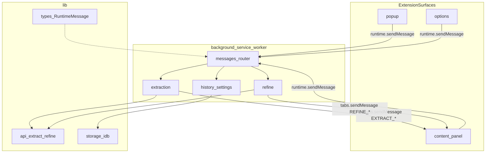

# AGENTS.md — Prompt Hub 代码导航

面向 Cursor / AI Agent 的单一入口：30 秒内定位「改功能该打开哪些文件」。细节文档用链接指向 `docs/` 与 `.cursor/`，避免双源维护。

---

## 项目是什么

**Prompt Hub** 是一款 Chrome Manifest V3 扩展：用户在网页上收集参考图/视频，通过自备视觉模型 API 反推 AI 绘画提示词。

- **Background Service Worker** 是唯一可信执行环境：调 API、读写 storage/IndexedDB、路由消息。
- **Content Script** 在宿主页 Shadow DOM 注入浮动面板（非独立扩展页）。
- **Popup / Options** 为标准 React 页面。

权威 Manifest 定义：[`src/manifest.config.ts`](src/manifest.config.ts)。

---

## 快速入口（改前先读）

| 你要改…            | 首读                                                                                                                                               | 常连带                                                                                                                                                       |
| ------------------ | -------------------------------------------------------------------------------------------------------------------------------------------------- | ------------------------------------------------------------------------------------------------------------------------------------------------------------ |
| 反推 / 流式结果    | [`src/background/extraction.ts`](src/background/extraction.ts)、[`src/lib/api/extract.ts`](src/lib/api/extract.ts)                                 | [`src/lib/strategies.ts`](src/lib/strategies.ts)、[`src/content/panel/extractStream.ts`](src/content/panel/extractStream.ts)                                 |
| AI 改写            | [`src/background/refine.ts`](src/background/refine.ts)、[`src/lib/api/refine.ts`](src/lib/api/refine.ts)                                           | [`src/lib/types.ts`](src/lib/types.ts) 中 `REFINE_*`                                                                                                         |
| 浮动面板 UI / 交互 | [`PanelApp.tsx`](src/content/panel/PanelApp.tsx)、[`components/`](src/content/panel/components/)、[`styles.ts`](src/content/panel/styles.ts)       | [`panelReducer.ts`](src/content/panel/panelReducer.ts)、[`state.ts`](src/content/panel/state.ts)、[`docs/naming-glossary.zh.md`](docs/naming-glossary.zh.md) |
| 右键菜单           | [`src/background/context-menu.ts`](src/background/context-menu.ts)                                                                                 | [`src/lib/keepalivePort.ts`](src/lib/keepalivePort.ts)、[`src/content/index.ts`](src/content/index.ts) contextmenu 监听                                      |
| 区域截图           | [`src/background/regionCapture.ts`](src/background/regionCapture.ts)、[`src/lib/regionCaptureCrop.ts`](src/lib/regionCaptureCrop.ts)               | [`src/manifest.config.ts`](src/manifest.config.ts) `commands`                                                                                                |
| 历史 / 版本        | [`src/lib/storage/historyDb.ts`](src/lib/storage/historyDb.ts)、[`src/background/history.ts`](src/background/history.ts)                           | 消息 `GET/APPEND/RESTORE/REMOVE_PROMPT_VERSION`                                                                                                              |
| 设置页             | [`src/options/settings/SettingsView.tsx`](src/options/settings/SettingsView.tsx)                                                                   | [`src/lib/storage/settings.ts`](src/lib/storage/settings.ts)                                                                                                 |
| 提示词库           | [`src/options/PromptLibrary/`](src/options/PromptLibrary/)                                                                                         | [`src/lib/storage/folders.ts`](src/lib/storage/folders.ts)                                                                                                   |
| 数据导入导出       | [`src/options/dataPersistence/`](src/options/dataPersistence/)、[`src/lib/configImport.ts`](src/lib/configImport.ts)                               | [`src/options/DataPersistence.tsx`](src/options/DataPersistence.tsx)                                                                                         |
| 供应商 / 模型      | [`src/lib/providers.ts`](src/lib/providers.ts)、[`src/lib/modelPick.ts`](src/lib/modelPick.ts)、[`src/lib/api/providers/`](src/lib/api/providers/) | [`docs/vision-model-catalog.zh.md`](docs/vision-model-catalog.zh.md)、[`docs/provider-streaming.zh.md`](docs/provider-streaming.zh.md)                       |
| 消息协议变更       | **先改** [`src/lib/types.ts`](src/lib/types.ts)                                                                                                    | [`src/background/messages.ts`](src/background/messages.ts)、[`src/content/index.ts`](src/content/index.ts)、各 `sendMessage` 调用点                          |
| 扩展更新           | [`src/background/updater.ts`](src/background/updater.ts)、[`src/lib/updater.ts`](src/lib/updater.ts)                                               | [`src/options/UpdateSection.tsx`](src/options/UpdateSection.tsx)                                                                                             |
| 供应商额度         | [`src/lib/quota/`](src/lib/quota/)                                                                                                                 | [`docs/provider-quota.zh.md`](docs/provider-quota.zh.md)                                                                                                     |

### Manifest 入口点

| 上下文         | 入口文件                                                                                           |
| -------------- | -------------------------------------------------------------------------------------------------- |
| Service Worker | [`src/background/index.ts`](src/background/index.ts) → [`messages.ts`](src/background/messages.ts) |
| Content Script | [`src/content/index.ts`](src/content/index.ts) → [`content/panel/`](src/content/panel/)            |
| Popup          | [`src/popup/main.tsx`](src/popup/main.tsx) → [`PopupApp.tsx`](src/popup/PopupApp.tsx)              |
| Options        | [`src/options/main.tsx`](src/options/main.tsx) → [`OptionsApp.tsx`](src/options/OptionsApp.tsx)    |

构建入口清单（knip）：[`knip.json`](knip.json) `entry` 字段。

---

## 目录地图

```
src/
  manifest.config.ts   # MV3 manifest（@crxjs/vite-plugin）
  background/          # Service Worker
    index.ts           # 注册 keepalive、右键菜单、消息监听、onInstalled
    messages.ts        # runtime 消息路由中枢
    extraction.ts      # 反推调度与流式回传
    refine.ts          # AI 改写调度
    context-menu.ts    # 右键「添加参考 / 直接反推」
    region-capture.ts  # 框选截图中继
    tabMessaging.ts    # tabs.sendMessage 可靠投递
    history.ts         # 历史/版本消息桥接
    updater.ts         # 扩展更新检查
    dataDirectorySync.ts
  content/             # 注入所有 URL（all_frames）
    index.ts           # onMessage、contextmenu、面板生命周期
    extensionBridge.ts # content 侧 sendMessage 封装
    bgPort.ts          # keepalive port 快路径
    regionCapture.ts   # 框选 UI
    mediaHit.ts        # 媒体元素命中探测
    videoSegmentSample.ts
    panel/             # Shadow DOM 浮动面板（React + 轻量 reducer）
      PanelApp.tsx
      panelReactRoot.tsx
      panelShell.ts
      components/
      styleSections/
      styles.ts
      panelReducer.ts / reducerHandlers/ / state.ts / extractStream.ts
  popup/               # 工具栏弹窗 React
  options/             # 选项页 React（settings | library 两 Tab）
    settings/          # 设置视图与子面板
    PromptLibrary/     # 提示词库
    dataPersistence/   # 备份/导入导出 UI 组件
  lib/                 # 跨上下文共享业务逻辑（见下节）
  components/          # 共享 React UI（Button、Field、SourceTag 等）
  hooks/               # 共享 React hooks
  dev/preview/         # 本地 UI 预览（不打包进扩展）
  styles/globals.css   # Tailwind 全局样式
```

仓库其他顶层（Agent 偶碰）：

- `docs/` — 功能域深度文档
- `scripts/` — 构建、zip、商店素材
- `store-listing/` — Chrome Web Store 文案
- `website/`、`services/api/` — 官网与后端（非扩展核心）

---

## 运行时架构



**数据流要点**：Content / Popup / Options 通过 `chrome.runtime.sendMessage` 请求 Background；Background 调 `lib/api` 与 `lib/storage`，反推/改写进度经 `tabs.sendMessage` 流式回面板。

---

## 消息协议

- **权威定义**：[`src/lib/types/messages.ts`](src/lib/types/messages.ts) → `RuntimeMessage`（[`types.ts`](src/lib/types.ts) re-export）
- **路由处理**：[`src/background/messages.ts`](src/background/messages.ts) → `registerRuntimeMessageListener()`
- **打开页面辅助**：[`src/lib/messaging/openSurfaces.ts`](src/lib/messaging/openSurfaces.ts)
- **Content 桥接**：[`src/content/extensionBridge.ts`](src/content/extensionBridge.ts)

### 高频消息（按方向）

| 方向               | 类型                                                                        | 用途                           |
| ------------------ | --------------------------------------------------------------------------- | ------------------------------ |
| Content → BG       | `EXTRACT_PROMPT`                                                            | 面板发起反推                   |
| Content → BG       | `REFINE_PROMPT`                                                             | 面板 AI 调整                   |
| Content → BG       | `CTX_MENU_PREP`                                                             | 右键前媒体 URL 探测            |
| Content → BG       | `REGION_CAPTURE_CONFIRM`                                                    | 框选矩形确认                   |
| Content → BG       | `APPEND_PROMPT_VERSION` / `RESTORE_PROMPT_VERSION` / `GET_HISTORY_ITEM`     | 版本操作（content 不直读 IDB） |
| Content → BG       | `SET_PROMPT_STRATEGY` / `SET_ONE_CLICK_REWRITE_RANDOMNESS`                  | 写回全局设置                   |
| BG → Content       | `EXTRACT_PENDING` / `EXTRACT_PROGRESS` / `EXTRACT_RESULT` / `EXTRACT_ERROR` | 反推流式 UI                    |
| BG → Content       | `REFINE_PROGRESS`                                                           | 改写进度                       |
| BG → Content       | `PANEL_APPEND_REFERENCE` / `PANEL_OPEN_VIDEO_REFERENCE`                     | 右键加参考 / 视频帧            |
| BG → Content       | `PANEL_FROM_HISTORY`                                                        | 历史召回到面板                 |
| BG → Content       | `START_REGION_CAPTURE`                                                      | 拉起框选 UI                    |
| Popup/Options → BG | `OPEN_OPTIONS` / `OPEN_IN_PANEL`                                            | 打开选项页 / 召回到面板        |
| Popup/Options → BG | `REQUEST_REGION_CAPTURE`                                                    | 发起框选                       |
| Popup/Options → BG | `CHECK_UPDATE` / `APPLY_EXTENSION_UPDATE`                                   | 扩展更新                       |
| Popup/Options → BG | `FETCH_PROVIDER_QUOTA`                                                      | 供应商额度                     |

完整 union 以 `types.ts` 为准；新增 type 时 **只改源码**，AGENTS.md 仅在高频路径变化时补一行。

---

## lib/ 子模块索引

| 模块                | 路径                                                                                                                                                    | 职责                                                                                                 |
| ------------------- | ------------------------------------------------------------------------------------------------------------------------------------------------------- | ---------------------------------------------------------------------------------------------------- |
| types               | [`lib/types/domain.ts`](src/lib/types/domain.ts)、[`lib/types/messages.ts`](src/lib/types/messages.ts)（[`types.ts`](src/lib/types.ts) 统一 re-export） | 领域类型 + `RuntimeMessage` 协议                                                                     |
| api                 | [`lib/api/`](src/lib/api/)                                                                                                                              | `extractPrompt`、`refinePrompt`、`listModels`；`providers/{openai,anthropic,gemini}.ts`              |
| storage             | [`lib/storage/`](src/lib/storage/)                                                                                                                      | `chrome.storage` + IndexedDB 历史/文件夹/版本/备份/设置；门面 [`index.ts`](src/lib/storage/index.ts) |
| strategies          | [`lib/strategies.ts`](src/lib/strategies.ts)、[`strategies-meta.ts`](src/lib/strategies-meta.ts)                                                        | 反推策略档位与元数据                                                                                 |
| providers / model   | [`providers.ts`](src/lib/providers.ts)、[`modelPick.ts`](src/lib/modelPick.ts)、[`modelVision.ts`](src/lib/modelVision.ts)                              | 供应商与识图模型选择                                                                                 |
| quota               | [`lib/quota/`](src/lib/quota/)                                                                                                                          | 各供应商额度适配器 + [`fetch.ts`](src/lib/quota/fetch.ts)                                            |
| platform            | [`lib/platform/`](src/lib/platform/)                                                                                                                    | 平台账号 auth/config/storage                                                                         |
| remoteRuntimeConfig | [`lib/remoteRuntimeConfig/`](src/lib/remoteRuntimeConfig/)                                                                                              | 远程运行时配置拉取与解析                                                                             |
| image / reference   | [`image.ts`](src/lib/image.ts)、[`referenceImages.ts`](src/lib/referenceImages.ts)、[`regionCaptureCrop.ts`](src/lib/regionCaptureCrop.ts)              | 图像处理、参考列表、截图裁剪                                                                         |
| configImport        | [`configImport.ts`](src/lib/configImport.ts)                                                                                                            | 设置导入导出                                                                                         |
| updater             | [`updater.ts`](src/lib/updater.ts)、[`applyExtensionUpdate.ts`](src/lib/applyExtensionUpdate.ts)                                                        | 扩展更新 feed                                                                                        |
| idb / fsBackup      | [`idb.ts`](src/lib/idb.ts)、[`fsBackup.ts`](src/lib/fsBackup.ts)                                                                                        | 底层 DB 与文件系统备份                                                                               |
| storage keys        | [`lib/storage/keys.ts`](src/lib/storage/keys.ts)                                                                                                        | Storage key 常量（如 `SETTINGS_KEY`）                                                                |

---

## 持久化与约束（Agent 易踩坑）

1. **Content 不能直读扩展 IndexedDB** — 历史库绑定扩展源；content 上下文读不到。版本/历史操作必须走 Background 消息（`GET_HISTORY_ITEM`、`APPEND_PROMPT_VERSION` 等）。
2. **Background 为 API 与 storage 唯一可信环境** — 不要在 content 里直接调 `lib/api` 或 `fetch` 带 Key。
3. **改消息协议的顺序** — 先改 `lib/types/messages.ts`（或经 `types.ts` re-export）→ 再改 `background/messages.ts` 处理器 → 再改各 `sendMessage` / `onMessage` 调用点（content、popup、options）。
4. **面板状态** — React（[`PanelApp.tsx`](src/content/panel/PanelApp.tsx)）+ reducer（[`panelReducer.ts`](src/content/panel/panelReducer.ts)）；命名见 [`docs/naming-glossary.zh.md`](docs/naming-glossary.zh.md)。
5. **设置同步** — 面板改策略/洗稿强度走 `SET_PROMPT_STRATEGY` 等消息写 settings；`chrome.storage.onChanged` 广播回面板。
6. **换 logo** — 必须走完整流程，见 [`.cursor/rules/logo-replacement.mdc`](.cursor/rules/logo-replacement.mdc)。

---

## 本地开发与预览

```bash
npm run dev:previews   # 推荐：5173 扩展聚合 + 4321 官网 + 8787 API
npm run dev            # 仅扩展 UI；默认打开 /__dev__/ui-preview
```

- 聚合预览页：Popup / Options / Panel / 右键菜单 mock
- 源码：[`src/dev/preview/`](src/dev/preview/)，垫片 [`chromeShim.ts`](src/dev/preview/chromeShim.ts)
- 详细说明：[`.cursor/skills/open-plugin-ui-preview/SKILL.md`](.cursor/skills/open-plugin-ui-preview/SKILL.md)

---

## 合并前检查

遵循 [`.cursor/rules/code-quality.mdc`](.cursor/rules/code-quality.mdc)：

```bash
npm run lint
npm run test
npm run build
```

涉及 background 消息路由、content 面板、storage 字段迁移时，需 smoke：右键提取、历史写入、设置页、提示词库。

结构拆分或大文件改动后，可用 [`.cursor/skills/code-quality-audit/SKILL.md`](.cursor/skills/code-quality-audit/SKILL.md) 做质量审计。

---

## 延伸阅读

### 架构 / 页面

- [`docs/naming-glossary.zh.md`](docs/naming-glossary.zh.md) — 领域术语与 panel 模块地图
- [`docs/plugin-pages-overview.zh.md`](docs/plugin-pages-overview.zh.md) — Manifest 页面、Options Tab、注入面板、dev 预览口径
- [`docs/optimization-roadmap.md`](docs/optimization-roadmap.md) — 架构优化 backlog

### 维护 / 上架

- [`docs/MAINTAINER.zh.md`](docs/MAINTAINER.zh.md) — 上架、CI、素材生成
- [`docs/deploy-platform.zh.md`](docs/deploy-platform.zh.md) — 官网 + 平台 API 上线与环境变量
- [`docs/CHROME_WEB_STORE_CI.md`](docs/CHROME_WEB_STORE_CI.md) — 商店自动发布

### 功能域

- [`docs/strategy-v035-model-payload.zh.md`](docs/strategy-v035-model-payload.zh.md) — 策略与模型 payload
- [`docs/vision-model-catalog.zh.md`](docs/vision-model-catalog.zh.md) — 识图模型目录
- [`docs/provider-streaming.zh.md`](docs/provider-streaming.zh.md) — 各供应商流式输出与降级说明
- [`docs/provider-quota.zh.md`](docs/provider-quota.zh.md) — 供应商额度
- [`docs/waterfall-video-capabilities.zh.md`](docs/waterfall-video-capabilities.zh.md) — 视频能力
- [`docs/compat-retention.md`](docs/compat-retention.md) — 兼容与数据保留

### 用户向

- [`README.md`](README.md) / [`README.en.md`](README.en.md)
- [`PRIVACY.md`](PRIVACY.md)

---

## 维护约定

- 新增 **manifest 入口** 或 **background 子模块** 时，同步更新本文「目录地图」与「快速入口」表。
- 新增 **RuntimeMessage type** 时：只改 `lib/types/messages.ts`；本文仅当该 type 成为高频路径时才补一行。
- 页面 / UI 口径以 [`docs/plugin-pages-overview.zh.md`](docs/plugin-pages-overview.zh.md) 为准，本文只链接。
