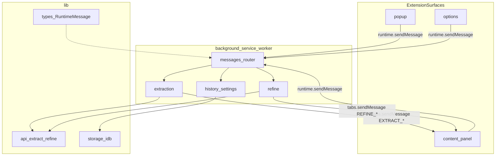

# AGENTS.md ???Prompt Hub ??????

??? Cursor / AI Agent ?????????????0 ???????????????????????????????????????????????????????????????? `docs/` ??`.cursor/`????????????????

---

## ???????????

**Prompt Hub** ???????Chrome Manifest V3 ???????????????????????????????????/???????????????????????? API ???? AI ???????????

- **Background Service Worker** ???????????????????????? API???????storage/IndexedDB?????????????
- **Content Script** ?????? Shadow DOM ??????????????????????????????
- **Popup / Options** ??????React ?????

??? Manifest ??????[`src/manifest.config.ts`](src/manifest.config.ts)???

---

## ??????????????????????

| ????????                    | ???                                                                                                                                                                                                                                                         | ?????                                                                                                                                                                                                                                                                                                                                                                                                                                                                                                                                                               |
| --------------------------- | ----------------------------------------------------------------------------------------------------------------------------------------------------------------------------------------------------------------------------------------------------------- | ------------------------------------------------------------------------------------------------------------------------------------------------------------------------------------------------------------------------------------------------------------------------------------------------------------------------------------------------------------------------------------------------------------------------------------------------------------------------------------------------------------------------------------------------------------------- |
| ???? / ???????              | [`src/background/extraction.ts`](src/background/extraction.ts)???[`src/lib/api/extract.ts`](src/lib/api/extract.ts)                                                                                                                                         | [`src/lib/strategies.ts`](src/lib/strategies.ts)???[`src/content/panel/extractStream.ts`](src/content/panel/extractStream.ts)                                                                                                                                                                                                                                                                                                                                                                                                                                       |
| AI ??????                   | [`src/background/refine.ts`](src/background/refine.ts)???[`src/lib/api/refine.ts`](src/lib/api/refine.ts)                                                                                                                                                   | [`src/lib/types.ts`](src/lib/types.ts) ??`REFINE_*`                                                                                                                                                                                                                                                                                                                                                                                                                                                                                                                 |
| ?????? UI / ???             | [`PanelApp.tsx`](src/content/panel/PanelApp.tsx)???[`components/`](src/content/panel/components/)???[`styles.ts`](src/content/panel/styles.ts)                                                                                                              | [`panelReducer.ts`](src/content/panel/panelReducer.ts)???[`state.ts`](src/content/panel/state.ts)???[`docs/naming-glossary.zh.md`](docs/naming-glossary.zh.md)                                                                                                                                                                                                                                                                                                                                                                                                      |
| ????????                    | [`src/background/context-menu.ts`](src/background/context-menu.ts)                                                                                                                                                                                          | [`src/lib/keepalivePort.ts`](src/lib/keepalivePort.ts)???[`src/content/index.ts`](src/content/index.ts) contextmenu ????                                                                                                                                                                                                                                                                                                                                                                                                                                            |
| ????????????                | [`src/background/regionCapture.ts`](src/background/regionCapture.ts)???[`src/lib/regionCaptureCrop.ts`](src/lib/regionCaptureCrop.ts)                                                                                                                       | [`src/manifest.config.ts`](src/manifest.config.ts) `commands`                                                                                                                                                                                                                                                                                                                                                                                                                                                                                                       |
| ???? / ??????               | [`src/lib/storage/historyDb.ts`](src/lib/storage/historyDb.ts)???[`src/background/history.ts`](src/background/history.ts)                                                                                                                                   | ??? `GET/APPEND/RESTORE/REMOVE_PROMPT_VERSION`                                                                                                                                                                                                                                                                                                                                                                                                                                                                                                                      |
| ????                        | [`src/options/settings/SettingsView.tsx`](src/options/settings/SettingsView.tsx)                                                                                                                                                                            | [`src/lib/storage/settings.ts`](src/lib/storage/settings.ts)                                                                                                                                                                                                                                                                                                                                                                                                                                                                                                        |
| ?????                       | [`src/options/PromptLibrary/`](src/options/PromptLibrary/)                                                                                                                                                                                                  | [`src/lib/storage/folders.ts`](src/lib/storage/folders.ts)                                                                                                                                                                                                                                                                                                                                                                                                                                                                                                          |
| ????????????                | [`src/options/dataPersistence/`](src/options/dataPersistence/)???[`src/lib/configImport.ts`](src/lib/configImport.ts)                                                                                                                                       | [`src/options/DataPersistence.tsx`](src/options/DataPersistence.tsx)                                                                                                                                                                                                                                                                                                                                                                                                                                                                                                |
| ???????/ ????               | [`src/lib/providers.ts`](src/lib/providers.ts)???[`src/lib/modelPick.ts`](src/lib/modelPick.ts)???[`src/lib/api/providers/`](src/lib/api/providers/)                                                                                                        | [`docs/vision-model-catalog.zh.md`](docs/vision-model-catalog.zh.md)???[`docs/provider-streaming.zh.md`](docs/provider-streaming.zh.md)                                                                                                                                                                                                                                                                                                                                                                                                                             |
| **UI ??? / ???????**        | [`src/components/ui/`](src/components/ui/)???[`src/styles/globals.css`](src/styles/globals.css)???[`website/components/ui/`](website/components/ui/)                                                                                                        | [`docs/ui-component-system.zh.md`](docs/ui-component-system.zh.md)???[`docs/admin-ui-conventions.zh.md`](docs/admin-ui-conventions.zh.md)                                                                                                                                                                                                                                                                                                                                                                                                                           |
| ??????????                  | **??????** [`src/lib/types.ts`](src/lib/types.ts)                                                                                                                                                                                                           | [`src/background/messages.ts`](src/background/messages.ts)???[`src/content/index.ts`](src/content/index.ts)????? `sendMessage` ????????                                                                                                                                                                                                                                                                                                                                                                                                                             |
| ???????????                 | [`src/background/updater.ts`](src/background/updater.ts)???[`src/lib/updater.ts`](src/lib/updater.ts)                                                                                                                                                       | [`src/options/UpdateSection.tsx`](src/options/UpdateSection.tsx)                                                                                                                                                                                                                                                                                                                                                                                                                                                                                                    |
| ??????????                  | [`src/lib/quota/`](src/lib/quota/)                                                                                                                                                                                                                          | [`docs/provider-quota.zh.md`](docs/provider-quota.zh.md)                                                                                                                                                                                                                                                                                                                                                                                                                                                                                                            |
| **?????????**               | [`website/app/admin/page.tsx`](website/app/admin/page.tsx)???[`website/lib/adminApi.ts`](website/lib/adminApi.ts)???[`AdminUpstreams.tsx`](website/components/admin/AdminUpstreams.tsx)???[`AdminPayments.tsx`](website/components/admin/AdminPayments.tsx) | [`services/api/src/routes/admin.ts`](services/api/src/routes/admin.ts)???[`upstream/registry.ts`](services/api/src/upstream/registry.ts)???[`upstream/syncModels.ts`](services/api/src/upstream/syncModels.ts)???[`upstream/routes.ts`](services/api/src/upstream/routes.ts)???[`payment/settings.ts`](services/api/src/payment/settings.ts)???[`docs/admin-dashboard.zh.md`](docs/admin-dashboard.zh.md)???[`docs/admin-ui-conventions.zh.md`](docs/admin-ui-conventions.zh.md)???[`docs/upstream-model-aggregation.zh.md`](docs/upstream-model-aggregation.zh.md) |
| **Zeabur ??? / ??????????** | [`docs/deploy-zeabur-runbook.zh.md`](docs/deploy-zeabur-runbook.zh.md)?????? checklist??                                                                                                                                                                    | [`docs/deploy-zeabur.zh.md`](docs/deploy-zeabur.zh.md)???????????????[`docs/deploy-platform.zh.md`](docs/deploy-platform.zh.md)??env ?????????`npm run gen:secrets`???[`services/api/Dockerfile`](services/api/Dockerfile)                                                                                                                                                                                                                                                                                                                                          |

### Manifest ???????

| ???????        | ????????                                                                                            |
| -------------- | --------------------------------------------------------------------------------------------------- |
| Service Worker | [`src/background/index.ts`](src/background/index.ts) ???[`messages.ts`](src/background/messages.ts) |
| Content Script | [`src/content/index.ts`](src/content/index.ts) ???[`content/panel/`](src/content/panel/)            |
| Popup          | [`src/popup/main.tsx`](src/popup/main.tsx) ???[`PopupApp.tsx`](src/popup/PopupApp.tsx)              |
| Options        | [`src/options/main.tsx`](src/options/main.tsx) ???[`OptionsApp.tsx`](src/options/OptionsApp.tsx)    |

??????????????knip????[`knip.json`](knip.json) `entry` ??????

---

## ???????????

```
src/
  manifest.config.ts   # MV3 manifest??@crxjs/vite-plugin??
  background/          # Service Worker
    index.ts           # ???? keepalive????????????????????????onInstalled
    messages.ts        # runtime ???????????
    extraction.ts      # ????????????????
    refine.ts          # AI ?????????
    context-menu.ts    # ????????????????/ ?????????????
    region-capture.ts  # ??????????????
    tabMessaging.ts    # tabs.sendMessage ????????
    history.ts         # ????/?????????????
    updater.ts         # ????????????????
    dataDirectorySync.ts
  content/             # ??????????URL??all_frames??
    index.ts           # onMessage???contextmenu?????????????????
    extensionBridge.ts # content ??sendMessage ???
    bgPort.ts          # keepalive port ????
    regionCapture.ts   # ?????UI
    mediaHit.ts        # ?????????????????
    videoSegmentSample.ts
    panel/             # Shadow DOM ????????React + ???? reducer??
      PanelApp.tsx
      panelReactRoot.tsx
      panelShell.ts
      components/
      styleSections/
      styles.ts
      panelReducer.ts / reducerHandlers/ / state.ts / extractStream.ts
  popup/               # ????????React
  options/             # ??????React??settings | library ??Tab??
    settings/          # ????????????
    PromptLibrary/     # ?????
    dataPersistence/   # ???/???????? UI ???
  lib/                 # ????????????????????????????????
  components/          # ???? React UI??Button???Field???SourceTag ????
  hooks/               # ???? React hooks
  dev/preview/         # ?????? UI ??????????????????????
  styles/globals.css   # Tailwind ???????
```

??????????????Agent ??????

- `docs/` ???????????????????
- `scripts/` ??????????zip???????????
- `store-listing/` ???Chrome Web Store ?????
- `website/`???`services/api/` ?????????????????????????????????? [`docs/admin-dashboard.zh.md`](docs/admin-dashboard.zh.md)

---

## ????????????



\*_?????????_??Content / Popup / Options ????? `chrome.runtime.sendMessage` ??? Background??Background ??`lib/api` ??`lib/storage`?????????????????`tabs.sendMessage` ??????????

---

## ?????

- **???????**??[`src/lib/types/messages.ts`](src/lib/types/messages.ts) ???`RuntimeMessage`??[`types.ts`](src/lib/types.ts) re-export??
- **????????**??[`src/background/messages.ts`](src/background/messages.ts) ???`registerRuntimeMessageListener()`
- **????????????**??[`src/lib/messaging/openSurfaces.ts`](src/lib/messaging/openSurfaces.ts)
- **Content ????**??[`src/content/extensionBridge.ts`](src/content/extensionBridge.ts)

### ???????????????????

| ?????               | ????                                                                        | ??????                           |
| ------------------- | --------------------------------------------------------------------------- | -------------------------------- |
| Content ???BG       | `EXTRACT_PROMPT`                                                            | ?????????                        |
| Content ???BG       | `REFINE_PROMPT`                                                             | ?? AI ?????                      |
| Content ???BG       | `CTX_MENU_PREP`                                                             | ???????????URL ?????             |
| Content ???BG       | `REGION_CAPTURE_CONFIRM`                                                    | ????????????                     |
| Content ???BG       | `APPEND_PROMPT_VERSION` / `RESTORE_PROMPT_VERSION` / `GET_HISTORY_ITEM`     | ?????????????content ??????IDB?? |
| Content ???BG       | `SET_PROMPT_STRATEGY` / `SET_ONE_CLICK_REWRITE_RANDOMNESS`                  | ?????????????                    |
| BG ???Content       | `EXTRACT_PENDING` / `EXTRACT_PROGRESS` / `EXTRACT_RESULT` / `EXTRACT_ERROR` | ?????? UI                        |
| BG ???Content       | `REFINE_PROGRESS`                                                           | ?????????                        |
| BG ???Content       | `PANEL_APPEND_REFERENCE` / `PANEL_OPEN_VIDEO_REFERENCE`                     | ????????????/ ??????             |
| BG ???Content       | `PANEL_FROM_HISTORY`                                                        | ??????????????                   |
| BG ???Content       | `START_REGION_CAPTURE`                                                      | ?????????UI                      |
| Popup/Options ???BG | `OPEN_OPTIONS` / `OPEN_IN_PANEL`                                            | ???????????/ ??????????          |
| Popup/Options ???BG | `REQUEST_REGION_CAPTURE`                                                    | ????????                         |
| Popup/Options ???BG | `CHECK_UPDATE` / `APPLY_EXTENSION_UPDATE`                                   | ???????????                      |
| Popup/Options ???BG | `FETCH_PROVIDER_QUOTA`                                                      | ??????????                       |

????? union ??`types.ts` ???????????type ???**??????**??AGENTS.md ????????????????????????????

---

## lib/ ???????

| ???                 | ???                                                                                                                                                      | ???                                                                                                |
| ------------------- | -------------------------------------------------------------------------------------------------------------------------------------------------------- | -------------------------------------------------------------------------------------------------- |
| types               | [`lib/types/domain.ts`](src/lib/types/domain.ts)???[`lib/types/messages.ts`](src/lib/types/messages.ts)??[`types.ts`](src/lib/types.ts) ???? re-export?? | ????????? + `RuntimeMessage` ??                                                                    |
| api                 | [`lib/api/`](src/lib/api/)                                                                                                                               | `extractPrompt`???`refinePrompt`???`listModels`??`providers/{openai,anthropic,gemini}.ts`          |
| storage             | [`lib/storage/`](src/lib/storage/)                                                                                                                       | `chrome.storage` + IndexedDB ????/????????????/???/?????????[`index.ts`](src/lib/storage/index.ts) |
| strategies          | [`lib/strategies.ts`](src/lib/strategies.ts)???[`strategies-meta.ts`](src/lib/strategies-meta.ts)                                                        | ????????????????????                                                                               |
| providers / model   | [`providers.ts`](src/lib/providers.ts)???[`modelPick.ts`](src/lib/modelPick.ts)???[`modelVision.ts`](src/lib/modelVision.ts)                             | ????????????????????????                                                                           |
| quota               | [`lib/quota/`](src/lib/quota/)                                                                                                                           | ????????????????????+ [`fetch.ts`](src/lib/quota/fetch.ts)                                         |
| platform            | [`lib/platform/`](src/lib/platform/)                                                                                                                     | ???? auth/config/storage                                                                           |
| remoteRuntimeConfig | [`lib/remoteRuntimeConfig/`](src/lib/remoteRuntimeConfig/)                                                                                               | ?????????????????????????                                                                          |
| image / reference   | [`image.ts`](src/lib/image.ts)???[`referenceImages.ts`](src/lib/referenceImages.ts)???[`regionCaptureCrop.ts`](src/lib/regionCaptureCrop.ts)             | ???????????????????????????????????                                                                |
| configImport        | [`configImport.ts`](src/lib/configImport.ts)                                                                                                             | ??????????                                                                                         |
| updater             | [`updater.ts`](src/lib/updater.ts)???[`applyExtensionUpdate.ts`](src/lib/applyExtensionUpdate.ts)                                                        | ??????????? feed                                                                                   |
| idb / fsBackup      | [`idb.ts`](src/lib/idb.ts)???[`fsBackup.ts`](src/lib/fsBackup.ts)                                                                                        | ???? DB ?????????????                                                                              |
| storage keys        | [`lib/storage/keys.ts`](src/lib/storage/keys.ts)                                                                                                         | Storage key ???????? `SETTINGS_KEY`??                                                              |

---

## ???????????????Agent ????????

1. **Content ????????????? IndexedDB** ?????????????????????content ???????????????????????????????????Background ?????`GET_HISTORY_ITEM`???`APPEND_PROMPT_VERSION` ???????
2. **Background ??API ??storage ????????????** ????????content ??????????? `lib/api` ???`fetch` ??Key???
3. **?????????????** ????????? `lib/types/messages.ts`???????`types.ts` re-export????? ?????? `background/messages.ts` ??????????????????`sendMessage` / `onMessage` ??????????content???popup???options?????
4. \*_????????_ ???React??[`PanelApp.tsx`](src/content/panel/PanelApp.tsx)?? reducer??[`panelReducer.ts`](src/content/panel/panelReducer.ts)??????????[`docs/naming-glossary.zh.md`](docs/naming-glossary.zh.md)???
5. **?????** ????????????????????`SET_PROMPT_STRATEGY` ???????? settings??`chrome.storage.onChanged` ????????????
6. **??logo** ???????????????????[`.cursor/rules/logo-replacement.mdc`](.cursor/rules/logo-replacement.mdc)???

---

## ????????????????

```bash
npm run dev:previews   # ??????173 ????????? + 4321 ???? + 8787 API
npm run dev            # ???????UI?????????? /__dev__/ui-preview
```

- ???????????Popup / Options / Panel / ???????? mock / ???????????????? `1`???`5`??
- ????[`src/dev/preview/`](src/dev/preview/)????????[`chromeShim.ts`](src/dev/preview/chromeShim.ts)
- ?????????[`.cursor/skills/open-plugin-ui-preview/SKILL.md`](.cursor/skills/open-plugin-ui-preview/SKILL.md)

---

## ???????????

?? [`.cursor/rules/code-quality.mdc`](.cursor/rules/code-quality.mdc)??

```bash
npm run lint
npm run test
npm run build
```

???? background ??????????content ?????storage ????????????? smoke???????????????????????????????????????

????????????????????????????????? [`.cursor/skills/code-quality-audit/SKILL.md`](.cursor/skills/code-quality-audit/SKILL.md) ???????????

---

## ??????

### ?????? / ??

- [`docs/architecture-map.generated.md`](docs/architecture-map.generated.md) ???**????????????**????????????????????????????????????????`npm run docs:map`?????`src/` ????????pre-commit ???????????????????
- [`docs/naming-glossary.zh.md`](docs/naming-glossary.zh.md) ??????????????panel ?????????
- [`docs/ui-component-system.zh.md`](docs/ui-component-system.zh.md) ???L1/L2/L3 ??????????????????????????Shadow ??????
- [`docs/plugin-pages-overview.zh.md`](docs/plugin-pages-overview.zh.md) ???Manifest ?????Options Tab????????????dev ???????
- [`docs/optimization-roadmap.md`](docs/optimization-roadmap.md) ?????????????? backlog

### ???? / ?????

- [`docs/MAINTAINER.zh.md`](docs/MAINTAINER.zh.md) ???????????CI???????????
- [`docs/deploy-zeabur-runbook.zh.md`](docs/deploy-zeabur-runbook.zh.md) ???**Zeabur ???????**??monorepo ???????????SQLite ????push ?????????????Smoke??
- [`docs/deploy-zeabur.zh.md`](docs/deploy-zeabur.zh.md) ???Zeabur ??????????Root Directory???Watch Paths???Volume?????????
- [`docs/deploy-platform.zh.md`](docs/deploy-platform.zh.md) ??????? + ?? API ??????????????
- [`docs/deploy-hosting-selection.zh.md`](docs/deploy-hosting-selection.zh.md) ??????????????????Zeabur Dev ????SQLite ????????
- [`docs/deploy-vps-checklist.zh.md`](docs/deploy-vps-checklist.zh.md) ???VPS + Vercel ???????????????????????????????????
- [`docs/admin-dashboard.zh.md`](docs/admin-dashboard.zh.md) ??????? `/admin` ???????`/v1/admin/*` API
- [`docs/admin-ui-conventions.zh.md`](docs/admin-ui-conventions.zh.md) ???????? UI ?????Button?????????????????????????????????
- [`docs/upstream-model-aggregation.zh.md`](docs/upstream-model-aggregation.zh.md) ????????????????????????????????????????????????????
- [`docs/CHROME_WEB_STORE_CI.md`](docs/CHROME_WEB_STORE_CI.md) ??????????????????

### ?????????

- [`docs/strategy-v035-model-payload.zh.md`](docs/strategy-v035-model-payload.zh.md) ??????????????payload
- [`docs/vision-model-catalog.zh.md`](docs/vision-model-catalog.zh.md) ?????????????????
- [`docs/provider-streaming.zh.md`](docs/provider-streaming.zh.md) ?????????????????????????????
- [`docs/provider-quota.zh.md`](docs/provider-quota.zh.md) ?????????????
- [`docs/waterfall-video-capabilities.zh.md`](docs/waterfall-video-capabilities.zh.md) ?????????????
- [`docs/compat-retention.md`](docs/compat-retention.md) ?????????????????

### ????????

- [`README.md`](README.md) / [`README.en.md`](README.en.md)
- [`PRIVACY.md`](PRIVACY.md)

---

## ???????

- **??????????[`docs/architecture-map.generated.md`](docs/architecture-map.generated.md) ????**??pre-commit ??????????????????????????????????????????????????????????????????????????????????????????????????
- ????? **manifest ????** ???\*_background ????_ ?????????????????????????????????????????????????????????
- ????? **RuntimeMessage type** ????????? `lib/types/messages.ts`????????????? type ?????????????????????????
- ?? / UI ?????[`docs/plugin-pages-overview.zh.md`](docs/plugin-pages-overview.zh.md) ??????????????????????
