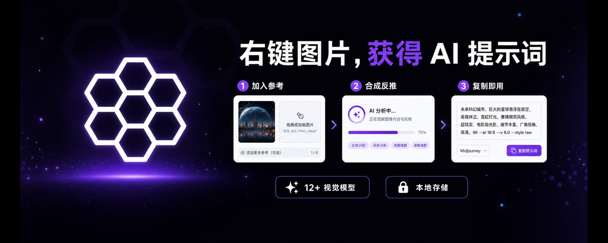
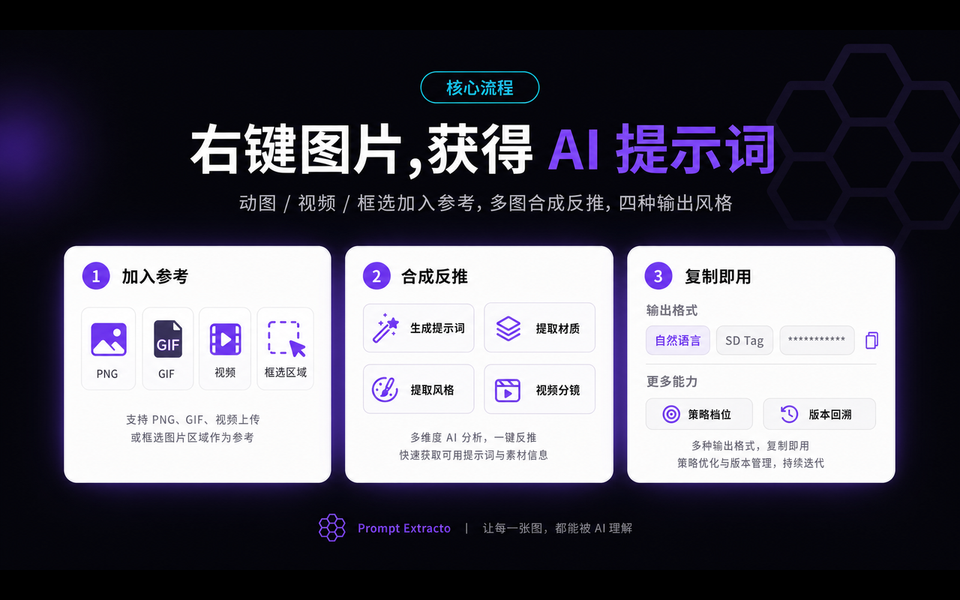
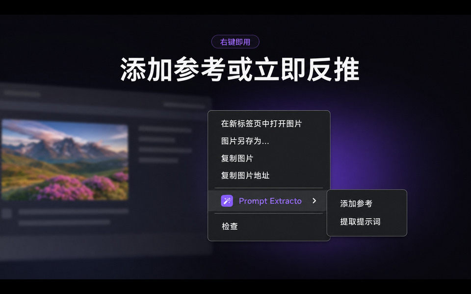
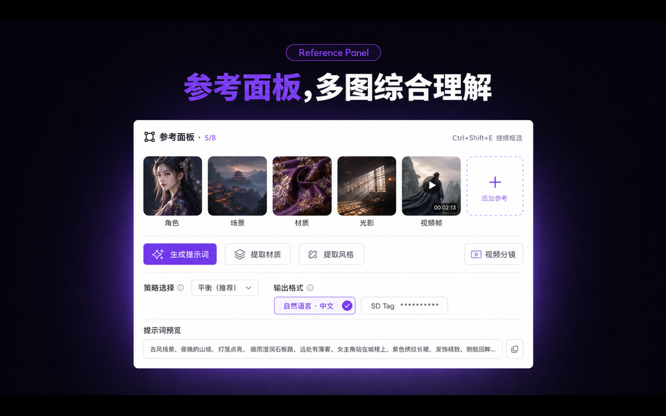
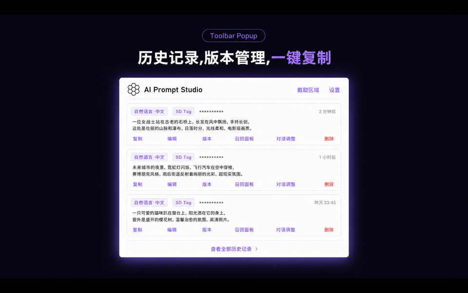
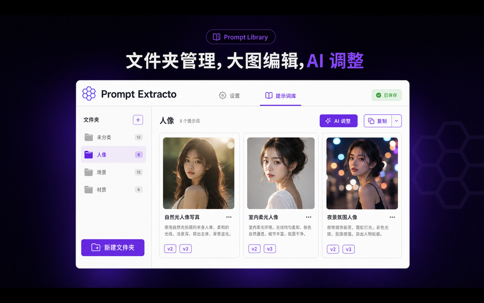
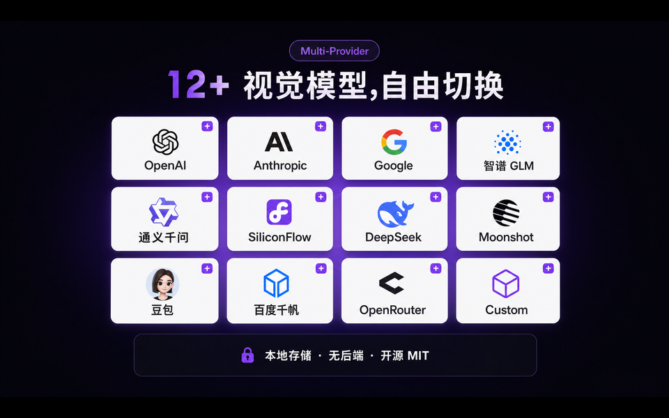
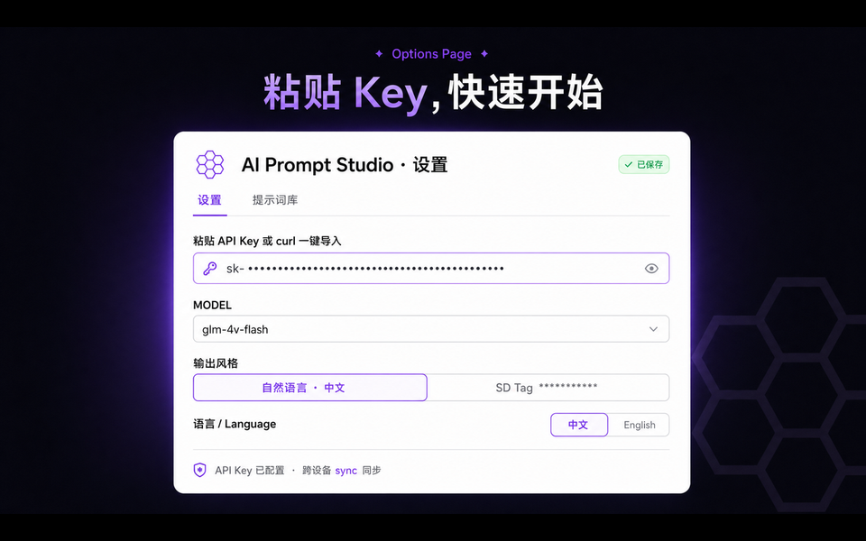

<p align="center">
  
  <h1>Prompt Hub</h1>
  <p>Browse and create: right-click to collect refs, bring your own vision API, reverse-engineer SD / MJ / Flux prompts in seconds.</p>
</p>

<p align="center">
  <a href="LICENSE"></a>
  <a href="https://github.com/xiaotao-02/prompt-hub/releases"></a>
  <a href="https://github.com/xiaotao-02/prompt-hub/actions/workflows/ci.yml"></a>
  <a href="README.md">简体中文</a> · <strong>English</strong>
</p>



The slow part of AI art is rarely the final render—it is turning a reference into a reusable prompt in the right shape for your toolchain. **Prompt Hub** works where you already browse: right-click to add images to the floating reference panel, or skip collection and extract directly. Results land in an on-page panel in seconds, ready for Stable Diffusion, Midjourney, Flux, and similar tools.

Configure your own vision-model API key in Options; the extension **does not send images or secrets to a developer backend** ([Privacy Policy](PRIVACY.md)).

---

## Quick start

1. Download the zip from [GitHub Releases](https://github.com/xiaotao-02/prompt-hub/releases), enable Developer mode at `chrome://extensions`, then **Load unpacked**
2. Click the toolbar icon → **Options**, enter your API key and pick a **vision-capable** model under Model & Connection
3. On any page **right-click an image** → **Add to reference** (or **Extract prompt directly**) → **Generate prompt** in the panel → **Copy**



---

## Features

### Right-click & reference panel

- Works on ``, `<video>`, `<canvas>`, inline SVG, CSS background images
- **Add to reference** (up to 8 images, then compose) or **Extract prompt directly**
- **Ctrl+Shift+E** (Mac: Command+Shift+E) region snip; also available from the toolbar popup

<p align="center">
  
</p>



- **Generate prompt** for full extraction; **Extract material / Extract style** for narrower dimensions
- Videos: sample frames across a time range for storyboard-style prompts

### GIF, video & region capture

- GIF / APNG / animated WebP → flattened to a static first frame
- Twitter / Reddit / Discord faux-GIF `<video>` → current frame via canvas
- When sites hijack the menu, use region snip or popup **capture region**

### Output styles & strategies

| Style           | Description           |
| --------------- | --------------------- |
| Natural CN / EN | Paragraph prompts     |
| SD Tag          | Stable Diffusion tags |
| Midjourney      | MJ-style phrasing     |

Strategy tiers: Classic, v0.2.2, v0.3.0, v0.3.5, **v0.3.6 General High-Fidelity** (default), Native, Custom combo.

### History, chat refine & prompt library



- Edit in panel and popup; **auto-saved versions**, restore any revision
- **Conversational refine**: “more cinematic / translate to English / add 8k masterpiece”
- Options → **Prompt Library**: large-image editing, folders, AI refine



### 12+ vision providers



OpenAI, Anthropic, Google Gemini, Zhipu GLM, Qwen, SiliconFlow (incl. DeepSeek-VL2), Moonshot, Doubao, Baidu Qianfan, OpenRouter, custom OpenAI-compatible endpoints—keys stored **only in your browser**.

### Options & privacy



- Keys sync via `chrome.storage.sync` across your Chrome devices
- Updates via **GitHub Releases**; current version shown in Options
- **No telemetry**

> **DeepSeek’s official API** does not accept images. For DeepSeek vision, use **SiliconFlow** in Options with model `deepseek-ai/deepseek-vl2`.

---

## Open-source BYOK build

This repository is a **Bring Your Own Key (BYOK)** open-source build:

| Included                                                   | Not included     |
| ---------------------------------------------------------- | ---------------- |
| Full extension logic, your own keys, direct provider calls | Platform proxy   |
| Local history & prompt library                             | Website login    |
| GitHub Releases distribution & in-extension update checks  | Top-up / billing |

Maintainers export this public repo from a private monorepo. **Do not change extension logic here directly**—edit the private repo and re-export. See [Maintainer guide (ZH)](docs/MAINTAINER.zh.md).

---

## Install & develop

Requires **Node 18+**.

```bash
npm install
npm run dev          # HMR; UI preview http://localhost:5173/__dev__/ui-preview
npm run build        # → dist/
npm run zip          # extension zip
```

**Load in Chrome (recommended)**

```bash
npm run install:chrome    # or npm run install:edge
```

Manual: `npm run build` → `chrome://extensions` → Developer mode → Load unpacked `dist/`.

<details>
<summary>install:chrome flags</summary>

| Flag                    | Description                               |
| ----------------------- | ----------------------------------------- |
| `--build`               | Force rebuild before launch               |
| `--browser=edge`        | Use Edge                                  |
| `--use-default-profile` | System Chrome profile (quit Chrome first) |

Default uses isolated profile `.chrome-dev-profile/` to avoid conflicting with a running Chrome instance.

</details>

**Stack**: Manifest V3 · Vite 6 · React 18 · TypeScript · Tailwind CSS v4 · Shadow DOM injection

---

## FAQ

**Q: What’s in the context menu?**  
A: **Add to reference** (collect first) and **Extract prompt directly**. Use “Add to reference” when composing multiple images.

**Q: “Failed to download image” on some sites?**  
A: Hotlink / Referer protection. Open the image in a new tab and try again.

**Q: Twitter / X GIFs don’t work?**  
A: They are `<video>` elements—right-click **on the video**. Use **Ctrl+Shift+E** if the site hijacks the menu.

**Q: Can’t capture video frames?**  
A: Cross-origin videos without `crossorigin="anonymous"` taint the canvas. Pause on the desired frame, or use region snip.

**Q: “Enhanced Safe Browsing doesn’t trust this extension”?**  
A: Common for newer developers when [Enhanced protection](https://support.google.com/chrome/answer/9890866) is on—it [does not mean the extension is malicious](https://support.google.com/chrome_webstore/answer/2664769). You can still **Continue to install**.

---

If Prompt Hub saves you time writing prompts, a GitHub Star means a lot for this independently maintained open-source extension.

---

## More docs

- [Privacy Policy](PRIVACY.md)
- [Extension UI overview (ZH)](docs/plugin-pages-overview.zh.md)
- [Maintainer guide (ZH)](docs/MAINTAINER.zh.md)

---

## License

This repository is licensed under the [MIT License](LICENSE). End users should install from [GitHub Releases](https://github.com/xiaotao-02/prompt-hub/releases).
