<!-- AUTO-GENERATED by npm run docs:map — 请勿手改 -->
# 架构知识图谱（自动生成）

> 生成时间：2026-06-07T02:04:18.722Z  
> 范围：`src/`（排除 `*.test.*`、`dev/preview`）  
> 更新方式：`npm run docs:map`，或在提交含 `src/` 变更时由 pre-commit 自动刷新。

---

## 目录树

```text
src/
├── background/
│   ├── handlers/
│   │   ├── capture.ts
│   │   ├── extraction.ts
│   │   ├── history.ts
│   │   ├── settings.ts
│   │   ├── surfaces.ts
│   │   ├── types.ts
│   │   └── update.ts
│   ├── context-menu.ts
│   ├── dataDirectorySync.ts
│   ├── extraction.ts
│   ├── history.ts
│   ├── index.ts
│   ├── messages.ts
│   ├── refine.ts
│   ├── refineProgressPortHub.ts
│   ├── regionCapture.ts
│   ├── tabMessaging.ts
│   └── updater.ts
├── components/
│   ├── ui/
│   │   ├── AnchoredMenu.tsx
│   │   ├── Button.tsx
│   │   ├── ChoiceCard.tsx
│   │   ├── Collapsible.tsx
│   │   ├── ConfirmDialog.tsx
│   │   ├── CopyFeedbackLabel.tsx
│   │   ├── DismissibleBanner.tsx
│   │   ├── Field.tsx
│   │   ├── IconButton.tsx
│   │   ├── PasswordInput.tsx
│   │   ├── SegmentedControl.tsx
│   │   ├── StatusBanner.tsx
│   │   ├── Surface.tsx
│   │   ├── cx.ts
│   │   └── index.ts
│   ├── AsyncStateBlock.tsx
│   ├── EmptyGuide.tsx
│   ├── ProviderQuotaBadge.tsx
│   └── SourceTag.tsx
├── content/
│   ├── panel/
│   │   ├── actions/
│   │   │   ├── compose.ts
│   │   │   ├── copyAndRetry.ts
│   │   │   ├── index.ts
│   │   │   ├── navigation.ts
│   │   │   ├── references.ts
│   │   │   ├── refine.ts
│   │   │   ├── types.ts
│   │   │   └── versions.ts
│   │   ├── components/
│   │   │   ├── ActionsBar.tsx
│   │   │   ├── ComposePanel.tsx
│   │   │   ├── ComposeVideoPicker.tsx
│   │   │   ├── ComposeVideoStudio.tsx
│   │   │   ├── ErrorPanel.tsx
│   │   │   ├── IconHtml.tsx
│   │   │   ├── LoadingPanel.tsx
│   │   │   ├── MetaRow.tsx
│   │   │   ├── ModelDropdown.tsx
│   │   │   ├── OneClickRefineRandomnessDropdown.tsx
│   │   │   ├── OutputStyleDropdown.tsx
│   │   │   ├── PanelHeader.tsx
│   │   │   ├── PanelSelectDropdown.tsx
│   │   │   ├── PanelSuccessBody.tsx
│   │   │   ├── PromptEditor.tsx
│   │   │   ├── ReferenceStrip.tsx
│   │   │   ├── RefineBlock.tsx
│   │   │   ├── StrategyDropdown.tsx
│   │   │   ├── SuccessPanel.tsx
│   │   │   ├── VersionList.tsx
│   │   │   ├── VersionsSidebar.tsx
│   │   │   ├── VideoShotOutline.tsx
│   │   │   └── index.ts
│   │   ├── hooks/
│   │   │   ├── usePanelEffects.tsx
│   │   │   └── useVersionListFlip.ts
│   │   ├── reducerHandlers/
│   │   │   ├── extract.ts
│   │   │   ├── historySync.ts
│   │   │   ├── panelEvents.ts
│   │   │   ├── references.ts
│   │   │   ├── refine.ts
│   │   │   ├── ui.ts
│   │   │   └── versions.ts
│   │   ├── styleSections/
│   │   │   ├── buttons.ts
│   │   │   ├── compose.ts
│   │   │   ├── dropdown.ts
│   │   │   ├── editor.ts
│   │   │   ├── header.ts
│   │   │   ├── loading.ts
│   │   │   ├── meta.ts
│   │   │   ├── references.ts
│   │   │   ├── refine.ts
│   │   │   ├── shell.ts
│   │   │   ├── versions.ts
│   │   │   └── videoShots.ts
│   │   ├── PanelApp.tsx
│   │   ├── appendReferencePlan.ts
│   │   ├── copyFeedback.ts
│   │   ├── dirtyChrome.ts
│   │   ├── dispatchPanel.ts
│   │   ├── editorText.ts
│   │   ├── extractStream.ts
│   │   ├── focusPolicy.ts
│   │   ├── geometry.ts
│   │   ├── icons.ts
│   │   ├── index.ts
│   │   ├── libraryPanelRevGuard.ts
│   │   ├── loading.ts
│   │   ├── modelDisplayName.ts
│   │   ├── outputStyleDisplay.ts
│   │   ├── panelActionBridge.ts
│   │   ├── panelDragResize.ts
│   │   ├── panelOutsideClose.ts
│   │   ├── panelReactRoot.tsx
│   │   ├── panelReducer.ts
│   │   ├── panelRenderBridge.ts
│   │   ├── panelShadowHost.ts
│   │   ├── panelShell.ts
│   │   ├── pendingReferenceQueue.ts
│   │   ├── quotaBadge.ts
│   │   ├── refineHelpers.ts
│   │   ├── refineSession.ts
│   │   ├── state.ts
│   │   ├── strategyDisplay.ts
│   │   ├── styles.ts
│   │   ├── tokens.ts
│   │   ├── versionListUi.ts
│   │   ├── versionsSync.ts
│   │   └── videoShots.ts
│   ├── bgPort.ts
│   ├── extensionBridge.ts
│   ├── index.ts
│   ├── mediaHit.ts
│   ├── regionCapture.ts
│   ├── sameOriginIframes.ts
│   └── videoSegmentSample.ts
├── hooks/
│   ├── useActionTip.ts
│   ├── useAnchoredDropdown.ts
│   ├── useAnchoredMenuDismiss.ts
│   ├── useCopyFeedback.ts
│   ├── usePresence.ts
│   └── useVersionsListDensity.ts
├── lib/
│   ├── api/
│   │   ├── providers/
│   │   │   ├── anthropic.ts
│   │   │   ├── gemini.ts
│   │   │   └── openai.ts
│   │   ├── extract.ts
│   │   ├── http.ts
│   │   ├── index.ts
│   │   ├── modelSort.ts
│   │   ├── models.ts
│   │   ├── providerValidation.ts
│   │   ├── refine.ts
│   │   ├── resolveProviderApiKey.ts
│   │   ├── types.ts
│   │   └── url.ts
│   ├── configImport/
│   │   ├── importModes/
│   │   │   ├── channelConn.ts
│   │   │   ├── multiProvider.ts
│   │   │   └── singleProvider.ts
│   │   ├── bareKey.ts
│   │   ├── curlParse.ts
│   │   ├── index.ts
│   │   ├── jsonHelpers.ts
│   │   ├── maps.ts
│   │   ├── merge.ts
│   │   ├── providerResolve.ts
│   │   └── types.ts
│   ├── format/
│   │   └── time.ts
│   ├── messaging/
│   │   ├── openOptionsDeepLink.ts
│   │   └── openSurfaces.ts
│   ├── quota/
│   │   ├── adapters/
│   │   │   ├── custom.ts
│   │   │   ├── deepseek.ts
│   │   │   ├── helpers.ts
│   │   │   ├── moonshot.ts
│   │   │   ├── newapiToken.ts
│   │   │   ├── openai.ts
│   │   │   ├── openrouter.ts
│   │   │   └── siliconflow.ts
│   │   ├── cache.ts
│   │   ├── fetch.ts
│   │   ├── format.ts
│   │   ├── messaging.ts
│   │   ├── registry.ts
│   │   └── types.ts
│   ├── remoteRuntimeConfig/
│   │   ├── constants.ts
│   │   ├── index.ts
│   │   ├── parse.ts
│   │   ├── policy.ts
│   │   ├── service.ts
│   │   └── types.ts
│   ├── storage/
│   │   ├── backup.ts
│   │   ├── backupNotify.ts
│   │   ├── folders.ts
│   │   ├── history.ts
│   │   ├── historyDb.ts
│   │   ├── index.ts
│   │   ├── keys.ts
│   │   ├── settings.ts
│   │   ├── updates.ts
│   │   ├── userStrategyPresets.ts
│   │   ├── versionState.ts
│   │   └── versions.ts
│   ├── types/
│   │   ├── domain.ts
│   │   └── messages.ts
│   ├── applyExtensionUpdate.ts
│   ├── configImport.ts
│   ├── fsBackup.ts
│   ├── idb.ts
│   ├── image.ts
│   ├── keepalivePort.ts
│   ├── modelPick.ts
│   ├── modelVision.ts
│   ├── motion.ts
│   ├── oneClickRefine.ts
│   ├── panelSettingsReflow.ts
│   ├── providerIdFromModel.ts
│   ├── providerRoles.ts
│   ├── providerVisionCatalog.ts
│   ├── providerVisionFamilies.ts
│   ├── providers.ts
│   ├── referenceImages.ts
│   ├── refineProgressPort.ts
│   ├── refineProgressUi.ts
│   ├── refineSuggestions.ts
│   ├── regionCaptureCrop.ts
│   ├── serviceMode.ts
│   ├── strategies-meta.ts
│   ├── strategies.ts
│   ├── strategyOverrides.ts
│   ├── strategySelectDisplay.ts
│   ├── streamVersionSentinels.ts
│   ├── surfaceErrorLogger.ts
│   ├── types.ts
│   ├── uiCopy.ts
│   ├── uiFeedback.ts
│   ├── uiFontStack.ts
│   ├── uiTokens.ts
│   ├── updater.ts
│   ├── version.ts
│   ├── versionChipLabels.ts
│   ├── versionLabel.ts
│   ├── versionPreview.ts
│   ├── versionsListDensity.ts
│   └── versionsSidebarWidth.ts
├── options/
│   ├── PromptLibrary/
│   │   ├── hooks/
│   │   │   ├── libraryScanInput.ts
│   │   │   ├── useLibraryData.ts
│   │   │   ├── useLibraryFilters.ts
│   │   │   ├── useLibraryFloatingPanel.ts
│   │   │   ├── useLibraryFolders.ts
│   │   │   ├── useLibrarySelection.ts
│   │   │   └── usePromptLibrary.ts
│   │   ├── parts/
│   │   │   ├── BulkActionBar.tsx
│   │   │   ├── EmptyState.tsx
│   │   │   ├── FilterSelect.tsx
│   │   │   ├── MoveToMenu.tsx
│   │   │   ├── NoMatchState.tsx
│   │   │   ├── OneClickRefineRandomnessDropdown.tsx
│   │   │   └── ViewToggle.tsx
│   │   ├── FolderTree.tsx
│   │   ├── IconBtn.tsx
│   │   ├── ItemGridCard.tsx
│   │   ├── ItemRow.tsx
│   │   ├── LibraryFloatingPanel.tsx
│   │   ├── PromptLibraryView.tsx
│   │   ├── SelectCheckbox.tsx
│   │   ├── Thumb.tsx
│   │   ├── index.tsx
│   │   ├── libraryPanelReactRoot.tsx
│   │   ├── libraryPanelState.ts
│   │   └── types.ts
│   ├── dataPersistence/
│   │   ├── DataPersistenceParts.tsx
│   │   ├── DataPersistenceView.tsx
│   │   ├── types.ts
│   │   ├── useDataPersistence.ts
│   │   └── utils.ts
│   ├── settings/
│   │   ├── hooks/
│   │   │   ├── useProviderConnection.ts
│   │   │   └── useSettingsPersistence.ts
│   │   ├── parts/
│   │   │   ├── ConnectionFieldColumn.tsx
│   │   │   ├── HelpDisclosure.tsx
│   │   │   ├── SettingRow.tsx
│   │   │   ├── SettingsAutosaveIndicator.tsx
│   │   │   ├── SettingsLoadingSkeleton.tsx
│   │   │   ├── SettingsNav.tsx
│   │   │   └── SettingsSection.tsx
│   │   ├── tabs/
│   │   │   ├── InteractionSettingsPanel.tsx
│   │   │   └── ProviderSettingsPanel.tsx
│   │   ├── SettingsView.tsx
│   │   └── types.ts
│   ├── ApiQuickSetup.tsx
│   ├── DataPersistence.tsx
│   ├── ModelPicker.tsx
│   ├── ModelSelectorField.tsx
│   ├── OptionsApp.tsx
│   ├── OutputSettingsPanel.tsx
│   ├── ProviderModelWarning.tsx
│   ├── ProviderSelect.tsx
│   ├── ProviderVisionSummary.tsx
│   ├── StrategySelect.tsx
│   ├── StrategySettingsPanel.tsx
│   ├── UpdateSection.tsx
│   ├── customPromptEditor.ts
│   ├── main.tsx
│   └── refineProgressPortClient.ts
├── popup/
│   ├── servicePanes/
│   │   ├── CustomApiPane.tsx
│   │   ├── PopupServicePane.tsx
│   │   ├── ServiceBody.tsx
│   │   ├── usePopupService.ts
│   │   └── utils.ts
│   ├── PopupApp.tsx
│   ├── PopupServiceCard.tsx
│   ├── PopupServiceMenu.tsx
│   ├── PopupVersionsInline.tsx
│   ├── main.tsx
│   ├── popupShell.ts
│   └── usePopupVersionsDetail.ts
├── test/
│   └── setup.ts
└── manifest.config.ts
```

---

## 目录级依赖图

折叠粒度：`src/<层>/<模块>`（例如 `src/lib/api`、`src/content/panel`）。

```mermaid
flowchart LR

subgraph 0["src"]
subgraph 1["background"]
2["context-menu.ts"]
3["dataDirectorySync.ts"]
4["extraction.ts"]
5["handlers"]
6["history.ts"]
7["index.ts"]
8["messages.ts"]
9["refine.ts"]
A["refineProgressPortHub.ts"]
B["regionCapture.ts"]
C["tabMessaging.ts"]
D["updater.ts"]
end
subgraph E["components"]
F["AsyncStateBlock.tsx"]
G["EmptyGuide.tsx"]
H["ProviderQuotaBadge.tsx"]
I["SourceTag.tsx"]
J["ui"]
end
subgraph K["content"]
L["bgPort.ts"]
M["extensionBridge.ts"]
N["index.ts"]
O["mediaHit.ts"]
P["panel"]
Q["regionCapture.ts"]
R["sameOriginIframes.ts"]
S["videoSegmentSample.ts"]
end
subgraph T["hooks"]
U["useActionTip.ts"]
V["useAnchoredDropdown.ts"]
W["useAnchoredMenuDismiss.ts"]
X["useCopyFeedback.ts"]
Y["usePresence.ts"]
Z["useVersionsListDensity.ts"]
end
subgraph 10["lib"]
11["api"]
12["applyExtensionUpdate.ts"]
13["configImport"]
14["configImport.ts"]
15["format"]
16["fsBackup.ts"]
17["idb.ts"]
18["image.ts"]
19["keepalivePort.ts"]
1A["messaging"]
1B["modelPick.ts"]
1C["modelVision.ts"]
1D["motion.ts"]
1E["oneClickRefine.ts"]
1F["panelSettingsReflow.ts"]
1G["providerIdFromModel.ts"]
1H["providerRoles.ts"]
1I["providerVisionCatalog.ts"]
1J["providerVisionFamilies.ts"]
1K["providers.ts"]
1L["quota"]
1M["referenceImages.ts"]
1N["refineProgressPort.ts"]
1O["refineProgressUi.ts"]
1P["refineSuggestions.ts"]
1Q["regionCaptureCrop.ts"]
1R["remoteRuntimeConfig"]
1S["serviceMode.ts"]
1T["storage"]
1U["strategies-meta.ts"]
1V["strategies.ts"]
1W["strategyOverrides.ts"]
1X["strategySelectDisplay.ts"]
1Y["streamVersionSentinels.ts"]
1Z["surfaceErrorLogger.ts"]
20["types"]
21["types.ts"]
22["uiCopy.ts"]
23["uiFeedback.ts"]
24["uiFontStack.ts"]
25["uiTokens.ts"]
26["updater.ts"]
27["version.ts"]
28["versionChipLabels.ts"]
29["versionLabel.ts"]
2A["versionPreview.ts"]
2B["versionsListDensity.ts"]
2C["versionsSidebarWidth.ts"]
end
2D["manifest.config.ts"]
subgraph 2E["options"]
2F["ApiQuickSetup.tsx"]
2G["DataPersistence.tsx"]
2H["ModelPicker.tsx"]
2I["ModelSelectorField.tsx"]
2J["OptionsApp.tsx"]
2K["OutputSettingsPanel.tsx"]
2L["PromptLibrary"]
2M["ProviderModelWarning.tsx"]
2N["ProviderSelect.tsx"]
2O["ProviderVisionSummary.tsx"]
2P["StrategySelect.tsx"]
2Q["StrategySettingsPanel.tsx"]
2R["UpdateSection.tsx"]
2S["customPromptEditor.ts"]
2T["dataPersistence"]
2U["main.tsx"]
2V["refineProgressPortClient.ts"]
2W["settings"]
end
subgraph 2X["popup"]
2Y["PopupApp.tsx"]
2Z["PopupServiceCard.tsx"]
30["PopupServiceMenu.tsx"]
31["PopupVersionsInline.tsx"]
32["main.tsx"]
33["popupShell.ts"]
34["servicePanes"]
35["usePopupVersionsDetail.ts"]
end
subgraph 36["test"]
37["setup.ts"]
end
end
2-->4
2-->C
4-->6
4-->C
7-->2
7-->3
7-->4
7-->8
7-->A
7-->B
8-->5
9-->A
9-->C
B-->C
N-->P
11-->18
11-->1H
11-->1M
11-->1V
11-->1W
11-->21
11-->1C
12-->21
13-->1G
13-->21
13-->1K
14-->13
16-->17
16-->1T
1B-->11
1B-->1C
1B-->1H
1B-->1K
1B-->1J
1B-->21
1C-->1K
1C-->1I
1C-->1J
1C-->21
1D-->25
1F-->1U
1F-->1Y
1F-->21
1G-->1K
1G-->21
1H-->11
1H-->21
1I-->21
1J-->21
1K-->21
1L-->21
1L-->1T
1L-->1K
1R-->1T
1R-->27
1T-->1U
1T-->1W
1T-->21
1T-->1C
1T-->1E
1T-->1K
1T-->1V
1T-->26
1U-->21
1V-->1U
1V-->21
1W-->1T
1W-->1V
1W-->21
1X-->1T
1X-->1U
1X-->21
20-->1U
20-->1L
21-->20
26-->21
26-->27
28-->1K
28-->1U
28-->21
2G-->2T
2I-->2H
2J-->2L
2J-->2W
2K-->2W
2K-->2Q
2Q-->2S
2Q-->2W
2Q-->2P
2R-->2W
2T-->2W
2U-->2J
2W-->2G
2W-->2K
2W-->2R
2W-->2F
2W-->2H
2W-->2L
2W-->2I
2W-->2M
2W-->2N
2W-->2O
2Y-->2Z
2Y-->30
2Y-->33
2Y-->31
2Y-->34
2Y-->35
2Z-->33
2Z-->34
30-->34
31-->33
32-->2Y
32-->33
```



---

## 模块导出清单

### `src/`

- `manifest.config.ts` — default

### `src/background/`

- `context-menu.ts` — applyCtxMenuPrep, clearTabContextMenuState, ensureContextMenus, registerContextMenuClickListener, registerKeepaliveConnectListener
- `dataDirectorySync.ts` — createDataDirectoryAutoSyncController, DATA_DIRECTORY_SYNC_DEBOUNCE_MS, DataDirectoryAutoSyncController, installDataDirectoryAutoSync, shouldAutoSyncStorageChange
- `extraction.ts` — clearTabExtractionGeneration, parsePayloadVideoSegment, runExtraction
- `history.ts` — persistHistory
- `index.ts` — _(无命名导出)_
- `messages.ts` — registerRuntimeMessageListener
- `refine.ts` — runRefine
- `refineProgressPortHub.ts` — installRefineProgressPortHub, postRefineProgressToExtensionPages
- `regionCapture.ts` — handleRegionCaptureConfirm, relayRegionCaptureToFocusedWebTab
- `tabMessaging.ts` — findTabByUrl, pickPanelTargetTab, pingTab, postToTab, sendTabMessageOk, sendToTabReliably, waitForTabComplete
- `updater.ts` — runUpdateCheck

### `src/background/handlers/`

- `capture.ts` — handleCaptureMessage
- `extraction.ts` — handleExtractionMessage
- `history.ts` — handleHistoryMessage
- `settings.ts` — ActiveModelOptionsResponse, handleSettingsMessage
- `surfaces.ts` — handleSurfacesMessage
- `types.ts` — dispatchMessageHandlers, MessageHandler
- `update.ts` — handleUpdateMessage

### `src/components/`

- `AsyncStateBlock.tsx` — AsyncStateBlock, AsyncStateBlockProps
- `EmptyGuide.tsx` — EmptyGuide, EmptyGuideProps, EmptyGuideStep
- `ProviderQuotaBadge.tsx` — default, ProviderQuotaBadge
- `SourceTag.tsx` — SourceTag

### `src/components/ui/`

- `AnchoredMenu.tsx` — AnchoredMenuPanel, AnchoredMenuPanelProps, anchoredMenuPanelStyle
- `Button.tsx` — Button, ButtonProps
- `ChoiceCard.tsx` — ChoiceCard, ChoiceCardProps
- `Collapsible.tsx` — Collapsible, CollapsibleProps
- `ConfirmDialog.tsx` — ConfirmDialog, ConfirmDialogAction, ConfirmDialogProps
- `CopyFeedbackLabel.tsx` — CopyFeedbackLabel
- `DismissibleBanner.tsx` — DismissibleBanner, DismissibleBannerProps
- `Field.tsx` — Field, FieldProps
- `IconButton.tsx` — IconButton, IconButtonProps
- `PasswordInput.tsx` — PasswordInput, PasswordInputProps
- `SegmentedControl.tsx` — SegmentedControl, SegmentedControlOption
- `StatusBanner.tsx` — StatusBanner, StatusBannerProps
- `Surface.tsx` — Surface, SurfaceProps
- `cx.ts` — cx
- `index.ts` — AnchoredMenuPanel, AnchoredMenuPanelProps, anchoredMenuPanelStyle, Button, ButtonProps, ChoiceCard, ChoiceCardProps, Collapsible, CollapsibleProps, ConfirmDialog, ConfirmDialogAction, ConfirmDialogProps, CopyFeedbackLabel, cx, DismissibleBanner, DismissibleBannerProps, Field, FieldProps, IconButton, IconButtonProps, PasswordInput, PasswordInputProps, SegmentedControl, SegmentedControlOption, StatusBanner, StatusBannerProps, Surface, SurfaceProps

### `src/content/`

- `bgPort.ts` — postCtxMenuPrepViaKeepalivePort
- `extensionBridge.ts` — ActiveModelOptionsResult, appendPromptVersionFromExtension, getActiveModelOptionsFromExtension, getHistoryItemFromExtension, HistoryMutationResponse, isExtensionContextValid, removePromptVersionFromExtension, restorePromptVersionFromExtension, safeSendMessage
- `index.ts` — safeSendMessage
- `mediaHit.ts` — computeCtxMenuPrep, CtxMenuPrepResult, parseFirstCssImageUrl
- `regionCapture.ts` — abortRegionCaptureIfActive, startRegionCaptureFromExtension
- `sameOriginIframes.ts` — forEachAccessibleSameOriginDocument, MAX_SAME_ORIGIN_IFRAME_DEPTH, MAX_SAME_ORIGIN_IFRAME_TOTAL
- `videoSegmentSample.ts` — captureVideoFrameToDataUrl, collectVideoElementsFromRoots, composeVideoPickerHtml, ComposeVideoPreviewSource, defaultVideoSegmentRange, findViewportVideoIndex, formatVideoPickerTriggerLabel, formatVideoSegmentInputSec, generateVideoFilmstrip, getVideoPickerTriggerLabel, inferVideoDisplayTitle, listViewportVideoMetas, listViewportVideos, resolveComposeVideoPreviewSource, resolveViewportVideoAtIndex, sampleVideoSegmentJPEGs, SampleVideoSegmentResult, selectVideoFrameCandidates, uniformSampleTimes, VideoFrameCandidateForSelection, VideoFrameCaptureOptions, ViewportVideoMeta

### `src/content/panel/`

- `PanelApp.tsx` — PanelApp, PanelAppProps
- `appendReferencePlan.ts` — buildComposeAfterAppendReference, shouldEnqueueAppendReference
- `copyFeedback.ts` — fallbackCopy, flashCopied
- `dirtyChrome.ts` — cancelPendingDirtyChromeDeferred, syncEditorCharCount, updateDirtyChrome, updateDirtyChromeImmediate
- `dispatchPanel.ts` — commitPanelEvent, dispatchPanelEvent
- `editorText.ts` — loadingEditorDisplayedText, successEditorDisplayedText
- `extractStream.ts` — applyExtractStreamError, applyExtractStreamProgress, applyExtractStreamResult, renderPanelForExtractPending
- `focusPolicy.ts` — applyStoredPanelAutofocus, shouldPanelContentAutofocus
- `geometry.ts` — applyGeometryToPanel, applyStableSurfaceMinHeight, capturePanelHeightBeforeRender, clampGeometry, collapsePanelForSidebar, COMPOSE_BODY_PAD, COMPOSE_PANEL_MAX_WIDTH, COMPOSE_PANEL_MIN_WIDTH, COMPOSE_REF_GAP, COMPOSE_REF_THUMB, COMPOSE_VIDEO_PANEL_MAX_WIDTH, composeCenteredGeometry, ComposePanelWidthOpts, computeComposePanelWidth, ensureGeometry, expandPanelForSidebar, getLayoutViewportBox, getStableSurfaceMinHeight, maybeAdjustGeometryForPanelStatus, maybeResetStableSurfaceForPanelStatus, MIN_HEIGHT, MIN_WIDTH, PANEL_HEIGHT_RATIO, PANEL_MAX_HEIGHT, PANEL_MAX_WIDTH, PANEL_WIDTH_RATIO, ratioCenteredGeometry, reclampOnViewportChange, resetStableSurfaceHeight, runPanelGeometryTransition, scheduleReclampOnViewportChange, scheduleStabilizePanelHeight, SIDEBAR_WIDTH, stabilizePanelHeightNow, updateGeometry, VIEWPORT_MARGIN
- `icons.ts` — ICON_CLOSE, ICON_COPY, ICON_EDIT, ICON_HISTORY, ICON_JUMP_ORIGINAL, ICON_LIBRARY, ICON_REFRESH, ICON_RESTORE, ICON_SAVE, ICON_SPARK, ICON_TRASH, ICON_VERSIONS_DENSITY_COMFORTABLE, ICON_VERSIONS_DENSITY_COMPACT
- `index.ts` — appendReferenceFromBackground, applyExtractStreamError, applyExtractStreamProgress, applyExtractStreamResult, applyHistoryPrefetch, applyHistoryReady, applyStoredActiveModel, applyStoredOneClickRefineRandomness, applyStoredOutputStyle, applyStoredPanelAutofocus, applyStoredPromptStrategy, closePanel, openVideoReferenceFromBackground, patchRefineProgress, patchStrategyDropdownSelection, renderPanel, renderPanelForExtractPending
- `libraryPanelRevGuard.ts` — libraryPanelPromptInSync, shouldScheduleLibraryPanelStabilize, shouldSuppressLibraryPanelRevRefresh, suppressLibraryPanelRevRefresh, versionsSnapshotEqual
- `loading.ts` — applyLoadingPatch, applyRefinePatch, BUFFERED_STREAM_HINT, extractStreamModeForUi, formatElapsed, manageLoadingStallWatchdog, manageLoadingTicker, manageRefineStallWatchdog, manageRefineTicker, refineStageHint, refineStageProgress, resolveStrategyDisplayId, stageHint, stageLabel, stageProgress, stopLoadingStallWatchdog, stopLoadingTicker, stopRefineStallWatchdog, stopRefineTicker, strategyDisplayLabel, strategyHeaderLabel, strategyLabel
- `modelDisplayName.ts` — panelModelDisplayName
- `outputStyleDisplay.ts` — outputStyleDisplayLabel, patchOutputStyleDropdownSelection, resolveOutputStyleDisplayId
- `panelActionBridge.ts` — panelActionRoot, runPanelAction
- `panelDragResize.ts` — bindEdgeResize, bindHeaderDrag
- `panelOutsideClose.ts` — bindPanelOutsideClose, panelOutsideCloseActions, unbindPanelOutsideClose
- `panelReactRoot.tsx` — ensurePanelReactRoot, renderPanelReact, unmountPanelReact
- `panelReducer.ts` — ExtractProgressPatch, PanelEvent, panelReducer, PanelStateTransition
- `panelRenderBridge.ts` — applyPanelStateAfterEvent, closePanel, renderPanelFromState
- `panelShadowHost.ts` — appendPanelResizeHandles, createPanelRoot, createPanelShadowHost, PANEL_RESIZE_DIRS, PANEL_SURFACE_SELECTOR
- `panelShell.ts` — applyStoredActiveModel, applyStoredOneClickRefineRandomness, applyStoredOutputStyle, applyStoredPromptStrategy, applyVersionsListDensityUi, bindEvents, cancelPendingDirtyChromeDeferred, fallbackCopy, flashCopied, patchVersionList, syncComposeCollectModeUi, syncEditorCharCount, syncVersions, updateDirtyChrome, updateDirtyChromeImmediate
- `pendingReferenceQueue.ts` — clearPendingAppendReferenceQueue, enqueuePendingAppendReference, mergePendingAppendUrlsInto
- `quotaBadge.ts` — bindPanelQuotaStorageSync, ensureQuotaBadgeHost, refreshPanelQuotaBadge, resetPanelQuotaProviderCache
- `refineHelpers.ts` — removeRefineJobById
- `refineSession.ts` — beginPanelRefineSession
- `state.ts` — applyDefaultComposeVideoSegment, clampComposeSelectedVideoIndex, ComposeCollectMode, currentState, getComposeCollectMode, getComposeSelectedVideoIndex, getComposeVideoSegEnd, getComposeVideoSegStart, host, HOST_ID, libraryStorageId, loadingTickHandle, matchesExtractStreamRequest, MAX_PARALLEL_PANEL_EXTRACTS, MAX_PARALLEL_PANEL_REFINES, panel, panelActions, PanelExtractJob, panelExtractJobs, panelGeometry, PanelGeometry, panelHasActiveExtractJobs, panelHasActiveRefine, panelReferenceUrls, PanelRefineJob, panelRefineJobs, PanelState, primaryRefineJobForUi, refineTickHandle, resetComposeCollectMode, resetComposeVideoSegment, setComposeCollectMode, setComposeSelectedVideoIndex, setComposeVideoSegEnd, setComposeVideoSegStart, setCurrentState, setHost, setLoadingTickHandle, setPanel, setPanelGeometry, setRefineTickHandle, setShadow, shadow
- `strategyDisplay.ts` — patchStrategyDropdownFromSettings, patchStrategyDropdownSelection, resolveStrategyDisplayId, resolveStrategyHeaderLabelAsync, strategyDisplayLabel, StrategyDropdownPatchOptions, strategyHeaderLabel
- `styles.ts` — STYLE
- `tokens.ts` — PANEL_THEME_CSS
- `versionListUi.ts` — applyStoredActiveModel, applyStoredOneClickRefineRandomness, applyStoredOutputStyle, applyStoredPromptStrategy, applyVersionsListDensityUi, applyVersionsSidebarWidthUi, patchOneClickRefineRandomnessDropdownSelection, patchVersionList, patchVideoPickerSelection
- `versionsSync.ts` — syncVersions
- `videoShots.ts` — parseVideoShots, VideoShot

### `src/content/panel/actions/`

- `compose.ts` — handleClose, handleComposeSetMode, handleRunExtract, handleVideoSegment, sendComposeExtractPrompt, syncComposeCollectModeUi
- `copyAndRetry.ts` — beginPanelReExtractFromSuccess, handleCopy, handleRetry
- `index.ts` — DATA_ACTION_HANDLERS, handleAddRefUrl, handleClose, handleComposeSetMode, handleCopy, handleCopyVersion, handleDeleteVersion, handleLoadOrSelectVersion, handleOneClickRefine, handleOpenInLibrary, handleOpenOptions, handleOpenRefineSettings, handlePickRefFile, handleRefineSuggest, handleRemoveReference, handleRestoreVersion, handleRetry, handleRunExtract, handleRunRefine, handleSave, handleToggleRefine, handleToggleVersions, handleToggleVersionsDensity, handleVideoSegment, sendComposeExtractPrompt, syncComposeCollectModeUi
- `navigation.ts` — handleOpenInLibrary, handleOpenOptions
- `references.ts` — handleAddRefUrl, handlePickRefFile, handleRemoveReference
- `refine.ts` — handleOneClickRefine, handleOpenRefineSettings, handleRefineSuggest, handleRunRefine, handleToggleRefine
- `types.ts` — DataActionContext, DataActionHandler
- `versions.ts` — handleCopyVersion, handleDeleteVersion, handleLoadOrSelectVersion, handleRestoreVersion, handleSave, handleToggleVersions, handleToggleVersionsDensity

### `src/content/panel/components/`

- `ActionsBar.tsx` — ActionsBar, ActionsBarProps
- `ComposePanel.tsx` — ComposePanel, ComposePanelProps
- `ComposeVideoPicker.tsx` — ComposeVideoPicker, ComposeVideoPickerProps
- `ComposeVideoStudio.tsx` — ComposeVideoStudio, ComposeVideoStudioProps
- `ErrorPanel.tsx` — ErrorPanel, ErrorPanelProps
- `IconHtml.tsx` — IconHtml
- `LoadingPanel.tsx` — LoadingPanel, LoadingPanelProps
- `MetaRow.tsx` — MetaRow, MetaRowJumpToOriginal, MetaRowProps
- `ModelDropdown.tsx` — ModelDropdown, ModelDropdownProps
- `OneClickRefineRandomnessDropdown.tsx` — OneClickRefineRandomnessDropdown, OneClickRefineRandomnessDropdownProps
- `OutputStyleDropdown.tsx` — OutputStyleDropdown, OutputStyleDropdownProps
- `PanelHeader.tsx` — PanelHeader, PanelHeaderProps
- `PanelSelectDropdown.tsx` — PanelSelectArrow, PanelSelectDropdown, PanelSelectDropdownProps
- `PanelSuccessBody.tsx` — PanelSuccessBody, PanelSuccessBodyProps
- `PromptEditor.tsx` — PromptEditor, PromptEditorProps
- `ReferenceStrip.tsx` — ReferenceStrip, ReferenceStripProps
- `RefineBlock.tsx` — RefineBlock, RefineBlockProps
- `StrategyDropdown.tsx` — StrategyDropdown, StrategyDropdownProps
- `SuccessPanel.tsx` — SuccessPanel, SuccessPanelProps
- `VersionList.tsx` — VersionListItems, VersionListItemsProps
- `VersionsSidebar.tsx` — versionsRowChrome, VersionsSidebar, VersionsSidebarProps
- `VideoShotOutline.tsx` — VideoShotOutline, VideoShotOutlineProps
- `index.ts` — ActionsBar, ActionsBarProps, ComposePanel, ComposePanelProps, ErrorPanel, ErrorPanelProps, IconHtml, LoadingPanel, LoadingPanelProps, MetaRow, MetaRowJumpToOriginal, MetaRowProps, OneClickRefineRandomnessDropdown, OneClickRefineRandomnessDropdownProps, OutputStyleDropdown, OutputStyleDropdownProps, PanelHeader, PanelHeaderProps, PanelSuccessBody, PanelSuccessBodyProps, PromptEditor, PromptEditorProps, ReferenceStrip, ReferenceStripProps, RefineBlock, RefineBlockProps, StrategyDropdown, StrategyDropdownProps, SuccessPanel, SuccessPanelProps, VersionListItems, VersionListItemsProps, versionsRowChrome, VersionsSidebar, VersionsSidebarProps

### `src/content/panel/hooks/`

- `usePanelEffects.tsx` — PanelAnnounce, usePanelEffects
- `useVersionListFlip.ts` — armVersionListFlip, scrollVersionsListToTopInPanel, useVersionListFlip

### `src/content/panel/reducerHandlers/`

- `extract.ts` — applyExtractError, applyExtractProgress, applyExtractResult
- `historySync.ts` — applyHistoryPrefetch, applyHistoryReady
- `panelEvents.ts` — ExtractProgressPatch, PanelEvent, PanelStateTransition
- `references.ts` — applyReferenceSetUrls
- `refine.ts` — applyRefineComplete, applyRefineDequeue, applyRefineEnqueue, applyRefineProgress
- `ui.ts` — applyUiLoadVersion, applyUiModel, applyUiOneClickRefineRandomness, applyUiOutputStyle, applyUiSelectVersionId, applyUiSetDraft, applyUiStrategy, applyUiToggleRefineOpen, applyUiToggleVersionsOpen
- `versions.ts` — applyVersionsSynced, applyVersionsUpdated

### `src/content/panel/styleSections/`

- `buttons.ts` — buttonsCss
- `compose.ts` — composeCss
- `dropdown.ts` — dropdownCss
- `editor.ts` — editorCss
- `header.ts` — headerCss
- `loading.ts` — loadingCss
- `meta.ts` — metaCss
- `references.ts` — referencesCss
- `refine.ts` — refineCss
- `shell.ts` — shellCss
- `versions.ts` — versionsCss
- `videoShots.ts` — videoShotsCss

### `src/hooks/`

- `useActionTip.ts` — ActionTip, useActionTip
- `useAnchoredDropdown.ts` — AnchoredDropdownAlign, AnchoredDropdownPosition, useAnchoredDropdown
- `useAnchoredMenuDismiss.ts` — useAnchoredMenuDismiss
- `useCopyFeedback.ts` — useCopyFeedback
- `usePresence.ts` — PresenceStatus, usePresence, UsePresenceOptions
- `useVersionsListDensity.ts` — useVersionsListDensity

### `src/lib/`

- `applyExtensionUpdate.ts` — applyExtensionUpdateFromFeed, applyStoreExtensionUpdate, requestBrowserExtensionUpdateCheck
- `configImport.ts` — applyImportedConfig, ensureOpenAIBase, importFromText, ImportResult, matchProviderByModel, matchProviderByUrl, resolveProviderAlias, trimUrlToVersionBase
- `fsBackup.ts` — BACKUP_FILE_NAME, DataDirectoryState, disconnectDataDirectory, ensureDirectoryPermission, hasDataDirectoryHandle, LEGACY_BACKUP_FILE_NAMES, loadFromDirectory, pickDataDirectory, readDirectoryState, readSyncMeta, supportsFileSystemAccess, supportsStoredDirectoryHandles, SYNC_META_KEY, SyncMeta, SyncMetaSource, SyncMetaStatus, syncToDirectory, writeSyncMeta
- `idb.ts` — clearDirectoryHandle, loadDirectoryHandle, saveDirectoryHandle
- `image.ts` — FetchedImage, fetchImageAsBase64, makeStorageThumbnail
- `keepalivePort.ts` — CtxMenuPrepPayload, KEEPALIVE_PORT_PREP_KIND, KeepaliveCtxPrepEnvelope, PROMPT_HUB_KEEPALIVE_PORT
- `modelPick.ts` — ApplyAutoModelPickOptions, applyAutoModelPickToDraft, isUnresolvedModel, ModelPickOptions, ModelPickPurpose, pickDefaultModelFromDiscovered, shouldHighlightFetchModelsButton
- `modelVision.ts` — buildVisionById, ClassifiedModel, classifyModel, classifyModelList, dedupePlatformDiscoveredModels, ensureVisionById, getProviderVisionDisplay, getRecommendedVisionModel, isVisionCapableModel, migratePlatformModelId, ModelVisionApiHint, ModelVisionSupport, partitionByVision, platformModelDisplayName, ProviderVisionDisplay, shouldBlockExtract, VisionClassifySource, VisionConfidence
- `motion.ts` — motionDurationMs, prefersReducedMotion
- `oneClickRefine.ts` — buildOneClickRefineInstruction, DEFAULT_ONE_CLICK_REFINE_RANDOMNESS, makeOneClickRefineNonce, normalizeOneClickRefineRandomness, ONE_CLICK_REFINE_RANDOMNESS_LABELS, ONE_CLICK_REFINE_RANDOMNESS_LEVELS
- `panelSettingsReflow.ts` — buildOutputStyleReflowInstruction, buildStrategyStyleReflowInstruction, detectPromptSettingsDrift, DisplayedVersionMeta, effectiveOutputStyleForReflow, PromptSettingsDrift, PromptSettingsDriftInput, resolveDisplayedVersionMeta
- `providerIdFromModel.ts` — inferProviderFromModelId, inferProviderFromModelList, matchProviderByModel, ProviderInferenceResult, ProviderInferenceSource
- `providerRoles.ts` — isRefineProviderConfigured, isRefineProviderNotConfiguredMessage, openRefineProviderSettings, REFINE_PROVIDER_NOT_CONFIGURED, RefineProviderNotConfiguredError, RefineSettingsValidation, resolveEffectiveRefineModel, resolveEffectiveRefineProvider, resolveExtractProvider, resolveRefineConfig, resolveRefineProvider, validateRefineSettings
- `providerVisionCatalog.ts` — CATALOG_UPDATED, getProviderVisionCatalog, isProviderVisionUnsupported, PROVIDER_VISION_CATALOG, PROVIDERS_WITHOUT_VISION, ProviderVisionCatalogEntry
- `providerVisionFamilies.ts` — getProviderDefiniteNoVision, getProviderLikelyVision, GLOBAL_DEFINITE_NO_VISION, GLOBAL_LIKELY_CHAT_VISION, PROVIDER_DEFINITE_NO_VISION, PROVIDER_LIKELY_VISION
- `providers.ts` — PROVIDER_LIST, PROVIDER_LIST_SORTED, PROVIDERS
- `referenceImages.ts` — appendReferenceUrl, MAX_REFERENCE_IMAGES, normalizeReferenceList, resolveExtractImageUrls
- `refineProgressPort.ts` — PROMPT_HUB_REFINE_PROGRESS_PORT, REFINE_PROGRESS_PORT_KIND, RefineProgressPortEnvelope, RefineProgressPortPayload
- `refineProgressUi.ts` — BUFFERED_STREAM_HINT, formatElapsed, pickRefineJobForUi, RefineJobForUi, refineStageHint, refineStageProgress
- `refineSuggestions.ts` — REFINE_PRESETS, RefinePreset
- `regionCaptureCrop.ts` — cropTabCaptureToJpeg, parseRegionCaptureConfirmPayload
- `serviceMode.ts` — resolveCustomProviderFallback, ServiceMode, serviceModeFromProvider
- `strategies-meta.ts` — CustomJoinPosition, CustomJoinVersion, DEFAULT_OUTPUT_STYLE, DEFAULT_STRATEGY_ID, isOutputStyle, OUTPUT_STYLE_DESCRIPTIONS, OUTPUT_STYLE_LABELS, OUTPUT_STYLE_ORDER, outputStyleLabel, SamplingVersion, STRATEGIES, STRATEGY_LABELS, StrategyComponents, StrategyDefinition, StrategyId, StylePromptSetVersion
- `strategies.ts` — CUSTOM_JOINS, CustomJoinPosition, CustomJoinVersion, DEFAULT_STRATEGY_ID, getStrategy, getStrategyList, PromptStrategy, resolveCustomStrategy, ResolvedStrategy, resolveStrategy, SAMPLING_PROFILES, SamplingProfile, SamplingVersion, STRATEGIES, STRATEGY_LABELS, StrategyComponents, StrategyDefinition, StrategyId, STYLE_PROMPT_SETS, StylePromptSetVersion
- `strategyOverrides.ts` — getReplaceInstructionForStrategy, getStrategyOverrideForId, migrateLegacyStrategyOverrides, patchStrategyOverrideForId, resolveStrategyForExtract
- `strategySelectDisplay.ts` — isBuiltinStrategyOptionActive, isPresetOptionActive, resolveStrategySectionDescription, resolveStrategySelectTriggerLabel
- `streamVersionSentinels.ts` — EXTRACT_STREAM_VERSION_ID, extractStreamDisplayedBody, extractStreamSentinelForJob, parseExtractJobSentinel, parseRefineJobSentinel, REFINE_STREAM_VERSION_ID, refineAwareEditorBody, refineStreamDisplayedBody, refineStreamSentinelForJob
- `surfaceErrorLogger.ts` — installSurfaceErrorLogger
- `types.ts` — * from ./types/domain, * from ./types/messages
- `uiCopy.ts` — UI_ACTION, UI_EMPTY, UI_NAV, UI_SETTINGS_COPY, UI_SURFACE
- `uiFeedback.ts` — UI_ACTION_TIP_MS, UI_COPIED_LABEL, UI_COPY_FEEDBACK_MS, UI_SAVED_TOAST_MS
- `uiFontStack.ts` — UI_FONT_STACK_SANS
- `uiTokens.ts` — buildPanelThemeCss, UI_MOTION, UI_THEME_DARK, UI_THEME_LIGHT, UiMotionTokens, UiSemanticColors, UiThemeMode
- `updater.ts` — DEFAULT_FEED_URL, DEFAULT_UPDATE_SETTINGS, fetchLatestRelease, getCurrentVersion, isNewerVersion, normalizeFeedUrl, performUpdateCheck
- `version.ts` — compareVersion, formatVersion, isNewerVersion, ParsedVersion, parseVersion
- `versionChipLabels.ts` — providerModelChipLabel, strategyChipLabel
- `versionLabel.ts` — getVersionOrdinalLabel, VersionOrdinalKind, VersionOrdinalLabel
- `versionPreview.ts` — commonPrefixLength, normalizePromptForPreview, versionListPreviewText, versionListReferencePrompt
- `versionsListDensity.ts` — getCachedVersionsListDensity, getVersionsListDensity, POPUP_DENSITY_KEY, previewMaxLen, setVersionsListDensity, toggleVersionsListDensity, VersionsListDensity
- `versionsSidebarWidth.ts` — clampVersionsSidebarWidth, getCachedVersionsSidebarWidth, getVersionsSidebarWidth, setVersionsSidebarWidth, VERSIONS_SIDEBAR_WIDTH_DEFAULT, VERSIONS_SIDEBAR_WIDTH_KEY, VERSIONS_SIDEBAR_WIDTH_MAX, VERSIONS_SIDEBAR_WIDTH_MIN

### `src/lib/api/`

- `extract.ts` — extractPrompt
- `http.ts` — describeRespFailure, EXTRACT_FETCH_TIMEOUT_MESSAGE, EXTRACT_FETCH_TIMEOUT_MS, extractFetchAbortSignal, isExtractFetchTimeoutError, isRefineFetchTimeoutError, isSseResponse, looksLikeHtml, parseJsonResponse, readSseDataChunks, REFINE_FETCH_TIMEOUT_MESSAGE, REFINE_FETCH_TIMEOUT_MS, refineFetchAbortSignal, safeText, STREAM_FLUSH_INTERVAL_MS, truncate
- `index.ts` — ExtractModelValidation, ExtractParams, ExtractProgressEvent, extractPrompt, ExtractResult, isMiniMaxTextOnlyImageModel, listModels, ModelListResult, RefineParams, refinePrompt, RefineResult, validateExtractModel
- `modelSort.ts` — modelFamily, ModelListEntry, modelType, sortModelsGroupedNewestFirst
- `models.ts` — listModels, ModelListResult
- `providerValidation.ts` — ExtractModelValidation, isMiniMaxTextOnlyImageModel, validateExtractModel
- `refine.ts` — refinePrompt
- `resolveProviderApiKey.ts` — resolveProviderApiKey
- `types.ts` — emitBufferedExtractProgress, emitBufferedRefineProgress, ExtractParams, ExtractProgressEvent, ExtractProgressFn, ExtractResult, RefineParams, RefineProgressEvent, RefineProgressFn, RefineResult, revealBufferedExtractProgress, revealBufferedRefineProgress, safeProgress, safeRefineProgress, simulateStreamReveal, StreamDeliveryMode
- `url.ts` — normalizeOpenAIBase, trimSlash

### `src/lib/api/providers/`

- `anthropic.ts` — callAnthropic, callAnthropicText
- `gemini.ts` — callGemini, callGeminiText
- `openai.ts` — applyOpenAIStreamDelta, callOpenAICompatible, callOpenAICompatibleText, OpenAISseAcc, OpenAIStreamDeltaOptions, OpenAIStreamDeltaResult

### `src/lib/configImport/`

- `bareKey.ts` — tryImportBareApiKey
- `curlParse.ts` — tryParseCurl
- `index.ts` — applyImportedConfig, ensureOpenAIBase, importFromText, ImportResult, matchProviderByModel, matchProviderByUrl, resolveProviderAlias, trimUrlToVersionBase
- `jsonHelpers.ts` — buildLowerMap, looksLikePlaceholder, pickFirst, pickStr, softFixJson, unwrap
- `maps.ts` — ENV_VAR_TO_PROVIDER, HOST_RULES, KEY_SYNONYMS, PROVIDER_ALIASES, VALID_IDS
- `merge.ts` — mergeOneProvider
- `providerResolve.ts` — ensureOpenAIBase, matchProviderByUrl, resolveProviderAlias, trimUrlToVersionBase
- `types.ts` — ImportResult

### `src/lib/configImport/importModes/`

- `channelConn.ts` — importChannelConn
- `multiProvider.ts` — importMultiProvider
- `singleProvider.ts` — importSingleProvider

### `src/lib/format/`

- `time.ts` — formatTime

### `src/lib/messaging/`

- `openOptionsDeepLink.ts` — openOptionsDeepLink, OpenOptionsDeepLinkParams
- `openSurfaces.ts` — openInPanelMessage, OpenInPanelResponse, openOptionsMessage, OpenOptionsPayload, sendOpenInPanel, sendOpenOptions

### `src/lib/quota/`

- `cache.ts` — clearQuotaCache, getCachedQuota, readQuotaCache, writeQuotaCache
- `fetch.ts` — fetchProviderQuota, FetchProviderQuotaOptions
- `format.ts` — currencySymbol, formatCny, formatCurrencyAmount, formatPoints, formatUsd
- `messaging.ts` — requestProviderQuota
- `registry.ts` — getQuotaAdapter, isQuotaSupported, QUOTA_SUPPORTED_PROVIDER_IDS, quotaDocsUrl
- `types.ts` — ProviderQuotaCacheMap, ProviderQuotaSnapshot, ProviderQuotaStatus, QUOTA_CACHE_TTL_MS, QuotaAdapter, QuotaAdapterContext

### `src/lib/quota/adapters/`

- `custom.ts` — fetchCustomQuota
- `deepseek.ts` — fetchDeepseekQuota
- `helpers.ts` — baseSnapshot, errorSnapshot, fetchJson, providerIdOf, resolveOrigin, unsupportedSnapshot
- `moonshot.ts` — fetchMoonshotQuota
- `newapiToken.ts` — fetchNewapiTokenQuota, fetchNewapiTokenQuotaCore, NEWAPI_QUOTA_PER_USD, NewapiTokenQuotaOptions
- `openai.ts` — fetchOpenaiQuota
- `openrouter.ts` — fetchOpenrouterQuota
- `siliconflow.ts` — fetchSiliconflowQuota

### `src/lib/remoteRuntimeConfig/`

- `constants.ts` — REMOTE_RUNTIME_CONFIG_FETCH_TIMEOUT_MS, REMOTE_RUNTIME_CONFIG_MAX_ANNOUNCE_LEN, REMOTE_RUNTIME_CONFIG_MAX_BODY_BYTES, REMOTE_RUNTIME_CONFIG_MAX_URL_LEN, REMOTE_RUNTIME_CONFIG_PUBLIC_KEY_RAW_B64, REMOTE_RUNTIME_CONFIG_REFRESH_COOLDOWN_MS, REMOTE_RUNTIME_CONFIG_URL
- `index.ts` — fetchAndParseRemoteRuntimeConfig, maybeRefreshRemoteRuntimeConfig, parseRemoteRuntimeWireRoot, readRemoteRuntimeConfigCache, refreshRemoteRuntimeConfigNow, REMOTE_RUNTIME_CONFIG_FETCH_TIMEOUT_MS, REMOTE_RUNTIME_CONFIG_MAX_BODY_BYTES, REMOTE_RUNTIME_CONFIG_POLICY_MARKER, REMOTE_RUNTIME_CONFIG_PUBLIC_KEY_RAW_B64, REMOTE_RUNTIME_CONFIG_REFRESH_COOLDOWN_MS, REMOTE_RUNTIME_CONFIG_URL, RemoteRuntimeConfigCache, RemoteRuntimeConfigPayload
- `parse.ts` — bytesFromFlexibleBase64, decodeRawPublicKeyBase64, extractSignedEnvelope, isNonEmptyRecord, looksSignedEnvelopeWire, parsePlainWireObject, parseTrustedInnerPayloadJson, SignedEnvelopeParts
- `policy.ts` — REMOTE_RUNTIME_CONFIG_POLICY_MARKER
- `service.ts` — fetchAndParseRemoteRuntimeConfig, maybeRefreshRemoteRuntimeConfig, parseRemoteRuntimeWireRoot, readRemoteRuntimeConfigCache, refreshRemoteRuntimeConfigNow
- `types.ts` — RemoteRuntimeConfigCache, RemoteRuntimeConfigPayload

### `src/lib/storage/`

- `backup.ts` — BackupPayload, buildBackup, dedupeForRestore, parseBackupPayload, restoreBackup
- `backupNotify.ts` — notifyBackupSubscribers, onLocalDataChange
- `folders.ts` — createFolder, CreateFolderInput, FOLDERS_KEY, foldersCache, getFolders, mergeFolders, moveHistoryItemsToFolder, patchFolder, removeFolder, renameFolder, replaceFolders, writeFolders
- `history.ts` — addHistory, clearHistory, ensureLibraryReady, exportAllHistoryPublic, finalizeHistoryMutation, getHistory, getHistoryItem, HISTORY_KEY, HISTORY_LIMIT, historyCount, LIBRARY_REV_KEY, listHistoryGlobalDescPage, listRecentHistory, migrateItem, newVersionId, normalizeHistoryItemStorageShape, patchHistoryItem, removeHistory, removeHistoryItems, resetLibraryReadyForTests, scanHistoryLibraryStats, writeHistory
- `historyDb.ts` — bulkPutHistoryItems, bulkReplaceHistory, bumpLibraryRev, clearHistoryStore, computeIndexKeys, deleteHistoryRecord, djb2Hex, exportAllHistoryPublic, forEachHistoryRecord, getByDedupeKey, getHistoryRecord, HISTORY_DB_NAME, HISTORY_DB_VERSION, HISTORY_STORE, historyCount, HistoryLibraryStats, HistoryStoredRecord, LIBRARY_REV_KEY, listHistoryGlobalDescPage, listRecentHistory, naturalDedupeKey, openHistoryDb, persistedDedupeKey, putHistoryRecord, resetHistoryDbForTests, scanHistoryLibraryStats, sortTime, toPublicHistory, toStoredRecord, trimOldestToMax
- `index.ts` — addHistory, addUserStrategyPreset, appendPromptVersion, applyUserStrategyPresetToSettings, BackupPayload, briefUserPresetFingerprint, buildBackup, buildUserStrategyPresetFromSettings, clearHistory, createFolder, CreateFolderInput, DEFAULT_CUSTOM_COMPONENTS, exportAllHistoryPublic, findMatchingUserPreset, FOLDERS_KEY, getFolders, getHistory, getHistoryItem, getSettings, getUpdateSettings, getUserStrategyPresets, HISTORY_KEY, historyCount, isSettingsMatchingUserPreset, LIBRARY_REV_KEY, listHistoryGlobalDescPage, listRecentHistory, MAX_PRESET_NAME_LEN, MAX_USER_STRATEGY_PRESETS, mergeUserStrategyPresets, migrateProviderSlot, moveHistoryItemsToFolder, onLocalDataChange, parseBackupPayload, patchFolder, patchHistoryItem, patchUpdateSettings, removeFolder, removeHistory, removeHistoryItems, removePromptVersion, removeUserStrategyPreset, renameFolder, restoreBackup, restorePromptVersion, saveSettings, saveUpdateResult, scanHistoryLibraryStats, setUserStrategyPresets, updateUserStrategyPresetName, USER_STRATEGY_PRESETS_KEY
- `keys.ts` — DISCOVERED_KEY, PROVIDER_QUOTA_CACHE_KEY, REMOTE_RUNTIME_CONFIG_CACHE_KEY, SETTINGS_KEY, USER_STRATEGY_PRESETS_KEY
- `settings.ts` — DISCOVERED_KEY, getSettings, migrateProviderSlot, saveSettings, SETTINGS_KEY, StorageWriteResult, USER_STRATEGY_PRESETS_KEY
- `updates.ts` — getUpdateSettings, patchUpdateSettings, saveUpdateResult
- `userStrategyPresets.ts` — addUserStrategyPreset, applyUserStrategyPresetToSettings, briefUserPresetFingerprint, buildUserStrategyPresetFromSettings, DEFAULT_CUSTOM_COMPONENTS, findMatchingUserPreset, getUserStrategyPresets, isSettingsMatchingUserPreset, MAX_PRESET_NAME_LEN, MAX_USER_STRATEGY_PRESETS, mergeUserStrategyPresets, removeUserStrategyPreset, setUserStrategyPresets, updateUserStrategyPresetName
- `versionState.ts` — getNextPromptVersionNo, metaForVersion, metaFromHistoryItem, mirrorCurrentVersion, normalizePromptVersions, promptVersionNo
- `versions.ts` — appendPromptVersion, removePromptVersion, restorePromptVersion

### `src/lib/types/`

- `domain.ts` — ApplyExtensionUpdateResult, AppSettings, ExtractFocus, ExtractStage, HistoryItem, LibraryFolder, OneClickRefineRandomness, OutputStyle, PromptVersion, PromptVersionSource, ProviderConfig, ProviderId, RefineStage, RegionCaptureConfirmPayload, StrategyComponents, StrategyId, StrategyOverride, StreamDeliveryMode, UpdateCheckResult, UpdateInfo, UpdateSettings, UserStrategyPreset, VideoSegmentMeta
- `messages.ts` — FetchProviderQuotaResponse, FetchProviderQuotaResponseErr, FetchProviderQuotaResponseOk, PE_EXT_GET_STATUS_TYPE, PE_EXT_OPEN_OPTIONS_TYPE, PE_EXT_QUOTA_REFRESH_TYPE, PeExtGetStatusMessage, PeExtGetStatusResponse, PeExtOpenOptionsMessage, PeExtOpenOptionsResponse, PeExtQuotaRefreshMessage, PeExtQuotaRefreshResponse, ProviderMeta, RefineResponse, RefineResponseErr, RefineResponseOk, RuntimeMessage

### `src/options/`

- `ApiQuickSetup.tsx` — ApiQuickSetup, default, ProviderSetupRole
- `DataPersistence.tsx` — DataPersistence, DataPersistenceProps, default
- `ModelPicker.tsx` — default, ModelPickerHandle, ModelPickerProps
- `ModelSelectorField.tsx` — ModelSelectorField, ModelSelectorFieldProps
- `OptionsApp.tsx` — default, OptionsApp
- `OutputSettingsPanel.tsx` — default, OutputSettingsPanel
- `ProviderModelWarning.tsx` — default, ProviderModelWarning
- `ProviderSelect.tsx` — default, ProviderSelect
- `ProviderVisionSummary.tsx` — default, ProviderVisionSummary
- `StrategySelect.tsx` — default, StrategySelect
- `StrategySettingsPanel.tsx` — default, StrategySettingsPanel
- `UpdateSection.tsx` — default, UpdateSection
- `customPromptEditor.ts` — applyPromptStrategyChange, briefCustomPromptSummary, readReplaceInstruction, REPLACE_INSTRUCTION_HINT, writeReplaceInstruction
- `main.tsx` — _(无命名导出)_
- `refineProgressPortClient.ts` — connectRefineProgressPort

### `src/options/PromptLibrary/`

- `FolderTree.tsx` — FolderTree, SelectedNodeId
- `IconBtn.tsx` — IconBtn
- `ItemGridCard.tsx` — ItemGridCard
- `ItemRow.tsx` — ItemRow
- `LibraryFloatingPanel.tsx` — LibraryFloatingPanel, LibraryFloatingPanelProps
- `PromptLibraryView.tsx` — PromptLibraryView
- `SelectCheckbox.tsx` — SelectCheckbox
- `Thumb.tsx` — Thumb
- `index.tsx` — default, PromptLibrary
- `libraryPanelReactRoot.tsx` — ensureLibraryPanelReactRoot, LibraryPanelRenderProps, renderLibraryPanelReact, setLibraryPanelRenderProps, unmountLibraryPanelReact
- `libraryPanelState.ts` — historyItemToLibraryPanelState, hydrateLibraryPanelOneClickRefineRandomness
- `types.ts` — getProjectColor, LibraryDockIntent, PROJECT_COLORS, SortKey, SYSTEM_NODE, SystemNodeId, TREE_EXPANDED_KEY, TREE_SELECTED_KEY, TREE_WIDTH_KEY, VIEW_STORAGE_KEY, ViewMode

### `src/options/PromptLibrary/hooks/`

- `libraryScanInput.ts` — buildUsesFullLibraryScan, DEFAULT_LIBRARY_SCAN_INPUT, LibraryScanInput
- `useLibraryData.ts` — useLibraryData
- `useLibraryFilters.ts` — useLibraryFilters, UseLibraryFiltersDeps
- `useLibraryFloatingPanel.ts` — LibraryFloatingPanelSession, useLibraryFloatingPanel
- `useLibraryFolders.ts` — useLibraryFolders, UseLibraryFoldersDeps
- `useLibrarySelection.ts` — useLibrarySelection, UseLibrarySelectionDeps
- `usePromptLibrary.ts` — PromptLibraryViewModel, usePromptLibrary, UsePromptLibraryOptions

### `src/options/PromptLibrary/parts/`

- `BulkActionBar.tsx` — BulkActionBar
- `EmptyState.tsx` — EmptyState
- `FilterSelect.tsx` — FilterSelect
- `MoveToMenu.tsx` — MoveToMenu
- `NoMatchState.tsx` — NoMatchState
- `OneClickRefineRandomnessDropdown.tsx` — OneClickRefineRandomnessDropdown
- `ViewToggle.tsx` — ViewToggle

### `src/options/dataPersistence/`

- `DataPersistenceParts.tsx` — DecisionModal
- `DataPersistenceView.tsx` — DataPersistenceView
- `types.ts` — DataConfirmKind, DataConfirmState, DataPersistenceBusy, DataPersistenceProps, Decision, PendingExistingDecision, PendingShrinkDecision, SyncMeta, SyncToDirectoryResult
- `useDataPersistence.ts` — DataPersistenceController, useDataPersistence
- `utils.ts` — formatBytes, formatReason, isLiveSyncMeta, MANUAL_SYNC_TIMEOUT_MS, SYNC_ACTIVE_STALE_MS, syncToDirectoryWithTimeout

### `src/options/settings/`

- `SettingsView.tsx` — default, SettingsView
- `types.ts` — CommitSettings, isSettingsPanelId, PROVIDER_ROLE_SESSION_KEY, ProviderRole, readInitialPanelId, readInitialProviderRole, SETTINGS_PANEL_NAV, SETTINGS_PANEL_STORAGE_KEY, SettingsPanelId, settingsPanelNavButtonClass

### `src/options/settings/hooks/`

- `useProviderConnection.ts` — ProviderSettingsPanelProps, useProviderConnection
- `useSettingsPersistence.ts` — CommitSettingsOptions, SettingsSaveState, useSettingsPersistence

### `src/options/settings/parts/`

- `ConnectionFieldColumn.tsx` — ConnectionFieldColumn, default
- `HelpDisclosure.tsx` — HelpDisclosure, HelpDisclosureProps
- `SettingRow.tsx` — SettingRow, SettingRowProps
- `SettingsAutosaveIndicator.tsx` — SettingsAutosaveIndicator
- `SettingsLoadingSkeleton.tsx` — SettingsLoadingSkeleton
- `SettingsNav.tsx` — default, SettingsNav
- `SettingsSection.tsx` — SettingsSection, SettingsSectionProps

### `src/options/settings/tabs/`

- `InteractionSettingsPanel.tsx` — default, InteractionSettingsPanel
- `ProviderSettingsPanel.tsx` — default, ProviderSettingsPanel

### `src/popup/`

- `PopupApp.tsx` — default, PopupApp, PopupAppProps
- `PopupServiceCard.tsx` — default, PopupServiceCard
- `PopupServiceMenu.tsx` — default, PopupServiceMenu
- `PopupVersionsInline.tsx` — PopupVersionsInline
- `main.tsx` — _(无命名导出)_
- `popupShell.ts` — POPUP_BODY_CLASS, POPUP_CHROME_MAX_HEIGHT_PX, POPUP_EMPTY_MIN_CLASS, POPUP_HEADER_RESERVE_PX, POPUP_LAYOUT_CLASS_NAMES, POPUP_ROOT_CLASS, POPUP_SCROLL_CLASS, POPUP_SCROLL_MAX_HEIGHT_PX, POPUP_SERVICE_CARD_SCROLL_CLASS, POPUP_VERSIONS_LIST_MAX_CLASS, POPUP_WIDTH_PX
- `usePopupVersionsDetail.ts` — usePopupVersionsDetail, UsePopupVersionsDetailOptions

### `src/popup/servicePanes/`

- `CustomApiPane.tsx` — CustomApiPane, default
- `PopupServicePane.tsx` — default, PopupServicePane, PopupServicePaneProps
- `ServiceBody.tsx` — default, ServiceBody
- `usePopupService.ts` — collapsedSummary, hasAnyCustomProviderConfigured, headerSummary, isCustomProviderConfigured, PopupServiceState, usePopupService
- `utils.ts` — resolveCustomProviderFallback, ServiceMode, serviceModeFromProvider

### `src/test/`

- `setup.ts` — _(无命名导出)_
