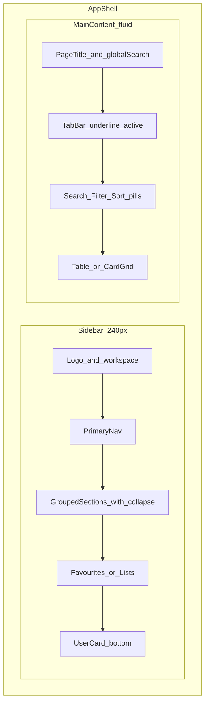

# 深色 Dashboard 风格指南（补充规范）

本文档描述**深色为主、数据密集的后台 Dashboard** 视觉与布局范式，提炼自 CRM / 邮件营销 / 用户管理 / 信息聚合类参考界面。作为项目主风格指南的**补充**，不替代、不修改现有 [`DESIGN.md`](../DESIGN.md) 与 [`website/DESIGN.md`](../website/DESIGN.md)。

---

## 与现有规范的关系

| 文档                                        | 默认方向                                                                        | 本文档角色                                           |
| ------------------------------------------- | ------------------------------------------------------------------------------- | ---------------------------------------------------- |
| [`DESIGN.md`](../DESIGN.md)                 | 扩展 popup / options / 面板：**亮色默认** + 靛蓝 `#5B5BD6` + Linear/Vercel 极简 | 不适用扩展紧凑表面为主场景                           |
| [`website/DESIGN.md`](../website/DESIGN.md) | 官网营销 + `/admin`：**亮色默认**，同一靛蓝体系                                 | 可选：后台暗色变体、Stitch 暗色屏、高密度列表/表格页 |
| 本文档                                      | **深色 Dashboard 模式**（近黑底 + 分组侧栏 + 表格）                             | 补充规范，色值与现有 `dark-*` 令牌同源               |

**色相同源原则**：强调色沿用项目靛蓝，不引入参考图中独立的紫/蓝双强调体系。

- 亮色强调：`#5B5BD6`（hover `#4F4FC4`，soft `#EEF0FB`）
- 深色强调：`#7C7CF0`（hover `#9B9BF5`，soft `rgba(91, 91, 214, 0.16)`）
- 实现对照：[`src/lib/uiTokens.ts`](../src/lib/uiTokens.ts) 的 `UI_THEME_DARK`、`website/DESIGN.md` YAML 中 `dark-*`

**禁止**为贴合参考图单独新增品牌紫（如 `#8b5cf6`）或霓虹描边、大面积渐变底；参考图里的紫/蓝交互态统一映射到上述靛蓝深色档。

---

## Overview / 定位

### 适用场景

- 运营后台 `/admin` 的**暗色主题**或 Stitch 暗色画板
- 左侧固定导航 + 右侧表格/列表的数据工作台
- 筛选浮层、批量多选、Tab 切换、详情侧栏/卡片网格
- 信息密度高、需长时间扫读的专业工具界面

### 不适用场景

- 营销 Hero、定价页、文档站（继续用 [`website/DESIGN.md`](../website/DESIGN.md) 亮色大留白）
- Chrome 扩展 popup（宽约 360px）、页面内浮动面板（继续用根 [`DESIGN.md`](../DESIGN.md) 紧凑规范）
- 需要与宿主页面强对比的浅色浮动 UI

### 设计气质

- **克制、专业、高级感**：弱化装饰，强化信息层级
- **深色 + 中性灰骨架 + 单一强调色**：交互反馈用靛蓝，彩色仅来自真实数据（品牌 logo、头像）
- **高密度但不杂乱**：靠间距、细线分隔、背景明度差分区，而非大色块或重阴影

---

## Colors（深色分层）

### 背景层级

靠**明度差**区分区域，侧栏与主内容可略差一档，避免依赖粗边框或彩色底。

| 语义                  | 色值      | 用途                                 |
| --------------------- | --------- | ------------------------------------ |
| `background`          | `#09090B` | 应用最底层、OLED 友好近黑            |
| `background-elevated` | `#18181B` | 主内容区、卡片、输入底               |
| `background-muted`    | `#27272A` | 侧栏底、表头轨、hover 行、搜索框填充 |
| `border`              | `#27272A` | 默认分隔线、输入描边                 |
| `border-strong`       | `#3F3F46` | hover 行、表头底、卡片 hover 描边    |

### 文字层级

| 语义          | 色值      | 用途                       |
| ------------- | --------- | -------------------------- |
| `text`        | `#F4F4F5` | 标题、主列、激活 Tab       |
| `text-muted`  | `#D4D4D8` | 表头、导航未选中、说明     |
| `text-subtle` | `#A1A1AA` | 占位符、时间戳、分组小标题 |

### 强调色（仅交互）

| 语义            | 色值                      | 用途                                               |
| --------------- | ------------------------- | -------------------------------------------------- |
| `primary`       | `#7C7CF0`                 | 选中 checkbox、激活 Tab 下划线、focus ring、主 CTA |
| `primary-hover` | `#9B9BF5`                 | 按钮悬停                                           |
| `primary-soft`  | `rgba(91, 91, 214, 0.16)` | 选中行底、侧栏激活项底                             |

**强调色只用于**：选中态、焦点、每屏一个主 CTA、checkbox 勾选。不用于大面积背景、装饰渐变或页面氛围光。

### 状态色

与主规范一致，仅用于 toast、badge、校验：`error` `#E5484D`、`success` `#30A46C`、`warning` `#F5A623`（暗色下保持可读对比，不替代 primary）。

### 「彩色只来自数据」

- UI 壳层保持中性灰 + 靛蓝点缀
- 表格中的 Slack / Notion / Netflix 等品牌图标、用户头像、列表收藏项前的 emoji/彩色圆点——作为**信息本身**的彩色，允许保留
- 不为导航项随意分配多种强调色（参考图紫/蓝 Tab 统一为靛蓝下划线）

---

## Typography

字体栈与 [`website/DESIGN.md`](../website/DESIGN.md) 一致：

- **Inter**：全部 UI 文案
- **Geist Mono**：订单号、API Key、模型 ID、表格数值列

| 层级        | 字号    | 字重 | 场景                                   |
| ----------- | ------- | ---- | -------------------------------------- |
| 页面标题    | 24–32px | 600  | 内容区 H1（如「Leads」「Email」）      |
| 区块标题    | 18–24px | 600  | 卡片标题、Dialog 标题                  |
| 正文        | 14–16px | 400  | 表格单元格、描述                       |
| 辅助        | 12–14px | 400  | 元数据、时间戳                         |
| 表头 / 标签 | 12px    | 500  | 列名、筛选 caption；**不要**全大写标题 |

- 字重：单视图最多 **Regular (400) + Semibold (600)**，避免 Bold 堆叠
- 表格：表头 `label-md` + `text-muted`；数值列可用 `mono-sm` **右对齐**
- 行高：正文 1.5–1.6，保证高密度下仍可扫读

---

## Layout（三段式范式）

后台 Dashboard 采用固定结构，各参考界面高度一致：

### 左侧边栏（约 240px）

1. **顶区**：产品 logo + 工作区名称 + 下拉（切换空间/项目）
2. **主导航**：图标 + 文字，激活项用 `background-muted` 或 `primary-soft` 圆角底
3. **分组**：小标题（`text-subtle`）+ 可折叠箭头；如 Channels、Navigate、More、Lists
4. **收藏 / 智能列表**：带 emoji 或彩色圆点的快捷入口（Hot Leads、Follow-ups）
5. **底区**：用户头像 + 名称 + 切换账号

### 主内容区

1. **页头**：大标题 + 可选副文案；右侧全局搜索（⌘K 提示）与头像
2. **Tab**：Sequences / Campaigns / All leads 等；激活态 **下划线**（`primary` 2px），非胶囊 Tab
3. **工具条**：行内搜索 + Filter + Sort，均为 **胶囊描边按钮**（pill）
4. **数据区**：全宽表格，或详情左卡 + 右列表，或模块化卡片网格（详情页）

### 间距

- 侧栏项内边距：8–12px；分组标题上下 16px
- 工具条与表格：16px
- 表格行高：44–48px
- 区块之间：24–32px（后台可略大于扩展，但仍避免 64px+ 大块留白）

---

## Elevation & Depth

层级靠**细边框 + 极轻阴影 + 背景明度差**，不用玻璃大模糊、霓虹发光或重投影。

| 层级                | 规则                                                             |
| ------------------- | ---------------------------------------------------------------- |
| 默认表面            | `border 1px` + 无阴影或 `shadowSm`：`0 1px 2px rgba(0,0,0,0.18)` |
| 悬停行/卡           | `border-strong` 或 `background-muted` 填充，无 scale             |
| 下拉 / Filters 浮层 | `background-elevated` + `border` + `shadowMd` / `shadowPanel`    |
| Dialog              | 遮罩 `rgba(0,0,0,0.5–0.6)`，内容区 `rounded-lg`，无彩色描边      |

侧栏与内容区分离：优先 **背景色差 1 档**，其次 1px `border`，避免双侧栏阴影。

---

## Shapes

与 [`website/DESIGN.md`](../website/DESIGN.md) 圆角尺度对齐：

| 令牌   | 值     | 用途                       |
| ------ | ------ | -------------------------- |
| `sm`   | 6px    | chip、徽章、表行内小控件   |
| `md`   | 8px    | 按钮、输入、侧栏激活底     |
| `lg`   | 12px   | 卡片、Filters 浮层、Dialog |
| `full` | 9999px | 头像、状态点、**胶囊按钮** |

- 图标：线性（Lucide），16 / 20 / 24px；描边 1.5–2px
- 触控目标：最小约 32×32px（图标按钮、checkbox）

---

## Components

### 侧栏导航

- 项高约 36–40px；图标左对齐 + 文案
- **激活**：`primary-soft` 底 + `text` 色，圆角 `md`
- **未激活**：透明底，`text-muted`；hover `background-muted`
- 分组标题：11–12px，`text-subtle`，可折叠
- 带计数：右侧数字徽章（`background-muted` 底 + `text` 小字）
- 收藏列表：左侧小圆点或 emoji，不改为多种 UI 强调色

### 数据表格

- 表头：`background-muted` 或透明 + `label-md` + `text-muted`
- 行分隔：1px `border`，低对比；**无**竖向列线
- 行 hover：`background-muted` 或略亮抬升
- 行选中 / 多选：`primary-soft` 底；checkbox 选中填充 `primary`
- 主列模式：**圆形头像 + 名称**；次列 **品牌 logo + 公司名**
- 行内操作：ghost 按钮；批量操作放在表格上方工具条
- **不要**用重阴影卡片包裹整张表；表格保持扁平可扫读

### 搜索框

- 圆角 `md`–`lg`，`background-muted` 填充
- 左侧或右侧放大镜图标；占位 `text-subtle`
- 可选快捷键提示（⌘K）右对齐，小字 `text-subtle`

### Filter / Sort 胶囊按钮

- 外形：`rounded-full` 或 `md` 大圆角
- 样式：1px `border` + 透明或 `background-elevated` 底
- 内容：图标 + 文案（Filter、Sort by）
- 激活：可加 `border-strong` 或 `primary-soft` 底，不整块填 primary

### Filters 浮层（下拉面板）

- 容器：`rounded-lg`，`background-elevated`，轻阴影
- 顶区：标题「Filters」+ 内嵌搜索
- 列表项：左图标 + 标签 + 可选 **计数徽章** + 右 chevron `>`
- 项 hover：`background-muted` 圆角底
- 支持分组标题（如 User attributes），`text-subtle`

### Tab 栏

- 水平排列；激活：**底部 2px `primary` 下划线** + `text`
- 未激活：`text-muted`；无滑动渐变动画

### 详情页卡片网格

- 模块化卡片：`background-elevated`，`rounded-lg`，内边距 16–24px
- 卡片间靠明度差分隔，少用粗边框
- 区块：图集、信息列表、地图、横向菜单、预订/操作、评价流
- 主 CTA：高对比（如白底黑字按钮）每区最多一个；次要 ghost/outlined

### 按钮层级

- **Primary**：靛蓝底 + 白字；**每屏一个**主 CTA
- **Secondary**：elevated 底 + border
- **Ghost**：工具栏、表行内
- 禁用：opacity + 禁止 pointer，不降到不可读

### Chips / Badges

- 中性：`background-muted` + `text-muted`
- 计数徽章：小圆角矩形，深灰底白字
- 状态：success / error / warning 浅底深字，不抢 primary

---

## Do's and Don'ts

### Do

- 以深色近黑为底，用 `#18181B` / `#27272A` 分层，侧栏与内容区可差一档明度
- 强调色只服务交互反馈（选中、Tab、checkbox、focus、一个主 CTA）
- 彩色仅来自真实数据（品牌图标、头像、列表语义色点）
- 保持三段式布局：分组侧栏 + Tab + 工具条 + 表格/卡片
- 用细边框与轻阴影表达浮层，Filters/Dialog 用 `rounded-lg`
- 沿用 Inter + Geist Mono；表头 label、数值 mono 右对齐
- 与 [`website/DESIGN.md`](../website/DESIGN.md) 的 `dark-*` 及 `uiTokens` 对齐实现

### Don't

- 不要引入与 `#5B5BD6` / `#7C7CF0` 冲突的新品牌紫或蓝紫双强调
- 不要使用霓虹描边、紫色光晕背景、大面积渐变 Hero
- 不要给每个导航项或 Tab 分配不同强调色
- 不要用重阴影卡片包裹数据表格
- 不要混用多种圆角（如 4px 按钮 + 16px 卡片同屏）
- 不要堆叠多个 primary 实心按钮
- 不要全大写标题；不要用装饰性衬线体
- 不要为「像参考图」而脱离项目现有 DESIGN.md 令牌体系

---

## 相关文档

| 文档                                                          | 说明                               |
| ------------------------------------------------------------- | ---------------------------------- |
| [`website/DESIGN.md`](../website/DESIGN.md)                   | 官网 + `/admin` 主令牌（亮色默认） |
| [`DESIGN.md`](../DESIGN.md)                                   | Chrome 扩展三表面                  |
| [`docs/ui-component-system.zh.md`](ui-component-system.zh.md) | L1/L2/L3 组件与令牌落地            |
| [`docs/stitch-redesign/README.md`](stitch-redesign/README.md) | Stitch 全量重设计流程              |
| [`src/lib/uiTokens.ts`](../src/lib/uiTokens.ts)               | 扩展与面板运行时深色语义色         |

Stitch 生成暗色后台屏时：仍以 [`website/DESIGN.md`](../website/DESIGN.md) 为粘贴源，本文件作为**暗色 Dashboard 构图与组件**的补充说明一并提供给设计/实现方。
