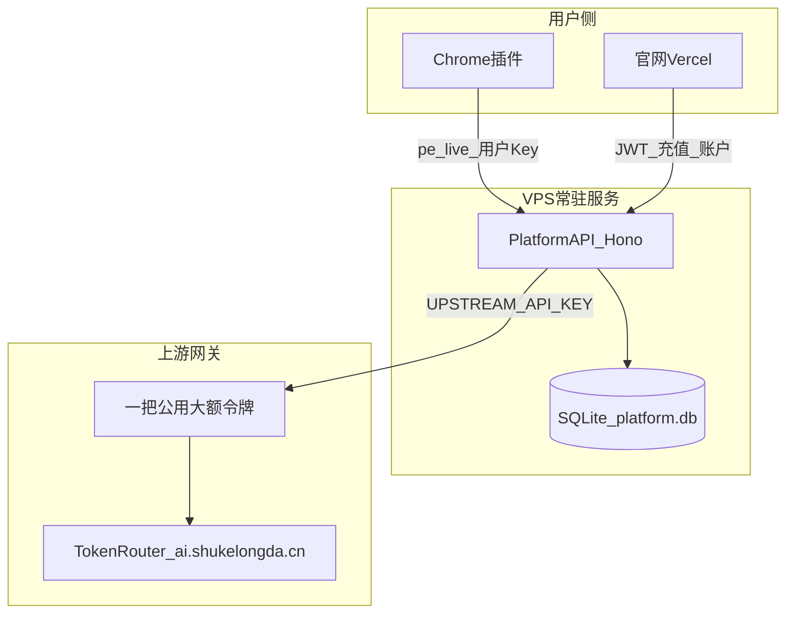

# 平台部署记忆（VPS + Vercel Checklist）

> 用途：上线 Prompt Hub 官网 + 平台 API + 插件联调时，直接按本文执行。环境变量对照见 [`deploy-platform.zh.md`](deploy-platform.zh.md)。

## 架构结论（已确认）



### 核心决策（勿改理解）

| 问题                           | 结论                                                                                                                                     |
| ------------------------------ | ---------------------------------------------------------------------------------------------------------------------------------------- |
| API 能放 Vercel 吗？           | **不能**。`services/api` 用 `better-sqlite3` + 本地文件 `DATABASE_PATH=./data/platform.db`，需要**持久磁盘 + 常驻进程**。                |
| 买 VPS 能解决吗？              | **能**。单台 VPS + SQLite 即可，**不必**为初期上 Postgres。                                                                              |
| 每个付费用户要在上游建令牌吗？ | **不需要**。`UPSTREAM_API_KEY` 是**平台唯一公用令牌**（大额安全闸），所有插件用户共用；逐用户限额在**平台层**完成。                      |
| 用户充值后额度怎么变？         | 平台 DB `users.balance_points` 自动加；**不需要**同步改上游令牌额度。                                                                    |
| 插件要用户自己填 Key 吗？      | **不用**。登录后官网自动创建/同步 `pe_live_*` API Key 到扩展，见 [`src/lib/platform/applyLogin.ts`](../src/lib/platform/applyLogin.ts)。 |

### 计费双层结构

1. **平台层（对用户）**：`balance_points` + `reservePoints` / `settleHold`（[`services/api/src/routes/proxy.ts`](../services/api/src/routes/proxy.ts)）；可选 `api_keys.quota_points` 子配额。
2. **上游层（对成本）**：一把 `UPSTREAM_API_KEY` 设**总额度上限**作兜底，防计费 bug 或 key 泄露；正常应用户余额先耗尽，而非撞上游额度。

---

## 推荐部署拓扑

| 组件          | 部署位置                                         | 说明                                                                                          |
| ------------- | ------------------------------------------------ | --------------------------------------------------------------------------------------------- |
| 官网 Next.js  | **Zeabur**（同 Project 双 Service）或 **Vercel** | Root: `website/`；Zeabur 见 [`docs/deploy-zeabur-runbook.zh.md`](deploy-zeabur-runbook.zh.md) |
| 平台 API      | **Zeabur**（挂 Volume `/data`）或 **自购 VPS**   | Docker；见 [`services/api/README.md`](../services/api/README.md)                              |
| SQLite 数据库 | VPS 本地磁盘                                     | 例：`/var/lib/prompt-hub/platform.db`；Docker 用 `-v prompt-hub-data:/data`                   |
| 上游令牌      | TokenRouter 管理台                               | 例 `https://ai.shukelongda.cn/console/token`；设大额额度，**仅填服务端 `.env`，不下发插件**   |

域名约定：[`deploy-platform.zh.md`](deploy-platform.zh.md)

- 官网：`https://github.com/xiaotao-02/prompt-hub`
- API：`https://github.com/xiaotao-02/prompt-hub`

---

## 服务器选型决策（Zeabur 服务器市场 / 自购 VPS）

> 结论：买 **海外 VPS**，把已购域名解析过去；**不要**买中国大陆节点。

### 推荐机型

| 维度        | 决策                                                                                         | 理由                                                                          |
| ----------- | -------------------------------------------------------------------------------------------- | ----------------------------------------------------------------------------- |
| 机型        | **Tencent 2 vCPU / 4 GB / 60 GB SSD / 1.5 TB 流量，约 $3/mo**，节点选 **Tokyo 或 Singapore** | API 仅转发 JSON + 读写单文件 SQLite，负载轻；海外节点免备案、无 GFW；价格最低 |
| 是否升 8 GB | 否（$5/mo 8GB 暂不需要）                                                                     | 4 GB 足够；除非同机再多跑服务才考虑                                           |
| 域名        | 已购阿里云域名**直接 A/CNAME 解析到海外 VPS**                                                | 海外主机不要求备案，域名照常可用                                              |

### 为何排除中国大陆节点（阿里云北京/上海等，即便 ∞ 流量更便宜）

1. **备案门槛**：绑公网域名走 80/443 **必须有 ICP 备案号**；"域名已注册 + 能解析" ≠ 已备案，不满足要求。
2. **GFW 限制**：大陆主机访问不了 Docker Hub / GitHub / Google / Telegram。本项目 Docker 构建拉镜像、依赖 GitHub、用 `GOOGLE_CLIENT_ID` 做 Google 登录，全部受阻，运维成本极高。

### Zeabur 计费补充

Zeabur 余额（Credits / 预付额度）是**最高优先级支付方式**，先抵扣订阅费与资源用量，余额用尽才扣绑定卡；可用信用卡 / 支付宝 / 微信充值。

---

## 已实现的产品闭环（上线前只需配环境，不必重做功能）

1. **官网注册登录** → `website/app/account` + `services/api/src/routes/auth.ts`
2. **充值显示点数** → `RechargePanel` / `ApiAccountPanel` 调 `GET /v1/account`
3. **插件登录** → 扩展打开 `{SITE_URL}/account?from_ext={extensionId}`
4. **自动配 API** → [`website/lib/extensionSync.ts`](../website/lib/extensionSync.ts) `PE_EXT_LOGIN` → [`src/background/externalAuth.ts`](../src/background/externalAuth.ts) → [`applyPlatformLogin.ts`](../src/lib/platform/applyLogin.ts)（切 `activeProvider=platform`）
5. **插件显示点数** → `usePlatformQuotaOnFocus`；充值后 `PE_EXT_QUOTA_REFRESH`

---

## VPS 部署步骤（Checklist）

### 1. 服务器基础

- Node 22+ 或 Docker
- 反代 + HTTPS：Caddy（推荐，自动证书）或 Nginx + certbot
- 将 `github.com/xiaotao-02/prompt-hub` 反代到本机 `8787`

### 2. 部署 API

**Docker 方式**（[`services/api/README.md`](../services/api/README.md)）：

```bash
cd services/api
docker build -t prompt-hub-api .
docker run -d --name prompt-hub-api -p 8787:8787 \
  -v prompt-hub-data:/data --env-file .env prompt-hub-api
```

**非 Docker**：`npm ci && npm run build && npm start`，用 pm2/systemd 守护。

### 3. 生产 `.env` 必改项

| 变量                                    | 生产值 / 要求                                 |
| --------------------------------------- | --------------------------------------------- |
| `JWT_SECRET`                            | 长随机串，勿用默认值                          |
| `AUTH_LINK_SECRET`                      | 邮件魔法链接签名                              |
| `DATABASE_PATH`                         | 持久路径，如 `/data/platform.db`              |
| `UPSTREAM_BASE_URL`                     | 上游 OpenAI 兼容地址                          |
| `UPSTREAM_API_KEY`                      | 上游管理台创建的大额公用令牌                  |
| `UPSTREAM_DEFAULT_MODEL`                | 如 `gpt-5.5`                                  |
| `UPSTREAM_INPUT/OUTPUT_PRICE_PER_1K`    | 与上游分组倍率一致（当前 GPT_PROMAX 20×）     |
| `POINTS_PER_USD`                        | 点数换算（当前约 144，含毛利）                |
| `CORS_ORIGIN`                           | 含 `https://github.com/xiaotao-02/prompt-hub` |
| `SITE_URL`                              | `https://github.com/xiaotao-02/prompt-hub`    |
| `API_PUBLIC_URL`                        | `https://github.com/xiaotao-02/prompt-hub`    |
| `GOOGLE_CLIENT_ID`                      | 与官网一致                                    |
| `MOCK_PAY_ENABLED`                      | **`false`**                                   |
| `DEV_LOGIN_ENABLED`                     | **`false`**                                   |
| `EMAIL_DEV_LOG`                         | **`false`**（配好 SMTP）                      |
| `WECHAT_PAY_ENABLED` / `ALIPAY_ENABLED` | 真实支付时 `true` 并填商户参数                |

### 4. Vercel 官网环境变量

| 变量                            | 生产值                                     |
| ------------------------------- | ------------------------------------------ |
| `NEXT_PUBLIC_SITE_URL`          | `https://github.com/xiaotao-02/prompt-hub` |
| `NEXT_PUBLIC_API_URL`           | `https://github.com/xiaotao-02/prompt-hub` |
| `NEXT_PUBLIC_GOOGLE_CLIENT_ID`  | 与 API 相同                                |
| `NEXT_PUBLIC_PRICING_ENABLED`   | `true`                                     |
| `NEXT_PUBLIC_MOCK_PAY_ENABLED`  | **`false`**                                |
| `NEXT_PUBLIC_DEV_LOGIN_ENABLED` | **`false`**                                |

### 5. 插件 / Manifest

- 默认生产 URL 已在 [`src/lib/platform/config.ts`](../src/lib/platform/config.ts)（`github.com/xiaotao-02/prompt-hub` / `github.com/xiaotao-02/prompt-hub`）
- [`src/manifest.config.ts`](../src/manifest.config.ts) `externally_connectable.matches` 已含 `https://github.com/xiaotao-02/prompt-hub`；**换域名时必须同步改 manifest 并重新发版扩展**
- 本地联调可临时加 `http://localhost/*`，**发布前移除**

### 6. 上游令牌

- 在 TokenRouter 管理台创建**一把**平台用令牌，设合理总额度
- 只写入 VPS 上 `UPSTREAM_API_KEY`，不进 git、不下发用户
- 额度见底要有监控/告警（否则全站不可用）

### 7. 数据库备份（必做）

- SQLite 单文件，cron 定时 `cp` 到对象存储或异地
- 可选 [litestream](https://litestream.io/) 实时复制
- 点数是真实资产，丢库 = 用户余额丢失

---

## 上线验收（Smoke）

- [ ] `GET https://github.com/xiaotao-02/prompt-hub/health` 正常
- [ ] 官网账户页：Google/邮箱登录成功
- [ ] 模拟支付关闭后，真实支付或人工充值入账，`balancePoints` 更新
- [ ] 扩展「登录账号」→ 官网 `?from_ext=` → 提示 Key 已同步，设置页显示 platform 已连接
- [ ] 扩展内反推一次，`/v1/chat/completions` 扣点，余额减少
- [ ] 充值后回扩展，点数刷新（focus 或 `PE_EXT_QUOTA_REFRESH`）
- [ ] 确认生产无 Dev 登录、无模拟支付入口

---

## 常见误区（对话中已澄清）

- **误区**：每个用户在上游建令牌才能限额 → **错**；平台层 `balance_points` 已限额，上游令牌只做总闸。
- **误区**：VPS 必须换 Postgres → **错**；单实例 + SQLite + 备份足够初期使用；多实例水平扩展时才需 Postgres。
- **误区**：用户看到的是上游 `sk-xxx` → **错**；用户持有的是平台签发的 `pe_live_*`，上游 key 仅服务端可见。
- **误区**：买了大陆 VPS + 买了域名就能直接上 → **错**；大陆节点绑域名要 ICP 备案，且 GFW 挡住 Docker Hub/GitHub/Google。优先海外节点（Tokyo/Singapore），域名解析过去即可，详见上文「服务器选型决策」。
