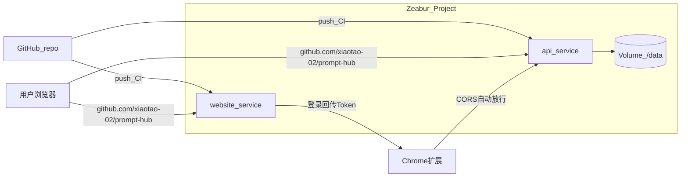

# Zeabur 速查记忆（Prompt Hub）

> **用途**：Zeabur 平台操作与概念速查，专注本仓库 monorepo（`website/` + `services/api/`）上线场景。
> **逐步上线清单**：[`deploy-zeabur-runbook.zh.md`](deploy-zeabur-runbook.zh.md)（\*.zeabur.app 验证阶段，含 env 模板与 Smoke）
> **关联文档**：套餐选型见 [`deploy-hosting-selection.zh.md`](deploy-hosting-selection.zh.md)；环境变量见 [`deploy-platform.zh.md`](deploy-platform.zh.md)；VPS 备选拓扑见 [`deploy-vps-checklist.zh.md`](deploy-vps-checklist.zh.md)。
> **官方文档**：[Zeabur 文档（中文）](https://zeabur.com/docs/zh-CN)

---

## 1. 一句话定位与计费

**Zeabur** 是 PaaS 部署平台：自动识别项目类型、开箱即用 CI/CD、可在一个 Project 内同时部署前端 / 后端 / 数据库。与 Vercel 类似，但**支持持久卷（Volumes）**，适合 SQLite 等有状态服务。

**计费模型** = **功能档位订阅费** + **CPU / 内存 / 持久卷按用量计费**（两部分叠加，无意外账单但用量仍会计费）。

| 套餐    | 月费                    | 与本项目关系                                                    |
| ------- | ----------------------- | --------------------------------------------------------------- |
| Free    | $0                      | 可跑通流程、可挂卷；**无备份**、日志仅 48h → 不承载真实付费用户 |
| **Dev** | **$5**（14 天免费试用） | **正式上线最低档**：含监控与**备份**                            |
| Pro     | $19                     | 流量大、需 30 天日志 / 进阶搜索 / 更多域名时再升                |
| Team    | $79                     | 多人协作，当前单人上线无关                                      |

**本项目结论**：因点数 = 真实资产、SQLite 必须备份 → 选 **Dev 档**起。详见 [`deploy-hosting-selection.zh.md` §4](deploy-hosting-selection.zh.md#4-zeabur-套餐选型结论重点)。

---

## 2. 部署方式（本仓库相关）

### GitHub 集成（推荐）

1. 控制台 → 设置 → 集成 → 绑定 GitHub 账号。
2. 创建服务时选 **GitHub** 类型 → Configure GitHub → 安装 Zeabur App 到个人/组织。
3. 搜索仓库名或粘贴 GitHub URL → 部署。
4. 之后 **push 到 GitHub 自动触发 CI/CD 重新部署**。

> 一个 GitHub 账号只能绑定一个 Zeabur 账号。

### Dockerfile 部署

- 项目根目录（或 Root Directory 内）存在 `Dockerfile` / `dockerfile` → Zeabur 自动以 Docker 方式构建。
- 本仓库 API 已有 [`services/api/Dockerfile`](../services/api/Dockerfile)（Root Directory = `services/api` 时用）；从仓库根构建时另有 [`api.Dockerfile`](../api.Dockerfile)（只复制 `services/api/`，不加载 Chrome 扩展主目录），与 [`zbpack.api.json`](../zbpack.api.json) 配合。
- 若不想用 Dockerfile、让 Zeabur 自动选 builder：
  - 环境变量 `ZBPACK_IGNORE_DOCKERFILE=true`，或
  - `zbpack.json`：`{ "ignore_dockerfile": true }`

### monorepo 一仓多服务

本仓库需在同一 Git repo 部署 **两个服务**（官网 + API）。Zeabur 不支持直接吃 `docker-compose.yml`，需拆成两个 Service 或转 [Template YAML](https://zeabur.com/docs/zh-CN/template/template-format)。

**指定 Dockerfile 的三种方式**（API 服务示例）：

| 方法                   | 配置                                                                        | 说明                                     |
| ---------------------- | --------------------------------------------------------------------------- | ---------------------------------------- |
| 服务名自动匹配（推荐） | 将 Dockerfile 命名为 `api.Dockerfile` 或 `Dockerfile.api`，服务名设为 `api` | 最简单                                   |
| 后缀环境变量           | `ZBPACK_DOCKERFILE_NAME=api`                                                | **只填后缀**，勿填 `Dockerfile.api` 全名 |
| 任意路径               | `ZBPACK_DOCKERFILE_PATH=services/api/Dockerfile`                            | 子目录 / 自定义文件名时用                |

> ⚠️ `ZBPACK_DOCKERFILE_NAME=Dockerfile.api` 会导致 Zeabur 去找 `Dockerfile.Dockerfile.api`，构建失败并可能误判为 Node.js 等其他 builder。

---

## 3. 服务隔离（monorepo 必配）

### Root Directory（构建根目录）

服务 → **设置** → **Root Directory** → 填入子目录 → 保存 → **Redeploy Service**。

| 服务 | Root Directory |
| ---- | -------------- |
| 官网 | `website`      |
| API  | `services/api` |

### 监控路径 Watch Paths

默认 `*` = 仓库任意文件变更都会触发该服务重建。monorepo 下应隔离：

| 服务 | Watch Paths 建议值 |
| ---- | ------------------ |
| 官网 | `/website`         |
| API  | `/services/api`    |

语法类似 `.gitignore`，但含义相反（**监控**而非忽略）。

---

## 4. 端口与公网访问

### 端口

- Git 服务**只能监听 1 个端口**；未指定 Dockerfile 端口时默认 **8080**。
- 应用必须读 `process.env.PORT`，**不要硬编码**（Zeabur 会注入 `PORT`）。
- 本仓库 API Dockerfile **不**写死 `ENV PORT`（避免覆盖 Zeabur 注入值）；应用读 `process.env.PORT`，未设置时 [`env.ts`](../services/api/src/env.ts) 回退 `8787`。部署前可跑 `.\scripts\check-zeabur-api-env.ps1`。

### 域名

服务 → **域名**：

- **生成域名**：一键获得 `your-service.zeabur.app`（最快验证）。
- **自定义域名**：输入 `github.com/xiaotao-02/prompt-hub` / `github.com/xiaotao-02/prompt-hub` → 按提示添加 DNS 记录（通常 CNAME 到 `*.clusters.zeabur.com`）。

**Cloudflare 注意**：

- 可开橙云（CDN）降流量费，但 SSL/TLS 模式**不能选 Full (Strict)**（Zeabur 使用自签证书，会连接失败）。
- Cloudflare 自带 CNAME Flattening，**根域名**（`example.com`）可直接 CNAME，无需手动转 A 记录。
- 三级以上子域名（`*.sub.example.com`）Cloudflare 不签发 SSL，需关橙云直连 Zeabur。

### 非 HTTP 服务

非 HTTP 协议可用「端口转发」（分配的主机名 + 端口），但**主机名和端口可能变更**，勿假设永久不变。

---

## 5. 环境变量

服务 → **变量**：

- 单条添加，或点 **编辑原始环境变量** 批量粘贴 `.env` 格式。
- 引用其他变量：`AUTH_INFO=${USERNAME}:${PASSWORD}`（模板语法 `${VAR}`）。

### 自动注入

Zeabur 预设注入：

- `PORT`：对外端口
- `{服务名}_HOST`：项目内网通信 host 名
- 关联数据库 / Redis 等服务也会自动注入连接变量

### 变量优先级

1. 当前服务定义的环境变量
2. 其他服务 **Expose** 的变量
3. Zeabur **特殊变量**

### 常用特殊变量

| 变量                       | 含义                                         |
| -------------------------- | -------------------------------------------- |
| `${ZEABUR_WEB_URL}`        | 该端口完整 URL，如 `https://test.zeabur.app` |
| `${ZEABUR_WEB_DOMAIN}`     | 该端口域名，如 `test.zeabur.app`             |
| `${CONTAINER_HOSTNAME}`    | 当前服务在项目内的 hostname                  |
| `${ZEABUR_GIT_COMMIT_SHA}` | 当前部署的 Git commit SHA（仅构建阶段）      |
| `${ZEABUR_GIT_BRANCH}`     | 当前分支（仅构建阶段）                       |
| `${PASSWORD}`              | Zeabur 为服务生成的随机密码                  |

> Git 服务的端口名称恒为 `web`，故 URL 变量为 `${ZEABUR_WEB_URL}` / `${ZEABUR_WEB_DOMAIN}`。

### Dockerfile 多阶段构建

若环境变量需在**构建阶段**使用，Dockerfile 中用 `ARG`；Zeabur 会在构建前自动注入。单阶段 Dockerfile 的运行时变量无需手写 `ENV`，平台会自动加上。

---

## 6. 持久卷与备份（本项目命脉）

### 为什么必须挂卷

Zeabur 服务默认**无状态**：重启 / 重新部署后容器文件系统重置。本仓库 API 使用 **SQLite**（`better-sqlite3` + 本地文件），**必须挂持久卷**，否则重启丢库、用户余额丢失。

### 挂载步骤

API 服务 → **硬盘** → **Mount Volumes**：

| 字段            | 示例值  | 说明                           |
| --------------- | ------- | ------------------------------ |
| Volume ID       | `data`  | 代号，仅作标识，与挂载路径无关 |
| Mount Directory | `/data` | 容器内需持久化的目录           |

挂载后设置环境变量：`DATABASE_PATH=/data/platform.db`（与 [`services/api/Dockerfile`](../services/api/Dockerfile) 默认一致）。

### 重要限制

- ⚠️ **首次挂载会清空目标目录**原有数据 → 先备份再挂，或先挂空目录再导入。
- ⚠️ 启用 Volumes 后**失去零停机重启**：重启会先完全关闭再启动，有短暂中断。
- 删除 Volume → 数据**不可恢复**，同时停止该空间计费。

### 备份

- Zeabur 的 **Backup** 功能备份的就是 Volume 数据；**Dev 档起可用**。
- 因点数 = 真实资产，建议 **Zeabur 备份 + Litestream / cron 导出到对象存储** 双保险。

---

## 7. 本项目落地映射

### 架构概览

### 官网服务（website）

| 配置项         | 值                                                                               |
| -------------- | -------------------------------------------------------------------------------- |
| Root Directory | `website`                                                                        |
| Watch Paths    | `/website`                                                                       |
| 域名           | `github.com/xiaotao-02/prompt-hub`（或先生成 `*.zeabur.app` 验证）               |
| 框架           | Next.js（Zeabur 自动识别）                                                       |
| 关键 env       | `NEXT_PUBLIC_SITE_URL`、`NEXT_PUBLIC_API_URL`、`NEXT_PUBLIC_GOOGLE_CLIENT_ID` 等 |

完整 env 对照 → [`deploy-platform.zh.md`](deploy-platform.zh.md)。

### API 服务（services/api）

| 配置项         | 值                                                                                                                         |
| -------------- | -------------------------------------------------------------------------------------------------------------------------- |
| Root Directory | `services/api`                                                                                                             |
| Watch Paths    | `/services/api`                                                                                                            |
| 域名           | `github.com/xiaotao-02/prompt-hub`                                                                                         |
| Dockerfile     | `services/api/Dockerfile`（推荐 Root `services/api`）；仓库根 fallback：`api.Dockerfile` / `zbpack.api.json`               |
| Volume         | Mount Directory `/data`，Volume ID `data`                                                                                  |
| 关键 env       | `DATABASE_PATH=/data/platform.db`、`SITE_URL`、`API_PUBLIC_URL`、`CONFIG_ENCRYPTION_KEY`、`ADMIN_EMAILS`、`CORS_ORIGIN` 等 |

完整 env 对照 → [`deploy-platform.zh.md`](deploy-platform.zh.md)。

### 扩展联动（换域名必做）

上线 / 换域名后必须同步：

- [`src/manifest.config.ts`](../src/manifest.config.ts) → `externally_connectable.matches`
- [`src/lib/platform/config.ts`](../src/lib/platform/config.ts) → 默认 `PLATFORM_SITE_URL` / `PLATFORM_API_URL`
- 重新打包并发版 Chrome 扩展

---

## 8. 易踩坑清单

| #   | 坑                                      | 对策                                                                                                 |
| --- | --------------------------------------- | ---------------------------------------------------------------------------------------------------- |
| 1   | API 未挂卷，重启丢 SQLite               | 挂 Volume 到 `/data`，`DATABASE_PATH` 指向卷内路径                                                   |
| 2   | Free 档无备份就上线                     | 升 Dev 档；验证 Backup 可导出 + 恢复                                                                 |
| 3   | monorepo 改一处两边都重建               | 配 Root Directory + Watch Paths 隔离                                                                 |
| 4   | `ZBPACK_DOCKERFILE_NAME` 填了完整文件名 | 只填后缀，如 `api` 而非 `Dockerfile.api`                                                             |
| 5   | 硬编码端口 8080 / 8787                  | 读 `process.env.PORT`                                                                                |
| 6   | Cloudflare Full (Strict)                | 改为 Full 或 Flexible                                                                                |
| 7   | 首次挂 Volume 丢已有数据                | 先下载备份，挂卷后再导入                                                                             |
| 8   | 把 API 放 Vercel / 纯 Serverless        | API 必须有持久磁盘 + 常驻进程，见 [`deploy-hosting-selection.zh.md`](deploy-hosting-selection.zh.md) |
| 9   | 假设端口转发地址永久不变                | 用域名访问 HTTP 服务；非 HTTP 勿硬编码转发地址                                                       |
| 10  | docker-compose 直接部署                 | Zeabur 不支持；拆成多 Service 或转 Template YAML                                                     |

---

## 快速操作索引

| 我要…                          | 去哪                                                         |
| ------------------------------ | ------------------------------------------------------------ |
| **逐步上线 checklist（推荐）** | [`deploy-zeabur-runbook.zh.md`](deploy-zeabur-runbook.zh.md) |
| 绑定 GitHub 自动部署           | 控制台 → 设置 → 集成；创建服务选 GitHub                      |
| 指定 monorepo 子目录           | 服务 → 设置 → Root Directory → Redeploy                      |
| 避免无关目录触发重建           | 服务 → 设置 → 监控路径                                       |
| 挂 SQLite 持久卷               | 服务 → 硬盘 → Mount Volumes                                  |
| 绑自定义域名                   | 服务 → 域名 → 自定义域名 → 配 DNS                            |
| 批量粘贴 env                   | 服务 → 变量 → 编辑原始环境变量                               |
| 忽略 Dockerfile                | `ZBPACK_IGNORE_DOCKERFILE=true`                              |
| 指定子目录 Dockerfile          | `ZBPACK_DOCKERFILE_PATH=services/api/Dockerfile`             |
