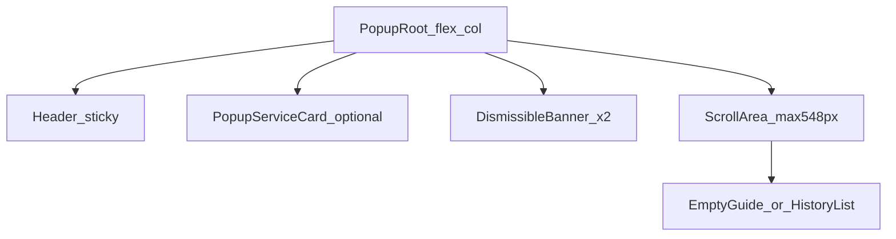
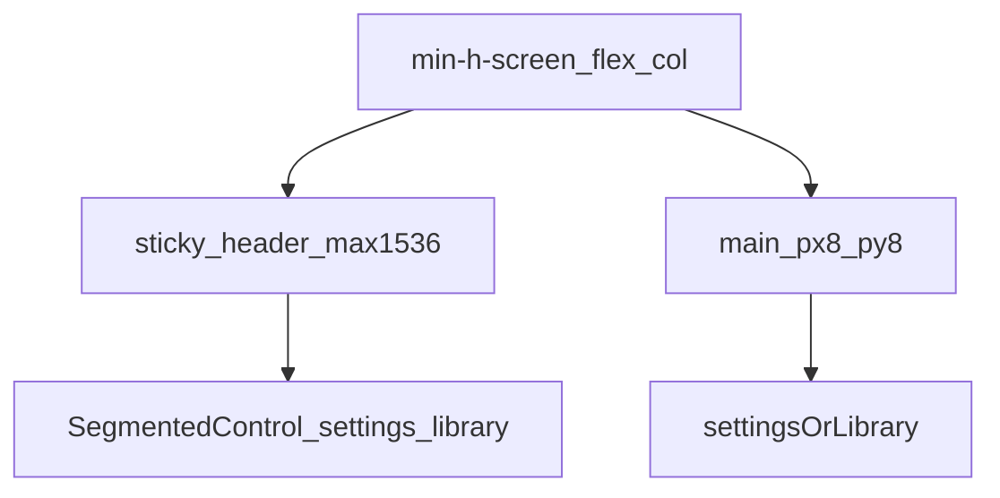
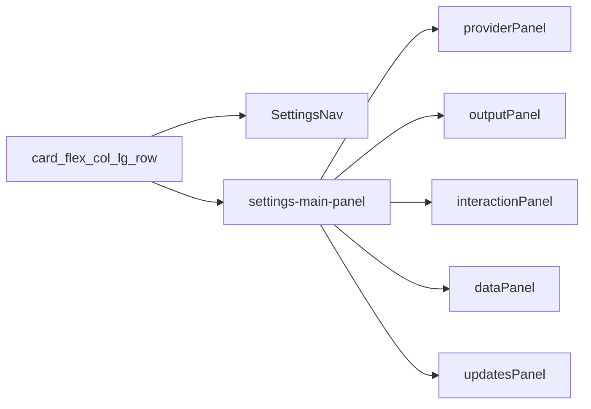
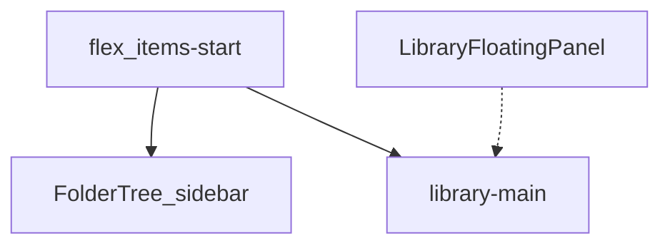
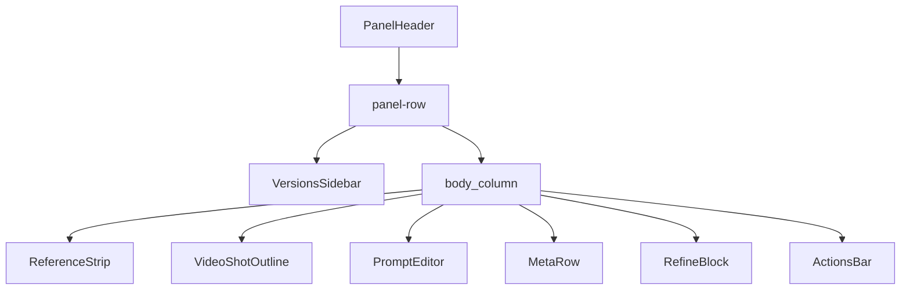
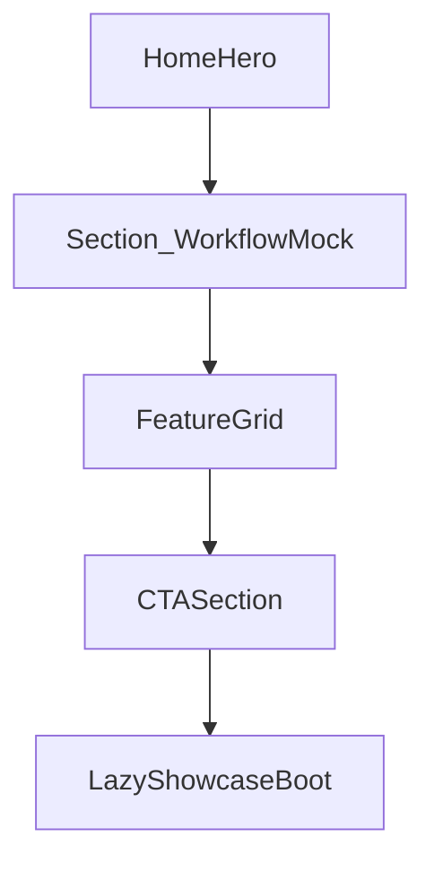
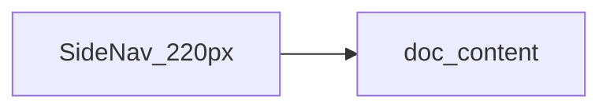
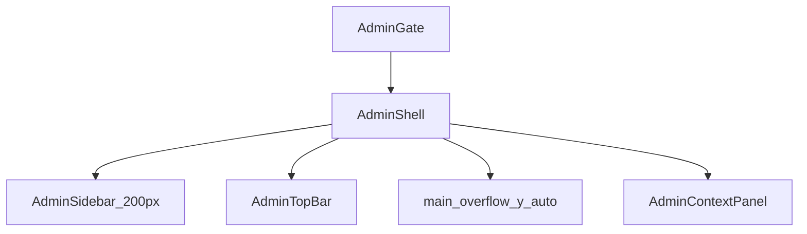

# 全站页面布局与样式文档

逐页拆解 **Chrome 扩展** 与 **官网/运营后台** 的布局结构、样式规格与组件映射，可作为 UI 还原依据与新人对齐资料。

**不重复**设计体系全文；Token、组件分层、后台约定等请交叉阅读：

- [ui-component-system.zh.md](ui-component-system.zh.md) — 插件/官网 L1–L3 分层
- [website-design-system.zh.md](website-design-system.zh.md) — 官网 Token 与组件分层
- [admin-ui-conventions.zh.md](admin-ui-conventions.zh.md) — `/admin` 视觉与交互约定
- [plugin-pages-overview.zh.md](plugin-pages-overview.zh.md) — 扩展页面统计口径
- [naming-glossary.zh.md](naming-glossary.zh.md) — 面板领域术语

---

## 0. 总览

### 0.1 两侧技术栈差异

| 维度     | Chrome 扩展（`src/`）                                               | 官网/后台（`website/`）                                 |
| -------- | ------------------------------------------------------------------- | ------------------------------------------------------- |
| 框架     | Vite + React（MV3）                                                 | Next.js App Router                                      |
| 样式入口 | `src/styles/globals.css`（`@theme` + `--ui-*`）                     | `website/app/globals.css`（`@theme` + `--color-*`）     |
| Token 源 | [`src/lib/uiTokens.ts`](../src/lib/uiTokens.ts)                     | [`website/app/globals.css`](../website/app/globals.css) |
| L2 原语  | `src/components/ui/*`                                               | `website/components/ui/*`                               |
| 特殊表面 | Content 面板：Shadow DOM + 字符串 CSS（`panel/styleSections/*.ts`） | `/admin`：独立壳层，隐藏全站头尾                        |
| 主题策略 | `prefers-color-scheme` 自动亮/暗                                    | 固定 `html.dark` 暗色                                   |
| 字体     | 系统无衬线栈（`uiFontStack.ts`）                                    | Inter + JetBrains Mono（Geist 变量名）                  |

### 0.2 全站页面清单

| 表面                        | 路由/入口                           | 页面文件                                                                          | 壳层/布局组件                                     |
| --------------------------- | ----------------------------------- | --------------------------------------------------------------------------------- | ------------------------------------------------- |
| **扩展 Popup**              | `chrome-extension://…/popup.html`   | [`src/popup/PopupApp.tsx`](../src/popup/PopupApp.tsx)                             | `popupShell.ts` 定宽定高                          |
| **扩展 Options · 设置**     | 同上 `options.html` `#tab=settings` | [`SettingsView.tsx`](../src/options/settings/SettingsView.tsx)                    | [`OptionsApp.tsx`](../src/options/OptionsApp.tsx) |
| **扩展 Options · 提示词库** | `#tab=library`                      | [`PromptLibrary/`](../src/options/PromptLibrary/)                                 | 同上                                              |
| **Content 浮动面板**        | 宿主页 Shadow DOM                   | [`PanelApp.tsx`](../src/content/panel/PanelApp.tsx)                               | `panel/styles.ts`                                 |
| **区域截图覆盖层**          | 宿主页注入                          | [`regionCapture.ts`](../src/content/regionCapture.ts)                             | 无独立 HTML                                       |
| **官网首页**                | `/`                                 | [`website/app/page.tsx`](../website/app/page.tsx)                                 | `SiteHeader` + `SiteFooter`                       |
| **功能**                    | `/features`                         | [`website/app/features/page.tsx`](../website/app/features/page.tsx)               | 营销壳                                            |
| **官方 API 定价**           | `/pricing`                          | [`website/app/pricing/page.tsx`](../website/app/pricing/page.tsx)                 | 营销壳                                            |
| **下载**                    | `/download`                         | [`website/app/download/page.tsx`](../website/app/download/page.tsx)               | 营销壳                                            |
| **文档中心**                | `/docs`                             | [`website/app/docs/page.tsx`](../website/app/docs/page.tsx)                       | `DocsLayout`                                      |
| **快速开始**                | `/docs/quickstart`                  | [`website/app/docs/quickstart/page.tsx`](../website/app/docs/quickstart/page.tsx) | `DocsLayout`                                      |
| **FAQ**                     | `/docs/faq`                         | [`website/app/docs/faq/page.tsx`](../website/app/docs/faq/page.tsx)               | `DocsLayout`                                      |
| **供应商配置**              | `/docs/providers`                   | [`website/app/docs/providers/page.tsx`](../website/app/docs/providers/page.tsx)   | `DocsLayout`                                      |
| **账户**                    | `/account`                          | [`website/app/account/page.tsx`](../website/app/account/page.tsx)                 | `AccountShell`                                    |
| **隐私政策**                | `/privacy`                          | [`website/app/privacy/page.tsx`](../website/app/privacy/page.tsx)                 | 营销壳 + `prose-docs`                             |
| **服务条款**                | `/terms`                            | [`website/app/terms/page.tsx`](../website/app/terms/page.tsx)                     | 营销壳 + `prose-docs`                             |
| **运营后台**                | `/admin`                            | [`website/app/admin/page.tsx`](../website/app/admin/page.tsx)                     | `AdminShell`（无 SiteHeader）                     |

### 0.3 站点/界面地图

```mermaid
flowchart TB
  subgraph ext [ChromeExtension]
    popup[Popup_560px]
    options[OptionsApp]
    settingsTab[SettingsView]
    libraryTab[PromptLibrary]
    panel[ContentPanel_ShadowDOM]
    regionCap[RegionCaptureOverlay]
    options --> settingsTab
    options --> libraryTab
  end

  subgraph web [Website]
    rootLayout[RootLayout_SiteHeaderFooter]
    home[/]
    features[/features]
    pricing[/pricing]
    download[/download]
    docs[/docs_and_subpages]
    account[/account]
    legal[/privacy_/terms]
    rootLayout --> home
    rootLayout --> features
    rootLayout --> pricing
    rootLayout --> download
    rootLayout --> docs
    rootLayout --> account
    rootLayout --> legal
  end

  subgraph admin [Admin]
    adminLayout[admin_layout_no_header]
    adminShell[AdminShell_9tabs]
    adminLayout --> adminShell
  end

  contentScript[content_scripts] --> panel
  contentScript --> regionCap
```

---

## 1. Chrome 扩展页面

### 1.1 Popup 工具栏弹窗

**用途**：快速查看历史、召回面板、区域截图、打开提示词库/官网；首配时内嵌服务配置卡片。

**入口**：[`src/popup/main.tsx`](../src/popup/main.tsx) → [`PopupApp.tsx`](../src/popup/PopupApp.tsx)

#### 布局结构



| 区域     | 布局                                      | 尺寸/间距                                        |
| -------- | ----------------------------------------- | ------------------------------------------------ |
| 根容器   | `flex flex-col`，类名来自 `popupShell.ts` | 固定宽 **560px**；禁止 `vh`/`vw` 高度            |
| 顶栏     | `flex justify-between`，`px-3 py-2.5`     | Logo **32×32**；标题 `text-[15px] font-semibold` |
| 滚动区   | `max-h-[548px] overflow-y-auto`           | 背景 `bg-zinc-50/50 dark:bg-zinc-950/35`         |
| 历史卡片 | `rounded-lg border p-3 shadow-sm`         | 列表 `space-y-2`，缩略图区 `flex gap-3`          |
| 空状态   | `min-h-[260px] flex center`               | 内嵌 `EmptyGuide` 或 `PopupCompactEmptyHint`     |

**尺寸权威来源**：[`src/popup/popupShell.ts`](../src/popup/popupShell.ts)

- `POPUP_WIDTH_PX = 560`
- `POPUP_SCROLL_MAX_HEIGHT_PX = 548`（600 − 顶栏预留 52）
- 服务卡片内滚动 `max-h-[420px]`；版本列表 `max-h-[320px]`

#### 样式规格

- **配色**：跟随扩展 `--ui-*`（亮 `#f8fafc` 底 / 暗 `#09090b` 底）；强调色 `violet-600` / `dark:violet-300`
- **顶栏**：`bg-white/85 dark:bg-zinc-950/60 backdrop-blur-sm`；底边 `border-zinc-200/90 dark:border-zinc-800`
- **交互**：历史卡片 hover `border-zinc-300`；展开版本时 `bg-violet-50/60 ring-violet-500/30`
- **按钮**：统一 `@/components/ui/Button`（`primary`/`secondary`/`ghost`/`danger`，`size="xs"`）

#### 区块 → 组件映射

- **顶栏 Logo + 标题** → `PopupApp.tsx` header 内 ``
- **服务菜单（已配置）** → [`PopupServiceMenu.tsx`](../src/popup/PopupServiceMenu.tsx)
- **区域截图按钮** → `PopupApp` header `Button` + `REQUEST_REGION_CAPTURE` 消息
- **打开官网 / 提示词库** → header 内 `<a>` + `Button`
- **首配内嵌卡片** → [`PopupServiceCard.tsx`](../src/popup/PopupServiceCard.tsx) + [`servicePanes/*`](../src/popup/servicePanes/)
- **错误/警告条** → `@/components/ui/DismissibleBanner`
- **历史列表项** → `PopupApp` 内 `<li>` 卡片 + 操作按钮行
- **内联版本展开** → [`PopupVersionsInline.tsx`](../src/popup/PopupVersionsInline.tsx) + `Collapsible`
- **空状态引导** → [`EmptyGuide.tsx`](../src/components/EmptyGuide.tsx)

---

### 1.2 Options 选项页

**用途**：扩展设置（API/输出/交互/备份/更新）与提示词库管理。

**入口**：[`src/options/main.tsx`](../src/options/main.tsx) → [`OptionsApp.tsx`](../src/options/OptionsApp.tsx)

#### 整体布局



| 区域     | 布局                                                 | 尺寸/间距                          |
| -------- | ---------------------------------------------------- | ---------------------------------- |
| 页头     | `sticky top-0 z-10`；桌面 `grid-cols-[1fr_auto_1fr]` | `max-w-[1536px] mx-auto px-8 py-4` |
| Tab 切换 | `SegmentedControl` 居中                              | 移动端：头部分两行 + 底部分段条    |
| 主内容   | settings：`max-w-[920px]`；library：`max-w-[1536px]` | `px-8 py-8`                        |
| Logo     | `icons/icon-128.png`                                 | `w-7 h-7 rounded-lg`               |

**深链**：`#tab=library&focus=<id>&dock=refine|versions`（读后 `replaceState` 清 hash）

#### 1.2.1 Settings 视图

**文件**：[`SettingsView.tsx`](../src/options/settings/SettingsView.tsx)



| 子面板 ID     | 标签                  | 组件                                                                                        |
| ------------- | --------------------- | ------------------------------------------------------------------------------------------- |
| `provider`    | 内置服务 / 自定义 API | [`ServiceConnectionPanel.tsx`](../src/options/settings/tabs/ServiceConnectionPanel.tsx)     |
| `output`      | 输出                  | [`OutputSettingsPanel.tsx`](../src/options/OutputSettingsPanel.tsx)                         |
| `interaction` | 交互                  | [`InteractionSettingsPanel.tsx`](../src/options/settings/tabs/InteractionSettingsPanel.tsx) |
| `data`        | 数据与备份            | [`DataPersistence.tsx`](../src/options/DataPersistence.tsx)                                 |
| `updates`     | 扩展更新              | [`UpdateSection.tsx`](../src/options/UpdateSection.tsx)                                     |

**导航样式**（[`SettingsNav.tsx`](../src/options/settings/parts/SettingsNav.tsx)）：

- 桌面侧栏：`w-52 sticky top-[88px]`，`border-r bg-zinc-50/85 dark:bg-zinc-950/40`
- 移动横向 Tab：`overflow-x-auto`，激活项 `bg-violet-50 text-violet-700`
- 主面板：`p-5 sm:p-6`，内容 `max-w-[920px] space-y-6`

**自动保存指示器**：[`SettingsAutosaveIndicator.tsx`](../src/options/settings/parts/SettingsAutosaveIndicator.tsx)（页头右侧，仅 settings Tab 显示）

#### 1.2.2 Library 视图

**文件**：[`PromptLibrary/index.tsx`](../src/options/PromptLibrary/index.tsx) → [`PromptLibraryView.tsx`](../src/options/PromptLibrary/PromptLibraryView.tsx)



| 区域       | 布局                            | 尺寸/间距                                                                          |
| ---------- | ------------------------------- | ---------------------------------------------------------------------------------- |
| 文件夹侧栏 | `sticky top-[88px]`，可拖拽调宽 | 默认宽 CSS 变量 `--library-sidebar-width`，范围 **180–480px**                      |
| 工具栏     | 搜索 + 筛选 chip + 视图切换     | `FilterSelect`、`ViewToggle`（列表/网格）                                          |
| 列表/网格  | `ItemRow` 或 `ItemGridCard`     | 多选时底部 [`BulkActionBar`](../src/options/PromptLibrary/parts/BulkActionBar.tsx) |
| 空/无匹配  | `EmptyState` / `NoMatchState`   | 居中插画 + 操作引导                                                                |
| 编辑浮窗   | `LibraryFloatingPanel`          | 复用面板 `PanelSuccessBody`（库模式）                                              |

**区块映射**：

- 文件夹树 → [`FolderTree.tsx`](../src/options/PromptLibrary/FolderTree.tsx)
- 统计/搜索/排序 → `PromptLibraryView` 顶栏
- 条目卡片 → [`ItemGridCard.tsx`](../src/options/PromptLibrary/ItemGridCard.tsx) / [`ItemRow.tsx`](../src/options/PromptLibrary/ItemRow.tsx)
- 库内浮动编辑面板 → [`LibraryFloatingPanel.tsx`](../src/options/PromptLibrary/LibraryFloatingPanel.tsx) + [`PanelSuccessBody.tsx`](../src/content/panel/components/PanelSuccessBody.tsx)

---

### 1.3 Content 浮动面板

**用途**：在任意网页内收集参考、生成/编辑提示词、版本管理、AI 调整、视频分镜。

**入口**：[`src/content/panel/PanelApp.tsx`](../src/content/panel/PanelApp.tsx)（状态机驱动）

**样式注入**：[`styles.ts`](../src/content/panel/styles.ts) ← `styleSections/*.ts` + [`tokens.ts`](../src/content/panel/tokens.ts)（`buildPanelThemeCss()`）

#### 状态机与视图切换

| `status`  | 视图组件                                                                                    | 说明                            |
| --------- | ------------------------------------------------------------------------------------------- | ------------------------------- |
| `compose` | [`ComposePanel.tsx`](../src/content/panel/components/ComposePanel.tsx)                      | 收集参考、选策略/输出风格后生成 |
| `loading` | [`LoadingPanel.tsx`](../src/content/panel/components/LoadingPanel.tsx)                      | 反推进行中，流式 partial        |
| `success` | [`SuccessPanel.tsx`](../src/content/panel/components/SuccessPanel.tsx) → `PanelSuccessBody` | 编辑、版本、AI 调整             |
| `error`   | [`ErrorPanel.tsx`](../src/content/panel/components/ErrorPanel.tsx)                          | 错误展示与重试                  |

切换时根节点 `key={state.status}` + `.panel-content-enter` 入场动画。

#### 面板外壳（Shadow DOM）

**文件**：[`styleSections/shell.ts`](../src/content/panel/styleSections/shell.ts)

| 属性   | 值                                                                              |
| ------ | ------------------------------------------------------------------------------- |
| 定位   | `position: fixed`；默认 `top/left: 24px`（JS 可改）                             |
| 宽度   | `min(720px, calc(100vw - 48px))`；`min-width: 360px`                            |
| 高度   | 内容自适应；`max-height: calc(100vh - 16px)`；用户拖拽后 `.panel-locked-height` |
| 背景   | `var(--pe-bg)` + `backdrop-filter: blur(20px)`                                  |
| 圆角   | `var(--pe-radius-lg)`（12px）                                                   |
| 阴影   | `var(--pe-shadow)`（来自 `uiTokens` `shadowPanel`）                             |
| 字体   | **13px / 1.5** 系统栈                                                           |
| Resize | 8 个 `.resize-handle`（四边+四角），z-index 5                                   |

#### Success 态正文布局



| 区块                | 组件                                                                                 | 样式节          |
| ------------------- | ------------------------------------------------------------------------------------ | --------------- |
| 顶栏                | [`PanelHeader.tsx`](../src/content/panel/components/PanelHeader.tsx)                 | `header.ts`     |
| 版本侧栏            | [`VersionsSidebar.tsx`](../src/content/panel/components/VersionsSidebar.tsx)         | `versions.ts`   |
| 参考条              | [`ReferenceStrip.tsx`](../src/content/panel/components/ReferenceStrip.tsx)           | `references.ts` |
| 视频分镜            | [`VideoShotOutline.tsx`](../src/content/panel/components/VideoShotOutline.tsx)       | `videoShots.ts` |
| 编辑器              | [`PromptEditor.tsx`](../src/content/panel/components/PromptEditor.tsx)               | `editor.ts`     |
| 元信息行            | [`MetaRow.tsx`](../src/content/panel/components/MetaRow.tsx)                         | `meta.ts`       |
| AI 调整             | [`RefineBlock.tsx`](../src/content/panel/components/RefineBlock.tsx)                 | `refine.ts`     |
| 操作栏              | [`ActionsBar.tsx`](../src/content/panel/components/ActionsBar.tsx)                   | `buttons.ts`    |
| 下拉（策略/模型等） | [`PanelSelectDropdown.tsx`](../src/content/panel/components/PanelSelectDropdown.tsx) | `dropdown.ts`   |

#### Compose 态布局

- **PanelHeader**（dot=`compose`）
- **参考区**：`ReferenceStrip` 或 [`ComposeRefDropzoneEmpty`](ComposePanel.tsx)（`.compose-dropzone`）
- **模式切换**：图片 / 视频（[`ComposeVideoStudio.tsx`](../src/content/panel/components/ComposeVideoStudio.tsx)）
- **策略 + 输出风格**：`StrategyDropdown` + `OutputStyleDropdown`
- **生成按钮**：`.btn.btn-primary`（Shadow 语义按钮，非 Tailwind `Button`）

#### Loading / Error 态

- **Loading**：与 success 同骨架；顶栏 dot=`loading`；进度条 + 阶段文案（`loading.ts`）
- **Error**：精简布局；错误消息 + 重试/关闭（`ErrorPanel.tsx`）

#### 面板 Token（`--pe-*`）

数值与扩展页 `--ui-*` 同源，见 [`src/lib/uiTokens.ts`](../src/lib/uiTokens.ts)：

- 亮色 accent `#6d28d9`；暗色 `#a78bfa`
- 圆角 `8px` / `12px`；动效 `220ms` spring ease

---

### 1.4 区域截图与右键菜单

| 表面           | 文件                                                                                        | 布局要点                                 |
| -------------- | ------------------------------------------------------------------------------------------- | ---------------------------------------- |
| 区域截图覆盖层 | [`src/content/regionCapture.ts`](../src/content/regionCapture.ts)                           | 全屏半透明遮罩 + 框选矩形 + 确认/取消 UI |
| 右键菜单文案   | content script contextmenu 处理                                                             | 「添加到参考」「提取图片提示词」等       |
| 开发预览       | [`src/dev/preview/context-menu-preview.html`](../src/dev/preview/context-menu-preview.html) | 静态模拟右键文案                         |

---

## 2. 官网页面

**全局壳层**：[`website/app/layout.tsx`](../website/app/layout.tsx)

- `html.dark` 固定暗色
- `site-bg` 固定噪点纹理底
- [`SiteHeader.tsx`](../website/components/SiteHeader.tsx)（`/admin` 下返回 `null`）
- [`SiteFooter.tsx`](../website/components/SiteFooter.tsx)
- 主内容 `<main className="flex-1">`

**共享侧栏布局**：[`SidebarLayout.tsx`](../website/components/layout/SidebarLayout.tsx)

- 桌面：`lg:grid-cols-[220px_1fr] lg:gap-10`
- 容器：`max-w-6xl`（账户/文档）或 `max-w-7xl`（后台）

### 2.1 首页 `/`

**文件**：[`website/app/page.tsx`](../website/app/page.tsx)



| 区块          | 组件                                                           | 样式要点                                                               |
| ------------- | -------------------------------------------------------------- | ---------------------------------------------------------------------- |
| Hero          | [`HomeHero.tsx`](../website/components/marketing/HomeHero.tsx) | `lg:grid-cols-2`；标题 `text-5xl md:text-6xl lg:text-7xl`；`max-w-6xl` |
| 产品流程      | `LazyWorkflowMock` + `SectionHeader`                           | `Section density="compact"`                                            |
| 特性网格      | [`FeatureGrid`](../website/components/marketing/blocks)        | 6 项卡片 + 链到 `/features`                                            |
| CTA           | `CTASection`                                                   | 主按钮链 CWS；次链 `/pricing`                                          |
| 插件 Showcase | `LazyShowcaseBoot`                                             | 懒加载营销 mock                                                        |

### 2.2 功能页 `/features`

**文件**：[`website/app/features/page.tsx`](../website/app/features/page.tsx)

- **PageHeroBlock**：页眉 label + title + subtitle
- **多段 FeatureSection**：`id` 锚点 + 左侧文案列表 + 右侧 `FeatureMockVariant` 插图
- 段落：`context` / `panel` / `output` / `history` 等主题块
- 底部 `LazyShowcaseBoot`

### 2.3 官方 API 定价 `/pricing`

**文件**：[`website/app/pricing/page.tsx`](../website/app/pricing/page.tsx)

| 区块     | 组件                                                                  |
| -------- | --------------------------------------------------------------------- |
| Hero     | `PageHeroBlock`（`py-10 md:py-12`，`max-w-5xl`）+ pill 标签行         |
| 套餐卡片 | `LazyPricingSection`（拉取 `API_URL` 定价）                           |
| 说明卡片 | [`PricingInfoCards`](../website/components/account/PricingExtras.tsx) |
| FAQ      | `PricingFaqSection`                                                   |

### 2.4 下载页 `/download`

**文件**：[`website/app/download/page.tsx`](../website/app/download/page.tsx)

- [`DownloadHero.tsx`](../website/components/marketing/DownloadHero.tsx)：安装 CTA
- `PageContainer max-w-2xl`：`Card` 内编号步骤列表（`01`/`02`…）
- 链到 `/docs/quickstart`、开源仓库

### 2.5 文档 `/docs` 及子页

**布局壳**：[`DocsLayout.tsx`](../website/components/DocsLayout.tsx)



| 元素   | 规格                                                               |
| ------ | ------------------------------------------------------------------ |
| 侧栏   | `SideNav` label="文档"；`DOC_NAV` 链接；页内 TOC（子页）；底栏 CTA |
| 移动端 | `SideNavPillLink` 横向 pill 导航（非 hub 页）                      |
| 正文   | `SectionTitle` + `Card` / `DocsSectionBlock`；链式 `DocsLinkPill`  |
| 动效   | `Reveal` / `Stagger` 进入动画                                      |

**子页**：

| 路径               | 特点                                    |
| ------------------ | --------------------------------------- |
| `/docs`            | 指南卡片网格 `DocsGuideGrid` + 推荐步骤 |
| `/docs/quickstart` | 分步安装/配置；带页内 TOC               |
| `/docs/faq`        | 折叠问答列表                            |
| `/docs/providers`  | 各供应商配置说明                        |

### 2.6 账户页 `/account`

**文件**：[`AccountPageClient.tsx`](../website/components/account/AccountPageClient.tsx)

**壳层**：[`AccountShell.tsx`](../website/components/account/AccountShell.tsx)（`SidebarLayout`）

| Section ID | 标签     | 主要内容                                                                           |
| ---------- | -------- | ---------------------------------------------------------------------------------- |
| `overview` | 概览     | 登录表单 / 用户头像 / 余额 `CountUp`                                               |
| `usage`    | 用量分析 | [`UsageDashboard.tsx`](../website/components/account/UsageDashboard.tsx)           |
| `access`   | 接入扩展 | API Key 卡片 + 扩展登录引导                                                        |
| `orders`   | 充值记录 | [`AccountOrderHistory.tsx`](../website/components/account/AccountOrderHistory.tsx) |

**侧栏**：`SideNav` + IntersectionObserver 滚动高亮；底栏「立即充值」「安装扩展」

**样式**：`Card` 分区；链接 `text-zinc-200 underline decoration-zinc-600`；状态通知 `statusNoticeClass`

### 2.7 法务页 `/privacy` · `/terms`

**文件**：[`privacy/page.tsx`](../website/app/privacy/page.tsx)、[`terms/page.tsx`](../website/app/terms/page.tsx)

- 无侧栏；[`ProseReveal`](../website/components/motion) 包裹
- 正文：`.prose-docs mx-auto max-w-3xl px-4 py-12`
- 标题 `text-3xl font-bold`；更新时间 `text-sm text-zinc-500`
- 层级 `h2`/`h3` + 列表；外链 GitHub

---

## 3. 运营后台 `/admin`

**独立布局**：[`website/app/admin/layout.tsx`](../website/app/admin/layout.tsx) — `data-admin-shell` 隐藏全站 `SiteHeader`/`SiteFooter`

**入口**：[`AdminPageClient.tsx`](../website/components/admin/AdminPageClient.tsx) → [`AdminShell.tsx`](../website/components/admin/AdminShell.tsx)

### 3.1 壳层布局



| 区域       | 组件                                                                                    | 尺寸/样式                                                                                          |
| ---------- | --------------------------------------------------------------------------------------- | -------------------------------------------------------------------------------------------------- |
| 侧栏       | [`AdminSidebar.tsx`](../website/components/admin/adminShell/AdminSidebar.tsx)           | 宽 **200px**；`bg-[var(--color-elevated)]/40`；激活项左侧紫条 inset shadow                         |
| 顶栏       | [`AdminTopBar.tsx`](../website/components/admin/adminShell/AdminTopBar.tsx)             | 标题 + 搜索入口（Ctrl+K）                                                                          |
| 工作区     | `main px-4 py-4 sm:px-5`                                                                | [`AdminWorkspaceHeader`](../website/components/admin/adminShell/AdminWorkspaceHeader.tsx) 描述文案 |
| 右侧上下文 | [`AdminContextPanel.tsx`](../website/components/admin/adminShell/AdminContextPanel.tsx) | 辅助信息面板                                                                                       |
| Tab 切换   | hash `#<tabId>` + `mountedIds` 保活                                                     | 切换不卸载已访问 Tab                                                                               |

**导航 Tab（9 个）**：

| ID          | 标签     | 面板组件                                                                   |
| ----------- | -------- | -------------------------------------------------------------------------- |
| `overview`  | 平台总览 | [`AdminOverview.tsx`](../website/components/admin/AdminOverview.tsx)       |
| `users`     | 用户管理 | [`AdminUsers.tsx`](../website/components/admin/AdminUsers.tsx)             |
| `orders`    | 充值订单 | [`AdminOrders.tsx`](../website/components/admin/AdminOrders.tsx)           |
| `refunds`   | 退款审批 | [`AdminRefunds.tsx`](../website/components/admin/AdminRefunds.tsx)         |
| `logs`      | 请求日志 | [`AdminRequestLogs.tsx`](../website/components/admin/AdminRequestLogs.tsx) |
| `upstreams` | 上游接入 | [`AdminUpstreams.tsx`](../website/components/admin/AdminUpstreams.tsx)     |
| `payments`  | 支付管理 | [`AdminPayments.tsx`](../website/components/admin/AdminPayments.tsx)       |
| `pricing`   | 定价管理 | [`AdminPricing.tsx`](../website/components/admin/AdminPricing.tsx)         |
| `audit`     | 审计日志 | [`AdminAuditLogs.tsx`](../website/components/admin/AdminAuditLogs.tsx)     |

### 3.2 共享后台模式件

| 模式     | 组件                                                                                         | 用途                     |
| -------- | -------------------------------------------------------------------------------------------- | ------------------------ |
| 筛选行   | [`AdminFilterBar.tsx`](../website/components/admin/AdminFilterBar.tsx)                       | 搜索/日期/重置/导出 slot |
| 数据表   | [`AdminDataTable.tsx`](../website/components/admin/AdminDataTable.tsx)                       | 排序 + 分页 + 行点击     |
| 简表     | [`AdminSimpleTable.tsx`](../website/components/admin/AdminSimpleTable.tsx)                   | 配置型只读表             |
| 详情弹窗 | [`AdminDetailDialog.tsx`](../website/components/admin/AdminDetailDialog.tsx)                 | 统一 Dialog（非 Sheet）  |
| 属性网格 | [`AdminSectionCard`](../website/components/admin/AdminSectionCard.tsx) + `AdminPropertyGrid` | Notion 式 `dl`           |
| 行内菜单 | [`AdminActionMenu.tsx`](../website/components/admin/AdminActionMenu.tsx)                     | 表格 `...` 操作          |
| 状态徽章 | [`AdminStatusBadge.tsx`](../website/components/admin/AdminStatusBadge.tsx)                   | 订单/退款/日志/熔断色    |

**按钮约定**：后台默认 `size="sm"`；主操作 `variant="primary"`；详见 [admin-ui-conventions.zh.md](admin-ui-conventions.zh.md)

### 3.3 上游模块（参考实现）

| 区块            | 组件                                                                                              |
| --------------- | ------------------------------------------------------------------------------------------------- |
| 概览指标条      | [`UpstreamOverviewBar.tsx`](../website/components/admin/adminUpstreams/UpstreamOverviewBar.tsx)   |
| 上游卡片列表    | [`UpstreamCard.tsx`](../website/components/admin/adminUpstreams/UpstreamCard.tsx)                 |
| 详情 Dialog Tab | [`UpstreamDetailDialog.tsx`](../website/components/admin/adminUpstreams/UpstreamDetailDialog.tsx) |
| 聚合模型表      | [`AggregatedModelTable.tsx`](../website/components/admin/adminUpstreams/AggregatedModelTable.tsx) |
| 手动路由表      | [`ManualModelRoutes.tsx`](../website/components/admin/adminUpstreams/ManualModelRoutes.tsx)       |
| API Key 列表    | [`UpstreamKeyList.tsx`](../website/components/admin/adminUpstreams/UpstreamKeyList.tsx)           |

### 3.4 支付模块

| 区块     | 组件                                                                                                         |
| -------- | ------------------------------------------------------------------------------------------------------------ |
| 展示配置 | [`PaymentDisplaySection.tsx`](../website/components/admin/adminPayments/PaymentDisplaySection.tsx)           |
| 路由配置 | [`PaymentRoutingSection.tsx`](../website/components/admin/adminPayments/PaymentRoutingSection.tsx)           |
| 通道统计 | [`PaymentChannelStatsSection.tsx`](../website/components/admin/adminPayments/PaymentChannelStatsSection.tsx) |

---

## 4. 跨页样式速查附录

### 4.1 官网 Token（`website/app/globals.css`）

| 变量                 | 值/用途                                |
| -------------------- | -------------------------------------- |
| `--color-bg`         | `#08080a` 页面底                       |
| `--color-elevated`   | `#141417` 卡片/侧栏                    |
| `--color-elevated-2` | `#1b1b1f` 次级表面                     |
| `--color-border`     | `rgb(255 255 255 / 0.07)`              |
| `--color-text`       | `rgb(237 237 240)`                     |
| `--color-text-muted` | `rgb(160 160 170)`                     |
| `--color-text-faint` | `rgb(110 110 120)`                     |
| `--color-brand`      | `#8b5cf6` 品牌紫（焦点/链接/关键状态） |
| `--radius`           | `0.75rem`（12px）                      |
| `--font-sans`        | Geist Sans + 系统中文字体              |
| `--font-mono`        | Geist Mono                             |

**全站背景**：`.site-bg` 固定层 + 1.5% 噪点 overlay；导航 `.glass-nav` blur 12px。

### 4.2 扩展 Token（`src/lib/uiTokens.ts` → `globals.css --ui-*`）

| 变量               | 亮色       | 暗色                      |
| ------------------ | ---------- | ------------------------- |
| `--ui-bg`          | `#f8fafc`  | `#09090b`                 |
| `--ui-bg-elevated` | `#ffffff`  | `#18181b`                 |
| `--ui-accent`      | `#6d28d9`  | `#a78bfa`                 |
| `--ui-radius`      | `8px`      | `8px`                     |
| 面板 `--pe-*`      | 与上表同源 | 随 `prefers-color-scheme` |

**动效**：`--ui-collapse-duration: 220ms`；`--ui-ease-spring: cubic-bezier(0.2, 0.9, 0.3, 1.2)`

### 4.3 响应式断点

两侧均使用 Tailwind 默认断点：

| 前缀 | 宽度   | 典型用途                                                       |
| ---- | ------ | -------------------------------------------------------------- |
| `sm` | 640px  | Options 页头双行→单行；Popup 空状态 padding                    |
| `md` | 768px  | 文档/账户侧栏显现；营销 Hero 字号跳变                          |
| `lg` | 1024px | Options Settings 左 nav；官网 `SidebarLayout` 双栏；Admin 侧栏 |

### 4.4 暗色策略

- **扩展**：跟随系统 `prefers-color-scheme`；Popup/Options 使用 `dark:` Tailwind 变体
- **官网**：`html` 永久 `className="dark"`；`color-scheme: dark`
- **Content 面板**：Shadow 内 `@media (prefers-color-scheme: dark)` 切换 `--pe-*`

### 4.5 开发预览入口

根目录 `npm run dev:previews` 聚合：

| 端口 | 内容                                                                                             |
| ---- | ------------------------------------------------------------------------------------------------ |
| 5173 | 扩展 UI：`/__dev__/ui-preview`（`#popup` / `#options` / `#panel` / `#contextmenu` / `#website`） |
| 4321 | 官网各路由                                                                                       |
| 8787 | 平台 API                                                                                         |

详见 [plugin-pages-overview.zh.md](plugin-pages-overview.zh.md)「开发时 UI 预览」节。

---

## 5. 维护说明

- 新增页面时：在本文件对应章节补一节（用途 / 布局 mermaid / 样式 / 组件映射）。
- 改 Token 时：同步 `uiTokens.ts`、`globals.css`（两侧）与 `panel/tokens.ts`。
- 改后台共享组件时：同步 [admin-ui-conventions.zh.md](admin-ui-conventions.zh.md) 参考实现表。
