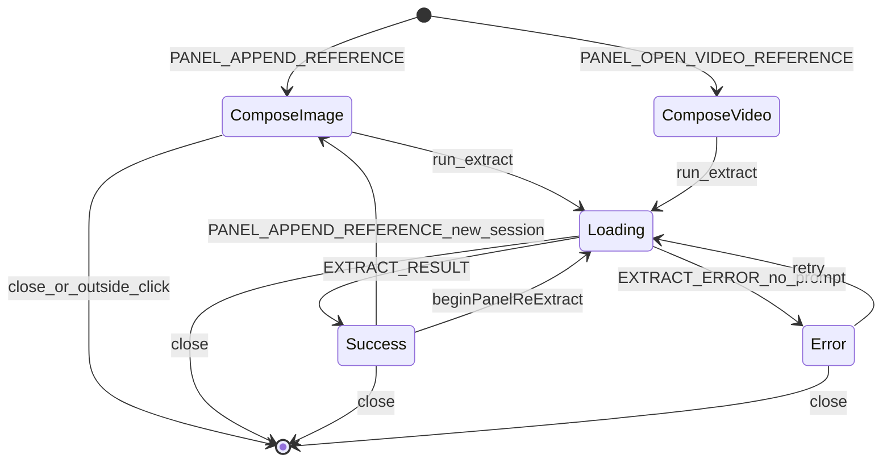
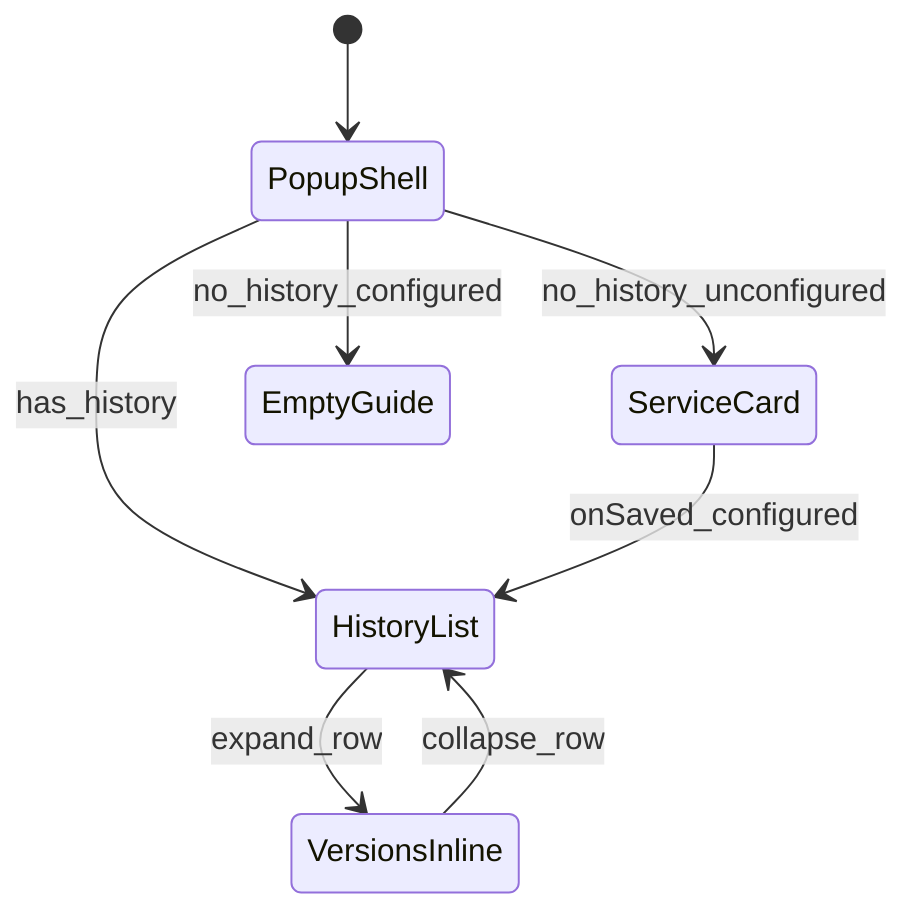
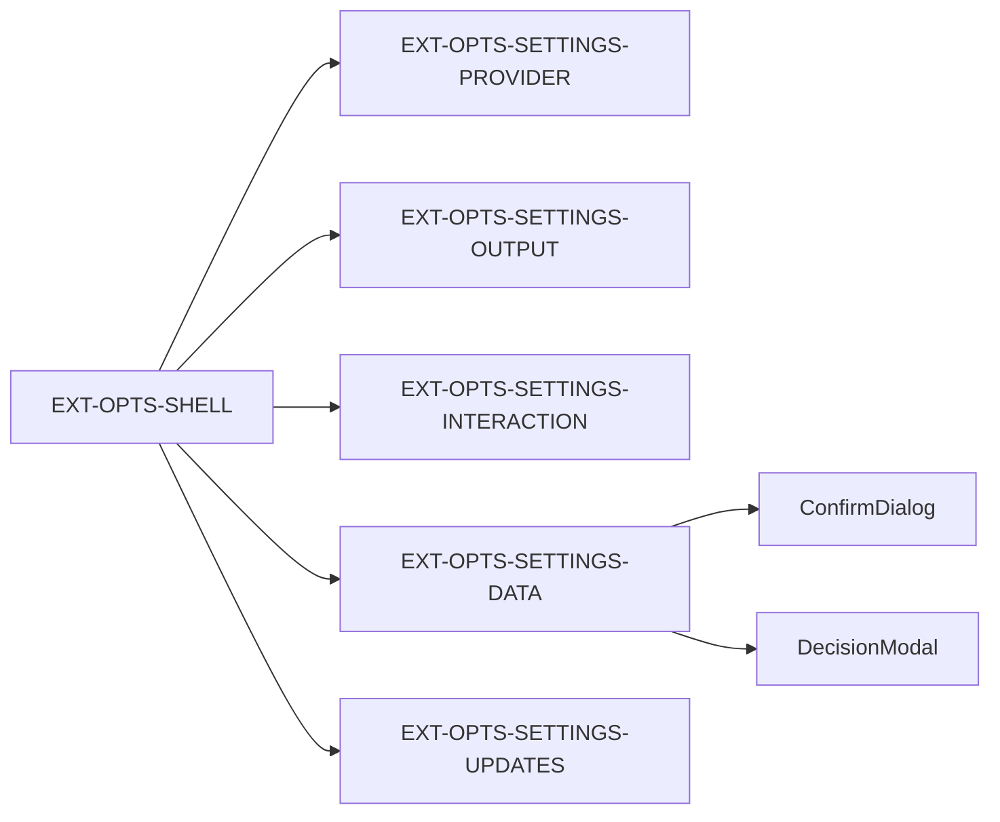
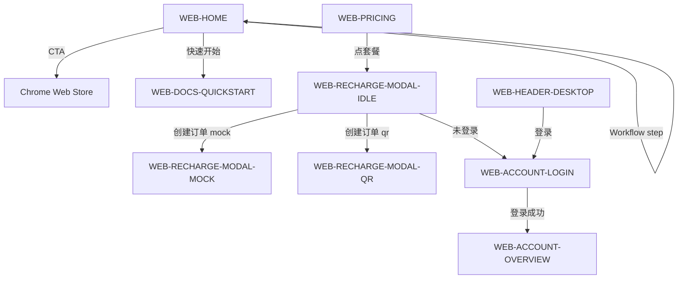
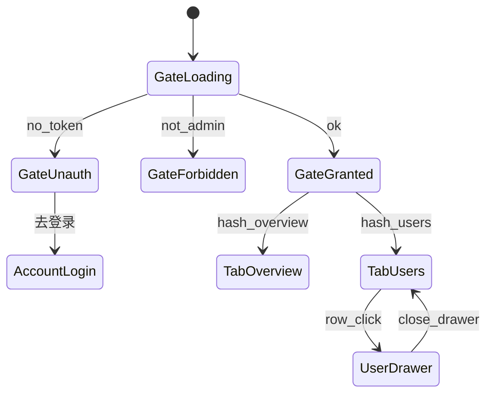

# 交互与原型连线图

> 屏幕 ID 定义见 [01-screen-inventory.md](./01-screen-inventory.md)。在 Stitch 画布上按本节连接屏幕后，使用 **Play** 预览 Prototypes。

---

## 一、连线表格式说明

| 列     | 含义                  |
| ------ | --------------------- |
| 源屏   | 起始屏幕 ID           |
| 触发   | 用户操作或系统事件    |
| 目标屏 | 下一屏幕 ID           |
| 过渡   | 建议动画（可选）      |
| 回退   | Esc / 取消 / 点外关闭 |

---

## 二、Content 浮动面板 — 核心反推流

### 主路径连线

| 源屏                       | 触发                         | 目标屏                                  | 过渡                     | 回退            |
| -------------------------- | ---------------------------- | --------------------------------------- | ------------------------ | --------------- |
| EXT-PANEL-COMPOSE-IMAGE    | 点击「生成提示词」           | EXT-PANEL-LOADING                       | 面板内容切换，进度条出现 | —               |
| EXT-PANEL-COMPOSE-VIDEO    | 点击「采样到参考」           | EXT-PANEL-COMPOSE-IMAGE                 | 参考条增加缩略图         | —               |
| EXT-PANEL-COMPOSE-IMAGE    | 切换 tab「采集视频帧」       | EXT-PANEL-COMPOSE-VIDEO                 | 无                       | 再点 tab 回图片 |
| EXT-PANEL-LOADING          | `EXTRACT_RESULT`             | EXT-PANEL-SUCCESS                       | 标题变「提示词已生成」   | —               |
| EXT-PANEL-LOADING          | `EXTRACT_ERROR`（无 prompt） | EXT-PANEL-ERROR                         | —                        | —               |
| EXT-PANEL-ERROR            | 点击「重试」                 | EXT-PANEL-LOADING                       | —                        | —               |
| EXT-PANEL-ERROR            | 点击「打开设置」             | EXT-OPTS-SETTINGS-PROVIDER              | 跨表面：新开 Options     | 关 Options      |
| EXT-PANEL-SUCCESS          | 编辑 textarea                | EXT-PANEL-SUCCESS（dirty）              | MetaRow 显示未保存       | —               |
| EXT-PANEL-SUCCESS          | 点击「保存为新版本」         | EXT-PANEL-SUCCESS                       | dirty 清除               | —               |
| EXT-PANEL-SUCCESS          | 点击「让 AI 调整」           | EXT-PANEL-SUCCESS                       | RefineBlock 进度         | —               |
| EXT-PANEL-SUCCESS          | 点击「复制」                 | EXT-PANEL-SUCCESS                       | toast/复制反馈           | —               |
| EXT-PANEL-SUCCESS          | MetaRow 切换「历史版本」     | EXT-PANEL-VERSIONS-SIDEBAR              | 侧栏滑出，面板变宽       | 再点收起        |
| EXT-PANEL-VERSIONS-SIDEBAR | 点击「恢复此版本」           | EXT-PANEL-SUCCESS                       | 编辑器内容切换           | —               |
| EXT-PANEL-VERSIONS-SIDEBAR | 点击「删除」                 | EXT-PANEL-DIALOG-CONFIRM-DELETE-VERSION | Dialog                   | 取消→侧栏       |
| EXT-PANEL-SUCCESS          | 关闭 icon                    | [*]                                     | 面板消失                 | —               |
| 任意面板态                 | 点面板外 / Esc               | [*]                                     | 淡出                     | —               |

### 区域框选汇入

| 源屏               | 触发             | 目标屏                  | 回退             |
| ------------------ | ---------------- | ----------------------- | ---------------- |
| [*]                | Ctrl+Shift+E     | EXT-REGION-CAPTURE      | Esc→关闭 overlay |
| EXT-REGION-CAPTURE | 拖拽松开有效矩形 | EXT-PANEL-COMPOSE-IMAGE | —                |
| EXT-REGION-CAPTURE | 矩形过小         | [*]                     | —                |

---

## 三、Popup 状态矩阵

| 源屏                   | 触发                        | 目标屏                                          | 回退        |
| ---------------------- | --------------------------- | ----------------------------------------------- | ----------- |
| EXT-POPUP-SHELL        | 首次打开无配置无历史        | EXT-POPUP-SERVICE-CARD                          | —           |
| EXT-POPUP-SERVICE-CARD | 保存成功                    | EXT-POPUP-EMPTY-GUIDE 或 EXT-POPUP-HISTORY-LIST | —           |
| EXT-POPUP-SHELL        | 无历史已配置                | EXT-POPUP-EMPTY-GUIDE                           | —           |
| EXT-POPUP-SHELL        | 有历史                      | EXT-POPUP-HISTORY-LIST                          | —           |
| EXT-POPUP-HISTORY-LIST | 展开多版本行                | EXT-POPUP-VERSIONS-INLINE                       | 再点收起    |
| EXT-POPUP-HISTORY-LIST | 点击「提示词库」            | EXT-OPTS-SHELL（library）                       | 跨表面      |
| EXT-POPUP-HISTORY-LIST | 点击「召回面板」成功        | [*]                                             | popup 关闭  |
| EXT-POPUP-HISTORY-LIST | 点击「编辑/优化」panel 模式 | EXT-PANEL-SUCCESS                               | 跨表面      |
| EXT-POPUP-SHELL        | 区域截取失败                | EXT-POPUP-BANNER-REGION                         | 关闭 Banner |
| EXT-POPUP-SHELL        | 区域截取成功                | [*]                                             | popup 关闭  |

---

## 四、Options 设置导航

| 源屏                      | 触发               | 目标屏                            | 回退        |
| ------------------------- | ------------------ | --------------------------------- | ----------- |
| EXT-OPTS-SHELL            | 左侧 nav 点击      | 对应 `EXT-OPTS-SETTINGS-*`        | —           |
| EXT-OPTS-SHELL            | Tab「提示词库」    | EXT-LIB-SHELL                     | —           |
| EXT-OPTS-SETTINGS-DATA    | 点击「从目录恢复」 | ConfirmDialog                     | 取消        |
| EXT-OPTS-SETTINGS-DATA    | 发现旧备份         | DecisionModal                     | 选保持/覆盖 |
| EXT-OPTS-SETTINGS-UPDATES | 点击「立即更新」   | EXT-OPTS-SETTINGS-UPDATES（busy） | —           |

---

## 五、提示词库

| 源屏                   | 触发        | 目标屏                 | 回退             |
| ---------------------- | ----------- | ---------------------- | ---------------- |
| EXT-LIB-SHELL          | 无数据      | EXT-LIB-EMPTY          | —                |
| EXT-LIB-SHELL          | 筛选无结果  | EXT-LIB-NO-MATCH       | 清除筛选         |
| EXT-LIB-ITEM-LIST      | 点击行      | EXT-LIB-FLOATING-PANEL | 关闭浮层         |
| EXT-LIB-FLOATING-PANEL | dock=refine | EXT-LIB-FLOATING-PANEL | RefineBlock 展开 |
| EXT-LIB-FLOATING-PANEL | 跳转原图    | EXT-PANEL-SUCCESS      | 跨表面           |
| EXT-LIB-SHELL          | 多选 ≥1     | EXT-LIB-BULK-BAR       | 取消选择         |
| EXT-LIB-BULK-BAR       | 删除        | confirm 浏览器对话框   | 取消             |

---

## 六、官网 — 营销与账户

| 源屏                     | 触发                          | 目标屏                  | 回退       |
| ------------------------ | ----------------------------- | ----------------------- | ---------- |
| WEB-HOME                 | Workflow stepper 点击步骤 1–5 | WEB-HOME（步骤高亮变）  | —          |
| WEB-HOME                 | 「快速开始」                  | WEB-DOCS-QUICKSTART     | 浏览器后退 |
| WEB-PRICING              | 点击套餐卡                    | WEB-RECHARGE-MODAL-IDLE | 关闭 Modal |
| WEB-RECHARGE-MODAL-IDLE  | 未登录点支付                  | WEB-ACCOUNT-LOGIN       | 关 Modal   |
| WEB-RECHARGE-MODAL-IDLE  | 创建订单→mock                 | WEB-RECHARGE-MODAL-MOCK | —          |
| WEB-RECHARGE-MODAL-IDLE  | 创建订单→qr                   | WEB-RECHARGE-MODAL-QR   | —          |
| WEB-RECHARGE-MODAL-QR    | 支付成功                      | WEB-ACCOUNT-OVERVIEW    | —          |
| WEB-ACCOUNT-OVERVIEW     | 侧栏「用量分析」              | WEB-ACCOUNT-USAGE       | —          |
| WEB-ACCOUNT-ORDERS       | 「申请退款」                  | 退款 Dialog             | 取消       |
| WEB-HEADER-MOBILE-DRAWER | 打开汉堡                      | 抽屉覆盖                | 点遮罩/X   |

---

## 七、运营后台

| 源屏             | 触发             | 目标屏                           | 回退       |
| ---------------- | ---------------- | -------------------------------- | ---------- |
| ADM-GATE-LOADING | 探测完成无 token | ADM-GATE-UNAUTH                  | —          |
| ADM-GATE-UNAUTH  | 点击登录         | WEB-ACCOUNT-LOGIN                | —          |
| ADM-GATE-LOADING | 非管理员         | ADM-GATE-FORBIDDEN               | 首页       |
| ADM-GATE-LOADING | 通过             | ADM-SHELL + 默认 Tab             | —          |
| ADM-SHELL        | 侧栏 Tab 点击    | `ADM-{TAB}` 主表                 | —          |
| ADM-USERS        | 行点击           | ADM-USERS-DRAWER（同屏 overlay） | Esc / 关闭 |
| ADM-USERS-DRAWER | 改余额提交       | ADM-SHARED-CONFIRM               | 取消       |
| ADM-REFUNDS      | 批准             | ADM-SHARED-CONFIRM destructive   | 取消       |
| ADM-REFUNDS      | 驳回             | 驳回 Dialog                      | 取消       |
| ADM-UPSTREAMS    | 新增上游         | UpstreamFormDialog               | 取消       |
| ADM-UPSTREAMS    | 删除             | ADM-SHARED-CONFIRM               | 取消       |
| ADM-SHELL        | Ctrl/Cmd+K       | CommandPalette overlay           | Esc        |
| CommandPalette   | 选用户           | ADM-USERS + Drawer               | 关 Palette |

> 注：Drawer / Dialog 在 Stitch 中可画为**同屏叠加态**（源屏 ID + `-DIALOG-OPEN` 后缀），Play 时用 hotspot 连到叠加帧。

---

## 八、跨表面深链（Stitch 占位说明）

以下跳转**跨 Chrome 扩展/网页边界**，单一 Stitch 项目内用**虚线占位**或注释帧表示，不要强行连到不存在于本项目的画板。

| 源                     | 触发     | 目标（真实）                | Stitch 建议                          |
| ---------------------- | -------- | --------------------------- | ------------------------------------ |
| EXT-POPUP-HISTORY-LIST | 提示词库 | Options `tab=library`       | Extension 项目内连 EXT-OPTS-SHELL    |
| EXT-POPUP-HISTORY-LIST | 召回面板 | Content `EXT-PANEL-SUCCESS` | 同项目连 EXT-PANEL-\*                |
| EXT-LIB-FLOATING-PANEL | 跳转原图 | Content panel               | 同项目连 EXT-PANEL-SUCCESS           |
| EXT-PANEL-ERROR        | 打开设置 | Options provider            | 同项目连 EXT-OPTS-SETTINGS-PROVIDER  |
| WEB-HEADER             | 后台     | `/admin`                    | Website 项目内 ADM-GATE-\*           |
| ADM-GATE-UNAUTH        | 登录     | `/account`                  | WEB-ACCOUNT-LOGIN                    |
| Popup 区域截取         | 成功     | compose 面板                | EXT-REGION → EXT-PANEL-COMPOSE-IMAGE |

深链参数（实现参考，Stitch 文案可标注）：

| 参数                        | 用途               |
| --------------------------- | ------------------ |
| `tab=library`               | Options 打开库 Tab |
| `focusId`                   | 滚动到历史项       |
| `dock=refine` \| `versions` | 库浮层 / 面板 dock |

---

## 九、Stitch Prototypes 操作清单

1. **生成顺序**：先主路径（§二 compose→loading→success），再分支（error、侧栏、region）。
2. **连接方式**：选中源屏 hotspot（按钮区域）→ 拖到目标屏；或 Stitch「自动建议下一屏」后人工校正。
3. **Play 必测路径**：
   - P0：右键参考 → compose → 生成 → success → 复制
   - P1：compose 满 8 图 disabled；loading 流式 partial
   - P2：success → 版本侧栏 → 恢复
   - P3：Popup 无历史首配 → 保存 → EmptyGuide
   - P4：Pricing → Recharge mock → 成功
   - P5：Admin Gate → Users → Drawer → Confirm
4. **不可点击**：连到未生成屏的链接在 Play 中无效——须先在 inventory 补屏。
5. **导出前**：全路径 Play 一遍，记录缺 hotspot 的屏幕回到 [03-stitch-prompts.md](./03-stitch-prompts.md) 补生成。

---

## 十、按项目的最小可玩原型集

若时间有限，优先缝合以下 **MVP 连线**（其余屏可后续补）：

| 项目          | 最少屏幕数 | 必连路径                                                   |
| ------------- | ---------- | ---------------------------------------------------------- |
| Extension     | 12         | region→compose→loading→success；popup history→panel        |
| Website+Admin | 14         | home workflow；pricing→recharge→account；gate→users drawer |

完整连线以本节各表为准，MVP 为其子集。
