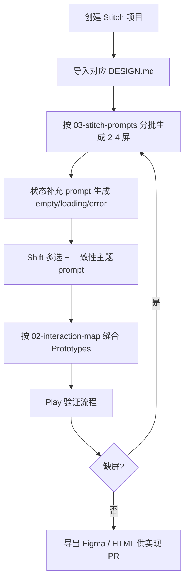

# Stitch 全量重设计 — 使用说明

本目录为 [Google Stitch](https://stitch.withgoogle.com)「以您的设计为基础」准备的**结构 + 状态 + 交互**文档，与视觉令牌文件配合使用。目标：在 Stitch 中重设计插件、官网、运营后台的全部页面与状态，并通过 **Prototypes** 复现可点击流程。

> 视觉方向：**现代极简 SaaS（Linear/Vercel）+ 靛蓝 `#5B5BD6` + 亮色为主**。  
> 本目录**不修改** `src/`、`website/` 运行时代码；落地实现需另开 PR。

---

## 文档索引

| 文件                                                   | 用途                                               |
| ------------------------------------------------------ | -------------------------------------------------- |
| [01-screen-inventory.md](./01-screen-inventory.md)     | 全量屏幕清单：每屏的区块、状态变体、交互、源码路径 |
| [02-interaction-map.md](./02-interaction-map.md)       | 跨屏连线表 + Mermaid 状态机 + 跨表面深链           |
| [03-stitch-prompts.md](./03-stitch-prompts.md)         | 可直接粘贴进 Stitch 的分批 prompt（2–4 屏/批）     |
| [../stitch-design-md.zh.md](../stitch-design-md.zh.md) | DESIGN.md 维护与 lint 说明                         |
| 根目录 [DESIGN.md](../../DESIGN.md)                    | 插件 popup / options / 浮动面板                    |
| [website/DESIGN.md](../../website/DESIGN.md)           | 官网营销 + `/admin` 运营后台                       |

---

## 两个 Stitch 项目（禁止混贴 DESIGN.md）

| Stitch 项目                      | 粘贴/上传的 DESIGN.md                          | 生成范围                                                            | 屏幕 ID 前缀     |
| -------------------------------- | ---------------------------------------------- | ------------------------------------------------------------------- | ---------------- |
| **Prompt Hub — Extension**       | 仓库根 [`DESIGN.md`](../../DESIGN.md)          | Popup、Options（设置+提示词库）、Content 浮动面板、区域框选 overlay | `EXT-*`          |
| **Prompt Hub — Website & Admin** | [`website/DESIGN.md`](../../website/DESIGN.md) | 官网 12 路由 + `/admin` 单页 9 Tab                                  | `WEB-*`、`ADM-*` |

**一次 Stitch 会话只贴一份 DESIGN.md。** 混贴会导致颜色、字号、圆角漂移。

---

## 推荐操作流程



1. 打开 [stitch.withgoogle.com](https://stitch.withgoogle.com) → 新建项目。
2. **以您的设计为基础** → 粘贴或上传上表对应 `DESIGN.md`。
3. 打开 [03-stitch-prompts.md](./03-stitch-prompts.md)，从 **Extension** 或 **Website+Admin** 第 1 批开始复制四段式 prompt 生成。
4. 每批生成后，用同文件中的「状态补充 prompt」补 empty / loading / error / Dialog。
5. **Shift + 点击** 选中本批全部画板 → 粘贴「多选一致性 prompt」统一视觉。
6. 按 [02-interaction-map.md](./02-interaction-map.md) 在画布上连接屏幕 → 点 **Play** 预览。
7. 跨 Chrome 扩展表面（Popup → Options → 页面内面板）在 Stitch 内用**占位连线**标注；真实跳转见 `02` 的「跨表面深链」表。

---

## 屏幕 ID 命名规范

格式：`{前缀}-{区域}-{名称}[-{状态}]`

| 前缀           | 含义                  | 示例                         |
| -------------- | --------------------- | ---------------------------- |
| `EXT-POPUP-*`  | 工具栏弹窗            | `EXT-POPUP-HISTORY-LIST`     |
| `EXT-OPTS-*`   | 选项页                | `EXT-OPTS-SETTINGS-PROVIDER` |
| `EXT-LIB-*`    | 提示词库 Tab          | `EXT-LIB-EMPTY`              |
| `EXT-PANEL-*`  | 页面内浮动面板        | `EXT-PANEL-COMPOSE-IMAGE`    |
| `EXT-REGION-*` | 区域框选（非 Shadow） | `EXT-REGION-CAPTURE`         |
| `WEB-*`        | 官网营销/账户         | `WEB-HOME-WORKFLOW-STEP3`    |
| `ADM-GATE-*`   | 后台鉴权门            | `ADM-GATE-FORBIDDEN`         |
| `ADM-{TAB}-*`  | 后台 Tab              | `ADM-USERS-DRAWER`           |

状态后缀（可选）：`-LOADING`、`-EMPTY`、`-ERROR`、`-DIALOG-OPEN`。

三份文档（inventory / interaction-map / prompts）通过**相同屏幕 ID** 交叉引用。

---

## Stitch 生成约束（必读）

| 约束        | 说明                                                                 |
| ----------- | -------------------------------------------------------------------- |
| 每批 2–4 屏 | 一次 prompt 不要超过 4 个主屏；状态屏单独补                          |
| 显式状态    | 每主屏至少补 empty、loading、error（有则加 Dialog）                  |
| 真实文案    | 产品名、按钮、策略标签用 README / `strategies-meta` 原文，勿虚构功能 |
| Prototypes  | 仅连接 inventory 中已列出的屏幕；缺屏先补生成再连线                  |
| 暗色        | 默认按 DESIGN.md 亮色生成；暗色变体可选，对照 YAML 中 `dark-*`       |

---

## 产品优先级（Stitch Overview 用）

README 工作流顺序：**参考 → 反推 → 复制**。次要能力后置。

| 优先级 | 能力                                | 主 CTA / 文案                            |
| ------ | ----------------------------------- | ---------------------------------------- |
| P0     | 右键收集 / 框选 → 生成提示词 → 复制 | 「生成提示词」                           |
| P1     | 多图合成（≤8）、直接反推            | 参考条 + 主 CTA                          |
| P2     | 输出风格四档 + 策略档位             | `OUTPUT_STYLE_LABELS`、`STRATEGY_LABELS` |
| P3     | 提取材质/风格、视频分镜             | compose 次要按钮                         |
| P4     | AI 调整、版本回溯、提示词库         | RefineBlock、VersionsSidebar             |
| P5     | 12+ 视觉模型、内置服务充值          | Options / 官网 pricing                   |

---

## 校验 DESIGN.md

```powershell
npx "@google/design.md" lint DESIGN.md
npx "@google/design.md" lint website/DESIGN.md
```

修复全部 `broken-ref`；按 lint 的 `contrast-ratio` 建议调整组件 `textColor`。

---

## 相关源码入口

| 表面         | 入口                                                                     |
| ------------ | ------------------------------------------------------------------------ |
| Popup        | [`src/popup/PopupApp.tsx`](../../src/popup/PopupApp.tsx)                 |
| Options      | [`src/options/OptionsApp.tsx`](../../src/options/OptionsApp.tsx)         |
| Content 面板 | [`src/content/panel/PanelApp.tsx`](../../src/content/panel/PanelApp.tsx) |
| 官网         | [`website/app/`](../../website/app/)                                     |
| 后台         | [`website/app/admin/page.tsx`](../../website/app/admin/page.tsx)         |

术语对照：[`docs/naming-glossary.zh.md`](../naming-glossary.zh.md)（extract / refine / reference）。
